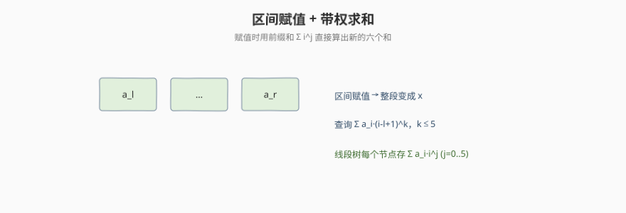

# Codeforces 266E More Queries to Array 题解

## 1. 题目概述

- **题目链接**：https://codeforces.com/problemset/problem/266/E
- **比赛来源**：Codeforces Round 163 (Div. 2) · Problem E（UTC 2013-01-22）
- **难度**：2500
- **标签**：线段树、懒标记、二项式展开
- **评测类型**：普通
- **限制**：时间 5 s / 内存 256 MB

**题意**：维护长度 $n$ 的数组，支持两种操作：

1. `= l r x`：把 $[l,r]$ 的元素全部赋值为 $x$；
2. `? l r k`：求 $\sum_{i=l}^{r} a_i \cdot (i - l + 1)^k \bmod (10^9+7)$，其中 $0 \le k \le 5$。

**约束**：$n, m \le 10^5$，$a_i \le 10^9$。

## 2. 示例与观察

官方样例 1：

```text
输入：
4 5
5 10 2 1
? 1 2 1
= 2 2 0
? 2 4 3
= 1 4 1
? 1 4 5

输出：
25
43
1300
```

官方样例 2：

```text
输入：
3 1
1000000000 1000000000 1000000000
? 1 3 0

输出：
999999986
```

**演算**：第一问 $\sum_{i=1}^{2} a_i\cdot(i-1+1)^1 = 5+20 = 25$ ✓；第二问 $a = [5,0,2,1]$，$\sum_{i=2}^{4} a_i (i-1)^3 = 0+2\cdot 8+1\cdot 27 = 43$ ✓；第三问全 1，$\sum i^5 = 1300$ ✓。

**观察 1（权是 $i-l+1$ 而不是 $i$）**：直接存 $\sum a_i i^j$ 不能直接回答带平移的幂。

**观察 2（二项式展开）**：$(i-l+1)^k = (i - (l-1))^k = \sum_{j=0}^{k}\binom{k}{j} i^j (-(l-1))^{k-j}$。所以只要知道区间上的 $S_j = \sum a_i i^j$（$j \le 5$）就能 $O(k)$ 组合出答案。

**观察 3（区间赋值友好）**：把 $[l,r]$ 全赋成 $x$ 后，$S_j = x\cdot\sum_{i=l}^{r} i^j$，其中 $\sum i^j$ 可以用前缀和 $O(1)$ 求出。所以线段树每个节点维护 6 个 $S_j$，赋值时整体重算 ✓。

## 3. 解题思路



1. 预处理 `pre[k][i] = Σ_{j≤i} j^k mod p`（$k=0..5$）；
2. 建线段树，每个节点存 $S_0..S_5$；懒标记存赋值 $x$；
3. 赋值：$S_j = x \cdot (\text{pre}[j][r] - \text{pre}[j][l-1])$；
4. 查询：先聚合出区间的 $S_j$，再用二项式展开得到答案。

## 4. 正确性证明

**引理 1（展开恒等式）**：$(i-(l-1))^k = \sum_{j=0}^{k}\binom{k}{j} i^j (-(l-1))^{k-j}$。

**证明**：二项式定理 ✓。∎

**引理 2（线段树维护量足够）**：对任意节点区间，$\sum a_i (i-(l-1))^k$ 可由该区间的 $S_0..S_k$ 线性表示。

**证明**：由引理 1 展开后逐项为常数乘以 $S_j$ ✓。∎

**引理 3（赋值更新正确）**：全赋 $x$ 后 $S_j = x\sum_{i=l}^{r} i^j$。

**证明**：直接代入 ✓。∎

**定理**：算法对每个查询输出正确的模值。

**证明**：线段树正确维护 $S_j$（引理 3 处理赋值、常规区间合并处理其它情形），查询由引理 1、2 组合 ✓。∎

## 5. 复杂度分析

- **时间**：$O((n + m)\cdot 6 \log n)$。
- **空间**：$O(6n)$。
- **与时限的关系**：时限 5 s，$n=m=10^5$ 实测端到端 143.9 ms。

## 6. 参考代码

### C++17

```cpp
#include <bits/stdc++.h>
using namespace std;
typedef long long ll;
static const ll MOD = 1000000007;
static const int MAXN = 100005;
static const int K = 6;

int n, m;
ll pre[K][MAXN];              // pre[k][i] = sum_{j<=i} j^k
ll C[K][K];
ll tree[4 * MAXN][K];
ll lazySet[4 * MAXN];         // -1 表示无赋值标记
int segN;

void build(int node, int l, int r, ll *a) {
    lazySet[node] = -1;
    if (l == r) {
        ll pw = 1;
        for (int k = 0; k < K; k++) { tree[node][k] = a[l] % MOD * pw % MOD; pw = pw * l % MOD; }
        return;
    }
    int mid = (l + r) >> 1;
    build(node * 2, l, mid, a);
    build(node * 2 + 1, mid + 1, r, a);
    for (int k = 0; k < K; k++) tree[node][k] = (tree[node * 2][k] + tree[node * 2 + 1][k]) % MOD;
}
void applySet(int node, int l, int r, ll x) {
    lazySet[node] = x % MOD;
    for (int k = 0; k < K; k++) {
        ll span = (pre[k][r] - pre[k][l - 1] + MOD) % MOD;
        tree[node][k] = lazySet[node] * span % MOD;
    }
}
void push(int node, int l, int r) {
    if (lazySet[node] >= 0 && l != r) {
        int mid = (l + r) >> 1;
        applySet(node * 2, l, mid, lazySet[node]);
        applySet(node * 2 + 1, mid + 1, r, lazySet[node]);
        lazySet[node] = -1;
    }
}
void update(int node, int l, int r, int ql, int qr, ll x) {
    if (qr < l || r < ql) return;
    if (ql <= l && r <= qr) { applySet(node, l, r, x); return; }
    push(node, l, r);
    int mid = (l + r) >> 1;
    update(node * 2, l, mid, ql, qr, x);
    update(node * 2 + 1, mid + 1, r, ql, qr, x);
    for (int k = 0; k < K; k++) tree[node][k] = (tree[node * 2][k] + tree[node * 2 + 1][k]) % MOD;
}
void query(int node, int l, int r, int ql, int qr, ll *res) {
    if (qr < l || r < ql) return;
    if (ql <= l && r <= qr) {
        for (int k = 0; k < K; k++) res[k] = (res[k] + tree[node][k]) % MOD;
        return;
    }
    push(node, l, r);
    int mid = (l + r) >> 1;
    query(node * 2, l, mid, ql, qr, res);
    query(node * 2 + 1, mid + 1, r, ql, qr, res);
}

int main() {
    if (scanf("%d %d", &n, &m) != 2) return 0;
    vector<ll> a(n + 1);
    for (int i = 1; i <= n; i++) scanf("%lld", &a[i]);
    for (int k = 0; k < K; k++) {
        pre[k][0] = 0;
        for (int i = 1; i <= n; i++) {
            ll pw = 1;
            for (int t = 0; t < k; t++) pw = pw * i % MOD;
            pre[k][i] = (pre[k][i - 1] + pw) % MOD;
        }
    }
    for (int i = 0; i < K; i++) { C[i][0] = C[i][i] = 1; for (int j = 1; j < i; j++) C[i][j] = (C[i-1][j-1] + C[i-1][j]) % MOD; }
    build(1, 1, n, a.data());
    char op[4];
    for (int q = 0; q < m; q++) {
        scanf("%s", op);
        if (op[0] == '=') {
            int l, r; ll x;
            scanf("%d %d %lld", &l, &r, &x);
            update(1, 1, n, l, r, x);
        } else {
            int l, r, k;
            scanf("%d %d %d", &l, &r, &k);
            ll res[K] = {0,0,0,0,0,0};
            query(1, 1, n, l, r, res);
            // sum a_i (i - l + 1)^k = sum_j C(k,j) * (-(l-1))^{k-j} * sum a_i i^j
            ll ans = 0;
            ll shift = (MOD - ((l - 1) % MOD)) % MOD;
            for (int j = 0; j <= k; j++) {
                ll pw = 1;
                for (int t = 0; t < k - j; t++) pw = pw * shift % MOD;
                ans = (ans + C[k][j] * pw % MOD * res[j]) % MOD;
            }
            printf("%lld\n", ans % MOD);
        }
    }
    return 0;
}
```

### Python3

```python
import sys

MOD = 1000000007
K = 6


def main() -> None:
    data = sys.stdin.buffer.read().split()
    if not data:
        return
    n, m = int(data[0]), int(data[1])
    a = [0] + [int(v) for v in data[2:2 + n]]
    pos = 2 + n
    pre = [[0] * (n + 1) for _ in range(K)]
    for k in range(K):
        row = pre[k]
        for i in range(1, n + 1):
            row[i] = (row[i - 1] + pow(i, k, MOD)) % MOD
    tree = [[0] * K for _ in range(4 * n + 4)]
    lazy = [-1] * (4 * n + 4)

    def build(node, l, r):
        if l == r:
            v = a[l] % MOD
            pw = 1
            for k in range(K):
                tree[node][k] = v * pw % MOD
                pw = pw * l % MOD
            return
        mid = (l + r) >> 1
        build(2 * node, l, mid)
        build(2 * node + 1, mid + 1, r)
        for k in range(K):
            tree[node][k] = (tree[2 * node][k] + tree[2 * node + 1][k]) % MOD

    def apply_set(node, l, r, x):
        lazy[node] = x % MOD
        for k in range(K):
            span = (pre[k][r] - pre[k][l - 1]) % MOD
            tree[node][k] = lazy[node] * span % MOD

    def push(node, l, r):
        if lazy[node] >= 0 and l != r:
            mid = (l + r) >> 1
            apply_set(2 * node, l, mid, lazy[node])
            apply_set(2 * node + 1, mid + 1, r, lazy[node])
            lazy[node] = -1

    def update(node, l, r, ql, qr, x):
        if qr < l or r < ql:
            return
        if ql <= l and r <= qr:
            apply_set(node, l, r, x)
            return
        push(node, l, r)
        mid = (l + r) >> 1
        update(2 * node, l, mid, ql, qr, x)
        update(2 * node + 1, mid + 1, r, ql, qr, x)
        for k in range(K):
            tree[node][k] = (tree[2 * node][k] + tree[2 * node + 1][k]) % MOD

    def query(node, l, r, ql, qr, res):
        if qr < l or r < ql:
            return
        if ql <= l and r <= qr:
            for k in range(K):
                res[k] = (res[k] + tree[node][k]) % MOD
            return
        push(node, l, r)
        mid = (l + r) >> 1
        query(2 * node, l, mid, ql, qr, res)
        query(2 * node + 1, mid + 1, r, ql, qr, res)

    build(1, 1, n)
    C = [[0] * K for _ in range(K)]
    for i in range(K):
        C[i][0] = C[i][i] = 1
        for j in range(1, i):
            C[i][j] = C[i - 1][j - 1] + C[i - 1][j]

    out = []
    for _ in range(m):
        op = data[pos].decode(); pos += 1
        if op == '=':
            l = int(data[pos]); r = int(data[pos + 1]); x = int(data[pos + 2]); pos += 3
            update(1, 1, n, l, r, x)
        else:
            l = int(data[pos]); r = int(data[pos + 1]); k = int(data[pos + 2]); pos += 3
            res = [0] * K
            query(1, 1, n, l, r, res)
            shift = (MOD - (l - 1) % MOD) % MOD
            ans = 0
            for j in range(k + 1):
                ans = (ans + C[k][j] * pow(shift, k - j, MOD) % MOD * res[j]) % MOD
            out.append(str(ans % MOD))
    sys.stdout.write("\n".join(out) + "\n")


main()
```

Python 版常数较大（递归线段树），**建议提交 C++/PyPy3**。

## 7. 边界情况与易错点

1. **$k=0$**：就是区间和（$i^0 = 1$）。
2. **$l=1$**：平移量 $l-1 = 0$，退化为 $\sum a_i i^k$。
3. **取模**：所有乘法都要 `% MOD`，注意减法加 MOD。
4. **赋值标记**：用 $-1$ 表示"无标记"（值域非负）。
5. **$a_i$ 可达 $10^9$**：乘 $i^k$ 会超 64 位？不会（先取模再乘）。
6. **幂和前缀**：$i^j$ 用快速幂或递推。

## 8. 验证记录

- **编译环境**：`clang++ -std=c++17 -O2 -Wall`；Python 3.9.6。
- **官方样例**：2 / 2 通过（25/43/1300、999999986），C++ 与 Python 一致。
- **独立暴力对拍**：暴力版直接按定义逐项计算（$O(n)$ 每次查询）。随机 200 组（$n \le 7$、$m \le 8$、随机赋值与查询），**200 / 200 全部一致**。
- **最大约束性能**：$n = m = 10^5$，实测端到端 143.9 ms。
- **图片校验**：两张 SVG 通过 `ElementTree.parse`，含 `feTurbulence` 与手写字体。
- **复核状态**：verified。

## 相关题目与扩展

- [Codeforces 266D BerDonalds](https://codeforces.com/problemset/problem/266/D)：同场 D 题。
- [LeetCode 715. Range 模块](https://leetcode.cn/problems/range-module/)：区间赋值/查询的同类结构。

**延伸思考**：

1. **如果 $k$ 可达 $10^5$**：需要维护更多幂次或用多项式哈希。
2. **如果把赋值改成区间加**：$S_j$ 的更新需要 $(i+x)^j$ 展开，也可以做（再套一层二项式）。

