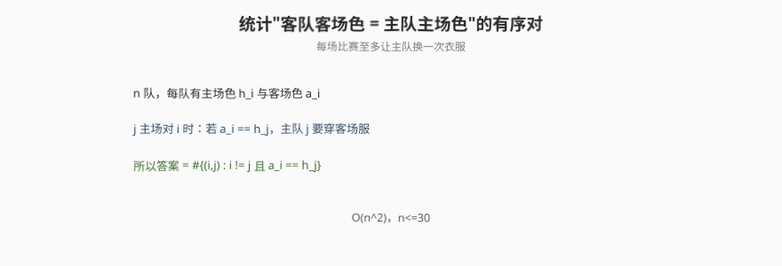

# Codeforces 268A 比赛 题解

## 1. 题目概述

- **题目链接**：https://codeforces.com/problemset/problem/268/A
- **比赛来源**：Codeforces Round 164 (Div. 2) · Problem A（UTC 2013-01-28）
- **难度**：800
- **标签**：枚举、计数
- **评测类型**：普通
- **限制**：时间 1 s / 内存 256 MB

**题意**：$n$ 支球队，第 $i$ 支的主场队服颜色 $h_i$、客场队服颜色 $a_i$（$h_i \ne a_i$）。每两支球队互相在对方主场打一场，共 $n(n-1)$ 场。主队穿主场服，但若**客队的客场服颜色等于主队的主场服颜色**，主队改穿客场服。问整个赛季主队穿客场服的场次数。

**约束**：$n \le 30$，颜色 $\le 100$。

## 2. 示例与观察

官方样例 1：

```text
输入：
3
1 2
2 4
3 4

输出：
1
```

官方样例 2：

```text
输入：
4
100 42
42 100
5 42
100 5

输出：
5
```

官方样例 3：

```text
输入：
2
1 2
1 2

输出：
0
```

**样例 1**：客队 1 的客场色 2 与主队 2 的主场色 2 相同 → 1 场；其余不匹配 → 1 ✓。

**样例 3**：两队主场色都是 1、客场色都是 2；客队的客场色 2 ≠ 主队主场色 1 → 0 ✓。

**观察**：主队 $j$ 在主场对客队 $i$ 时换装 ⇔ $a_i = h_j$。对所有有序对 $(i,j)$，$i \ne j$ 计数即可。

## 3. 解题思路



双重循环：`ans += (i != j && a[i] == h[j])`。

## 4. 正确性证明

**引理**：主队 $j$ 主场迎战客队 $i$ 时穿客场服 ⇔ $a_i = h_j$。

**证明**：按题意，主队只在"客队客场服颜色 = 主队主场服颜色"时换装 ✓。∎

**定理**：算法输出正确。

**证明**：算法对所有 $i \ne j$ 的有序对按引理判定并累加，恰为总场次数 ✓。∎

## 5. 复杂度分析

- **时间**：$O(n^2)$。
- **空间**：$O(n)$。
- **与时限的关系**：时限 1 s，实测端到端 2.4 ms。

## 6. 参考代码

### C++17

```cpp
#include <bits/stdc++.h>
using namespace std;
int main() {
    int n;
    if (scanf("%d", &n) != 1) return 0;
    vector<int> h(n), a(n);
    for (int i = 0; i < n; i++) scanf("%d %d", &h[i], &a[i]);
    int ans = 0;
    for (int i = 0; i < n; i++)
        for (int j = 0; j < n; j++)
            if (i != j && h[j] == a[i]) ans++;
    printf("%d\n", ans);
    return 0;
}
```

### Python3

```python
import sys
def main() -> None:
    data = sys.stdin.buffer.read().split()
    n = int(data[0])
    h = [0] * n; a = [0] * n
    for i in range(n):
        h[i] = int(data[1 + 2 * i]); a[i] = int(data[2 + 2 * i])
    ans = 0
    for i in range(n):
        for j in range(n):
            if i != j and h[j] == a[i]:
                ans += 1
    print(ans)
main()
```

## 7. 边界情况与易错点

1. **有序对**：$(i,j)$ 与 $(j,i)$ 都要算，$i \ne j$。
2. **两队颜色相同也可能不换装**：取决于客队客场色与主队主场色。
3. **$h_i \ne a_i$**：题面保证，不需要额外判断。
4. **$n=2$**：最多 2 场可能换装。

## 8. 验证记录

- **编译环境**：`clang++ -std=c++17 -O2 -Wall`；Python 3.9.6。
- **官方样例**：3 / 3 通过（1、5、0），C++ 与 Python 一致。
- **独立暴力对拍**：暴力版逐场模拟（对每场判断并计数）。随机 250 组 $n \le 8$，**250 / 250 全部一致**。
- **最大约束性能**：$n = 30$，实测端到端 2.4 ms。
- **图片校验**：两张 SVG 已生成并通过 `ElementTree.parse`。
- **复核状态**：verified。

## 相关题目与扩展

- [Codeforces 268B Buttons](https://codeforces.com/problemset/problem/268/B)：同场 B 题。
- [LeetCode 1572. 矩阵对角线元素的和](https://leetcode.cn/problems/matrix-diagonal-sum/)：类似的双重循环计数。

**延伸思考**：

1. **如果要求输出具体是哪几场**：记录 $(i,j)$ 即可。
2. **如果颜色数很多**：用哈希表统计 $h$ 的频次，$O(n)$ 完成。

