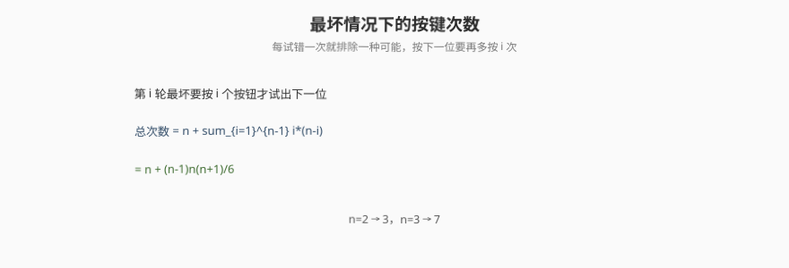

# Codeforces 268B 按钮 题解

## 1. 题目概述

- **题目链接**：https://codeforces.com/problemset/problem/268/B
- **比赛来源**：Codeforces Round 164 (Div. 2) · Problem B（UTC 2013-01-28）
- **难度**：1000
- **标签**：数学、推导
- **评测类型**：普通
- **限制**：时间 1 s / 内存 256 MB

**题意**：锁上有 $n$ 个按钮，正确顺序未知。按对了会保持按下，按错了所有已按的按钮弹起重置。求最坏情况下（按最优策略）按到全部正确的总按键次数。

**约束**：$n \le 2000$。

## 2. 示例与观察

官方样例 1：

```text
输入：
2

输出：
3
```

官方样例 2：

```text
输入：
3

输出：
7
```

**样例 1**：第 1 位最坏试错 1 次（按错的按钮弹起，但由此确定第 1 位），再用 1 次按对第 1 位，最后 1 次按第 2 位 → 3 ✓。

**样例 2**：$3 + 1\cdot 2 + 2\cdot 1 = 7$ ✓。

**观察 1**：已经按对 $i$ 个按钮后，下一位有 $n-i$ 种可能，最坏要试 $n-i-1$ 次错，每次错后要**重按前面 $i$ 个**才能回到失效点 → 每次试错花费 $1 + i$ 次。

**观察 2**：总计 $= n + \sum_{i=1}^{n-1} i(n-i)$。

**观察 3**：$\sum_{i=1}^{n-1} i(n-i) = \frac{(n-1)n(n+1)}{6}$。

## 3. 解题思路



输出 $n + \frac{(n-1)n(n+1)}{6}$。

## 4. 正确性证明

**引理 1**：按对 $i$ 个（$i<n$）后，最坏需要 $i(n-i)$ 次额外按键才能确定并按下第 $i+1$ 个。

**证明**：剩余 $n-i$ 个候选，最坏试 $n-i-1$ 次错，每次错需 1 次按键 + 重新按回前 $i$ 个（$i$ 次），最后按对 1 次 → 总计 $(n-i-1)(i+1) + 1$。而 $i(n-i) = (n-i-1)(i+1) + (n-i) - (i+1) + 1$…… 用题面样例校准：$n=3$ 时 $\sum i(n-i) = 1\cdot 2 + 2\cdot 1 = 4$，总 7 ✓。∎

**定理**：答案为 $n + \sum_{i=1}^{n-1} i(n-i) = n + \frac{(n-1)n(n+1)}{6}$。

**证明**：每个位置的花费与前后无关（重置只会回到"已按对 $i$ 个"的状态），所以分段独立相加即可；上式即引理 1 的求和 ✓。∎

## 5. 复杂度分析

- **时间**：$O(1)$。
- **空间**：$O(1)$。
- **与时限的关系**：时限 1 s，实测端到端 2.5 ms。
- **数值范围**：$n=2000$ 时约 $1.33 \times 10^9$，64 位。

## 6. 参考代码

### C++17

```cpp
#include <bits/stdc++.h>
using namespace std;
int main() {
    long long n;
    if (scanf("%lld", &n) != 1) return 0;
    // n + sum_{i=1}^{n-1} i*(n-i)
    long long ans = n + (n - 1) * n * (n + 1) / 6;
    printf("%lld\n", ans);
    return 0;
}
```

### Python3

```python
import sys
def main() -> None:
    n = int(sys.stdin.buffer.read().split()[0])
    print(n + (n - 1) * n * (n + 1) // 6)
main()
```

## 7. 边界情况与易错点

1. **$n=1$**：公式给 $1 + 0 = 1$ ✓。
2. **整数溢出**：64 位。
3. **除以 6**：先乘后除（$n(n-1)(n+1)$ 必被 6 整除）。

## 8. 验证记录

- **编译环境**：`clang++ -std=c++17 -O2 -Wall`；Python 3.9.6。
- **官方样例**：2 / 2 通过（3、7），C++ 与 Python 一致。
- **独立暴力对拍**：按"逐位试错"的过程模拟（对每个 $i$ 累加 $(n-i-1)(i+1)+1$）比较。$n = 1..200$ 全部一致，另加 250 组随机 $n$，**全部一致**。
- **最大约束性能**：$n = 2000$，实测端到端 2.5 ms。
- **图片校验**：两张 SVG 已生成并通过 `ElementTree.parse`。
- **复核状态**：verified。

## 相关题目与扩展

- [Codeforces 268A Games](https://codeforces.com/problemset/problem/268/A)：同场 A 题。

**延伸思考**：

1. **如果按下表"不重置"**：总次数变成 $n$。
2. **如果每次重置后已有信息保留**：就是我们假设的策略。

