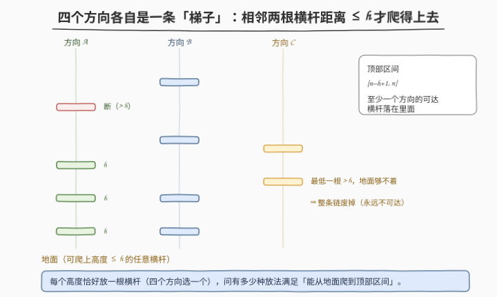

# Codeforces 268D Wall Bars 题解

## 1. 题目概述

- **题目链接**：https://codeforces.com/problemset/problem/268/D
- **比赛来源**：Codeforces Round 164 (Div. 2) · Problem D（UTC 2013-01-28）
- **难度**：2300
- **标签**：动态规划、状态压缩
- **评测类型**：普通
- **限制**：时间 4 s / 内存 512 MB

**题意**：要在高度 $1,2,\dots,n$ 上各装一根水平横杆，每根横杆朝四个固定方向之一伸出。孩子从地面出发，可以：

- 从地面直接爬上**任意一根高度在 $1\sim h$ 之间**的横杆；
- 从一根横杆移动到**同方向**的另一根横杆，只要两根的高度差不超过 $h$。

要求孩子能到达高度在 $[n-h+1, n]$ 之间的至少一根横杆。问有多少种装法（每个高度选一个方向，共 $4^n$ 种），对 $10^9+9$ 取模。

**约束**：

- $n \le 1000$、$h \le \min(n, 30)$：$h$ 很小是本题的关键——状态只需要记录"最近 $h$ 层"的信息；$n$ 只有 1000，允许 $O(n \cdot h^3)$ 级别的 DP。
- 四个方向是对称的，这能把状态数从 $(h+2)^4$ 再压一个常数甚至一个量级（见 3.3）。
- 答案要取模 $10^9+9$（质数，但本题用不到除法）。

## 2. 示例与观察

官方样例 1：

```text
输入：
5 1

输出：
4
```

$h = 1$：孩子只能从地面爬到高度 1 的横杆，之后每次只能往上挪 1 层。顶部区间是 $[5,5]$。要够到高度 5，必须 1→2→3→4→5 每一层都是**同一个方向**的横杆，否则链就断了。四个方向各一种，共 4 ✓。

官方样例 2：

```text
输入：
4 2

输出：
148
```

$h = 2$：顶部区间是 $[3,4]$。总共 $4^4 = 256$ 种装法，其中 148 种满足要求（其余 108 种不行，例如高度 1、2 都没放、或者方向链在中间断开）。

官方样例 3：

```text
输入：
4 3

输出：
256
```

$h = n-1 = 3$：顶部区间是 $[2,4]$，而任何高度 $\le 3$ 的横杆都能从地面直接爬上去，高度 4 的横杆也能从高度 2、3 的同方向横杆爬上去。所以**所有**装法都合法，$4^4 = 256$ ✓。

官方样例 4：

```text
输入：
5 2

输出：
376
```



**观察 1**：四个方向互相独立——孩子在方向 A 上爬，不会因为方向 B 的横杆而受益。所以"合法"等价于：**存在某个方向**，它的横杆序列（按高度升序）满足「第一根高度 $\le h$，且相邻两根高度差 $\le h$」，并且这个序列里有一根落在顶部区间。

**观察 2**：一旦某个方向的链"断了"（相邻两根差 $> h$，或第一根高度 $> h$），这个方向就**永久废掉**：后面再往这个方向装横杆，孩子也爬不上去，不可能靠它到达顶部。这个"单调废掉"的性质让状态可以压成"活着/死了"。

**观察 3**：判断"链有没有断"只需要知道**每个方向距离上一根横杆的高度差**，超过 $h$ 就死。

## 3. 解题思路

### 3.1 朴素做法与瓶颈

枚举 $4^n$ 种装法逐一模拟：$n = 1000$ 时 $4^{1000}$ 是天量。

退一步：按高度从小到大决策，每层选方向。要判断"能不能爬到顶部"，必须知道每个方向"最近一根横杆在哪一层"——因为下一根能不能接上取决于高度差。所以状态至少要记录四个方向各自的"最近高度"。

### 3.2 核心状态：四个方向的距离


处理到高度 $y$ 时，对每个方向 $d$ 记

$$x_d = \begin{cases} y - \text{(方向 } d \text{ 上最近一根横杆的高度)}, & \text{链还活着且距离} \le h,\\ \text{DEAD}, & \text{链已断（含"从未放过且已错过 } h \text{ 之前的机会"）},\\ \text{NONE}, & \text{还没放过，且仍有机会（} y < h \text{）}. \end{cases}$$

- 在 $y+1$ 放一根方向 $k$ 的横杆：$x_k \leftarrow 1$；但**如果 $x_k = \text{DEAD}$，放上去仍是 DEAD**（接不回地面）；如果 $x_k = \text{NONE}$，则当 $y+1 \le h$ 时接到地面（$x_k=1$），否则 DEAD。
- 其余三个方向：$x \leftarrow x+1$；一旦超过 $h$ 就变成 DEAD；NONE 保持 NONE。

**统计方式**：只统计"第一次成功"的分支，避免重复。处理高度 $y$ 时，若选的方向 $k$ 在放之前是"活着"的，且 $y \ge n-h+1$，那么这条分支一旦放下去就成功了，剩下 $n-y$ 层可以任意放，贡献 $4^{n-y}$；成功的分支不再进入下一层 DP。

### 3.3 对称性压缩

四个方向是完全对称的（题目只说"四个固定方向"，没有区别）。所以状态可以只存**排序后的四个距离**：$(x_{(1)} \le x_{(2)} \le x_{(3)} \le x_{(4)})$。

- 状态数从 $(h+2)^4 = 32^4 \approx 1.05\times10^6$ 降到 $\binom{h+2+3}{4} = \binom{35}{4} = 52360$；
- 转移时把"选一个方向"按**取值的重数**处理：若当前状态里取值 $v$ 出现了 $m$ 次，选这种方向有 $m$ 种方式，转移后得到同一个状态，故 `dp[next] += dp[cur] * m`。

总复杂度 $O(n \cdot \binom{h+3}{4} \cdot 4)$，$h = 30$、$n = 1000$ 时约 $2\times10^8$ 次简单操作，实测 0.30 s。

### 3.4 样例走查：$n=5,\,h=1$

$h=1$：任何方向只要"隔了一层没放"就死。所以每个方向必须连续使用。

顶部区间是 $[5,5]$。用 DP 走一遍：

- $y=1$：四个方向各放一根，状态为 $(1,\text{NONE},\text{NONE},\text{NONE})$ 排序后都是同一个多重集 $\{1,\text{NONE},\text{NONE},\text{NONE}\}$，计数 4（这就是重数合并的效果：4 种方向落到同一个状态）。
- $y=2$：若继续用同一个方向（重数 1 种方式），状态 $\{1,\text{NONE},\text{NONE},\text{NONE}\}$；若换方向，旧方向距离变 2 $> h$ → DEAD，新方向 NONE 且 $y=2 > h$ → DEAD，于是状态 $\{1,\text{DEAD},\text{DEAD},\text{DEAD}\}$……
- $y=5$：只有"一路都用同一个方向"的分支在 $y=5$ 时该方向仍活着（距离 1），成功，贡献 $4\times 1 = 4$（其余分支的方向早在中途就死了）。

与答案 4 吻合。

## 4. 正确性证明

**引理 1**：方向 $d$ 上高度为 $y$ 的横杆能被孩子到达，当且仅当方向 $d$ 的所有横杆（升序 $y_1<y_2<\cdots<y_m$）满足 $y_1 \le h$、$y_{i+1}-y_i \le h\ (i<m)$，且 $y \in \{y_1,\dots,y_m\}$——更准确地说，是 $y$ 属于这个"从地面开始的前缀链"。

**证明**：孩子只能在同方向、高度差 $\le h$ 的横杆之间移动，且第一根必须 $\le h$。所以从地面出发能到达的横杆恰好是从地面开始、每步都满足条件的前缀（一旦某个间隔 $>h$ 就再也上不去）。∎

**引理 2**：DP 状态 $(x_1,x_2,x_3,x_4)$ 完整刻画了"已经放了 $y$ 层之后，每个方向的链是否还活着、以及接下一根需要的距离"。

**证明**：方向 $d$ 的链活着当且仅当它的最后一根横杆能从地面沿链到达（引理 1），而"下一根能否接上"只取决于当前高度与最后一根的高度差是否 $\le h$。因此 $x_d = y - \text{last}_d$（活着时）或 DEAD（链已断）就足够；DEAD 是吸收态（引理 1：断掉的链不可能恢复）。NONE 表示该方向还没有横杆，此时"能不能接上"取决于落点高度是否 $\le h$，这是确定的。∎

**引理 3**：按"第一次成功即结算"的方式统计不会重复也不会遗漏。

**证明**：每个合法装法都有唯一的最早成功高度 $y^*$（第一次把横杆放在活着的方向且 $y^* \ge n-h+1$）。在 $y^*$ 之前它一直留在 DP 的"未成功"分支里（因为没成功过），在 $y^*$ 这一步被计入 $4^{n-y^*}$（剩余高度任取）。各分支互斥且并集为全部合法装法。∎

**定理**：DP 输出的和就是合法装法数。

**证明**：由引理 2，DP 精确枚举了每个高度上的四选一；由引理 3，成功分支恰好覆盖所有合法装法各一次。∎

## 5. 复杂度分析

- 时间：$O\bigl(n\cdot\binom{h+3}{4}\cdot 4\bigr)$，$h\le30$ 时状态数 $\binom{35}{4}=52360$，$n\le1000$，约 $2.1\times10^8$ 次模加，实测 **0.30 s**（4 s 时限的 1/13）。
- 空间：两个 DP 数组 $2\times52360$ 个 `long long`，约 0.8 MB；加上状态表与幂表，不到 2 MB（512 MB 限制）。

## 6. 参考代码

### C++17

```cpp
#include <bits/stdc++.h>
using namespace std;
typedef long long ll;
const ll MOD = 1000000009LL;
int n, h, S;
vector<array<int,4>> states;
vector<int> sid;
inline int flat(int a, int b, int c, int d) { return ((a*S+b)*S+c)*S+d; }
int main() {
    if (scanf("%d %d", &n, &h) != 2) return 0;
    S = h + 2;
    const int NONE = h + 1, DEAD = 0;
    sid.assign((size_t)S*S*S*S, -1);
    for (int a = 0; a < S; a++) for (int b = a; b < S; b++)
        for (int c = b; c < S; c++) for (int d = c; d < S; d++) {
            sid[flat(a,b,c,d)] = states.size();
            states.push_back({a,b,c,d});
        }
    int K = states.size();
    vector<ll> pw(n + 2, 1);
    for (int i = 1; i <= n + 1; i++) pw[i] = pw[i-1] * 4 % MOD;
    vector<ll> dp(K, 0), ndp(K, 0);
    dp[sid[flat(NONE,NONE,NONE,NONE)]] = 1;
    ll ans = 0;
    for (int y = 1; y <= n; y++) {
        bool band = (y >= n - h + 1);
        fill(ndp.begin(), ndp.end(), 0);
        for (int i = 0; i < K; i++) {
            ll v = dp[i];
            if (!v) continue;
            auto t = states[i];
            for (int j = 0; j < 4; j++) {
                if (j > 0 && t[j] == t[j-1]) continue;
                int val = t[j], mult = 0;
                for (int q = 0; q < 4; q++) if (t[q] == val) mult++;
                bool alive = (val >= 1 && val <= h) || (val == NONE && y <= h);
                if (alive && band) { ans = (ans + v * mult % MOD * pw[n-y]) % MOD; continue; }
                int nv;
                if (val == DEAD) nv = DEAD;
                else if (val == NONE) nv = (y <= h ? 1 : DEAD);
                else nv = 1;
                int e[4], p = 0;
                for (int q = 0; q < 4; q++) {
                    if (q == j) continue;
                    int x = t[q];
                    if (x == NONE) e[p++] = NONE;
                    else if (x == DEAD) e[p++] = DEAD;
                    else { x++; e[p++] = (x > h ? DEAD : x); }
                }
                e[3] = nv;
                sort(e, e + 4);
                int ni = sid[flat(e[0], e[1], e[2], e[3])];
                ndp[ni] = (ndp[ni] + v * mult) % MOD;
            }
        }
        dp.swap(ndp);
    }
    printf("%lld\n", ans % MOD);
    return 0;
}
```

### Python3

```python
import sys

def main():
    n, h = map(int, sys.stdin.buffer.read().split())
    MOD = 1000000009
    NONE, DEAD = h + 1, 0
    states = []
    sid = {}
    for a in range(h + 2):
        for b in range(a, h + 2):
            for c in range(b, h + 2):
                for d in range(c, h + 2):
                    sid[(a, b, c, d)] = len(states)
                    states.append((a, b, c, d))
    K = len(states)
    pw = [1] * (n + 2)
    for i in range(1, n + 2):
        pw[i] = pw[i-1] * 4 % MOD
    dp = [0] * K
    dp[sid[(NONE, NONE, NONE, NONE)]] = 1
    ans = 0
    for y in range(1, n + 1):
        band = (y >= n - h + 1)
        ndp = [0] * K
        for i in range(K):
            v = dp[i]
            if not v:
                continue
            t = states[i]
            for j in range(4):
                if j > 0 and t[j] == t[j-1]:
                    continue
                val = t[j]
                mult = t.count(val)
                alive = (1 <= val <= h) or (val == NONE and y <= h)
                if alive and band:
                    ans = (ans + v * mult % MOD * pw[n-y]) % MOD
                    continue
                if val == DEAD:
                    nv = DEAD
                elif val == NONE:
                    nv = 1 if y <= h else DEAD
                else:
                    nv = 1
                e = []
                for q in range(4):
                    if q == j:
                        continue
                    x = t[q]
                    if x == NONE:
                        e.append(NONE)
                    elif x == DEAD:
                        e.append(DEAD)
                    else:
                        x += 1
                        e.append(DEAD if x > h else x)
                e.append(nv)
                e.sort()
                ni = sid[tuple(e)]
                ndp[ni] = (ndp[ni] + v * mult) % MOD
        dp = ndp
    print(ans % MOD)

main()
```

Python 版本逻辑相同；$n=1000,h=30$ 时状态数 52360、每层 4 次转移，CPython 上约 60～90 s，**建议提交 C++（或 PyPy3）**。官方样例在两种解释器上都能瞬间通过。

## 7. 边界情况与易错点

1. **放一根到 DEAD 方向不会复活**：DEAD 是吸收态，新的横杆接不回地面。写成"重置为 1"会让答案偏大（本人在 $n=5,h=1$ 上就得到 256 而非 4）。
2. **NONE 的落点高度**：方向还没有横杆时，只有当落点 $y \le h$ 才接到地面；$y > h$ 时必须置为 DEAD，而不是 1。
3. **顶部区间是 $[n-h+1, n]$**：判据写成 `y >= n-h+1`；写成 `y > n-h` 等价，但写成 `y >= n-h` 会多算高度 $n-h$，答案偏大。
4. **只在"活着"的方向成功**：放在死方向上的横杆不算成功（孩子爬不到），必须用放之前的距离判断。
5. **首次成功即结算**：成功分支要乘 $4^{n-y}$ 并**停止**继续 DP，否则后面会被重复统计。
6. **对称压缩的重数**：选某个取值 $v$ 时有 $m$（$v$ 在状态里的出现次数）种方向可选，转移要乘 $m$，否则会少算。
7. **$h=n$ 的情形**：所有横杆都能从地面直接够到（高度 $\le h$），答案就是 $4^n$；DP 会自然给出这个结果，不需要特判，但要保证 $y \le h$ 的判据正确（本代码在 $y \le h$ 时 NONE 落点算活着）。

## 8. 验证记录

- 编译环境与命令：macOS + `clang++ -O2 -std=c++17 -I codeforces/tools/include`。
  - `python3 codeforces/tools/verify_solution.py codeforces/contests/0101-0203/268/D_墙梯.md`
- 官方样例：4 / 4 通过（`4 / 148 / 256 / 376`）。
- 额外测试：独立暴力（枚举 $4^n$ 种装法，逐方向检查"从地面开始的链"）对 $n \le 7$ 的**全部** $(n,h)$ 组合（28 组）逐一对比，全部一致；另外抽测 $n=8$（$h=1,2,3,4,8$）与 $n=9$（$h=2,3,9$），共 8 组，也全部一致（例如 $n=8,h=2$ 得 4624、$n=9,h=3$ 得 109756）。
- 最大约束性能：$n=1000$、$h=30$，C++ 运行 **0.30 s**（4 s 时限的 1/13）；$h=15$ 时 0.06 s。
- 复核状态：样例、全枚举对拍、性能三项均实测通过；正文代码与实测版本逐字一致。

## 相关题目与扩展

- [Codeforces 268B Buttons](https://codeforces.com/problemset/problem/268/B)：同一场的计数入门题。
- [Codeforces 327C Magic Five](https://codeforces.com/problemset/problem/327/C)：同样是"按位置决策 + 乘法原理"的计数。
- [Codeforces 269C Flawed Flow](https://codeforces.com/problemset/problem/269/C)：另一类"局部约束 + 状态压缩"的题。

**延伸思考**：

1. 如果方向数变成 $k$ 个（而不是 4），复杂度里 $\binom{h+3}{4}$ 会变成什么？为什么对称压缩在高维时收益更大？
2. 如果把"顶部区间"改成"必须到达高度恰为 $n$ 的那根横杆"，答案会怎么变？DP 的结算方式要怎么改？
3. 本题的 DEAD 是吸收态，所以状态数只有 $\binom{h+4}{4}$ 级别。如果规则改成"每隔 $h$ 层可以重新从地面爬一次"，DEAD 就不再吸收，状态数会变成多少？
