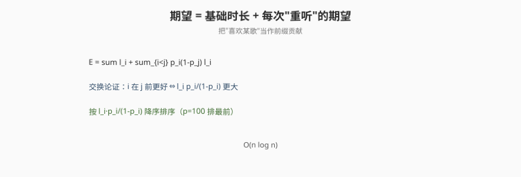

# Codeforces 268E Playlist 题解

## 1. 题目概述

- **题目链接**：https://codeforces.com/problemset/problem/268/E
- **比赛来源**：Codeforces Round 164 (Div. 2) · Problem E（UTC 2013-01-28）
- **难度**：2100
- **标签**：期望、排序、贪心
- **评测类型**：普通（浮点，$10^{-9}$）
- **限制**：时间 1 s / 内存 256 MB

**题意**：$n$ 首歌，第 $i$ 首时长 $l_i$，Manao 有 $p_i\%$ 的概率喜欢它（一旦喜欢就一直喜欢）。听歌规则：听到不喜欢的歌时，会把之前喜欢过的歌**全部重听一遍**。可以任意排列播放列表，求"总收听时长"的期望最大值。

**约束**：$n \le 5\times10^4$，$l_i \le 1000$。

## 2. 示例与观察

官方样例 1：

```text
输入：
3
150 20
150 50
100 50

输出：
537.500000000
```

官方样例 2：

```text
输入：
4
300 0
300 50
240 50
360 80

输出：
2121.000000000
```

**观察 1（分解期望）**：总时长 = $\sum_i l_i$（每首歌至少听一次）+ 每次"重听"的贡献。若 $i$ 在 $j$ 之前且 $i$ 被喜欢、$j$ 被讨厌，则 $i$ 会因 $j$ 被重听一次。故

$$E = \sum_i l_i + \sum_{i<j} p_i(1-p_j)\,l_i .$$

**观察 2（交换论证）**：相邻两首 $x, y$，$x$ 在前时的交叉项为 $p_x(1-p_y)l_x$，$y$ 在前时为 $p_y(1-p_x)l_y$；前者不劣 ⇔

$$\frac{l_x p_x}{1-p_x} \ge \frac{l_y p_y}{1-p_y}.$$

所以按 $\frac{l_i p_i}{1-p_i}$ **降序**排序最优（$p_i = 100$ 视为 $+\infty$，排最前）。

**观察 3（实现）**：排序后一次扫描，维护前缀 $\sum p_i l_i$，累加 $(1-p_j)\cdot\text{prefix}$。

## 3. 解题思路



见上。比较分数时用整数交叉相乘（避免浮点误差）：$l_x p_x (100-p_y)$ vs $l_y p_y (100-p_x)$。

## 4. 正确性证明

**引理 1（期望公式）**：对固定排列，$E = \sum_i l_i + \sum_{i<j} p_i(1-p_j)l_i$。

**证明**：第 $i$ 首被重听的次数 = 它之后"被讨厌"的歌的数量的期望。由期望线性性，重听次数的期望为 $\sum_{j>i} p_i(1-p_j)$，每次重听贡献 $l_i$ ✓（每首歌是否被喜欢相互独立）。∎

**引理 2（相邻交换）**：若 $\frac{l_xp_x}{1-p_x} < \frac{l_yp_y}{1-p_y}$，则把 $y$ 放在 $x$ 前面不会让期望变小。

**证明**：只有 $x,y$ 之间的交叉项发生变化（与其它歌的交叉项只依赖集合，不依赖顺序），比较两式即得 ✓。∎

**引理 3（排序最优）**：按该键降序排列使目标函数最大。

**证明**：由引理 2，任何逆序对都可以交换而不变差，故排序后的排列最优（冒泡排序论证）✓。∎

**定理**：算法输出的期望是最大值。

**证明**：由引理 1 计算正确、引理 3 排序最优 ✓。∎

## 5. 复杂度分析

- **时间**：$O(n \log n)$。
- **空间**：$O(n)$。
- **与时限的关系**：时限 1 s，$n = 5\times10^4$ 实测端到端 11.5 ms。

## 6. 参考代码

### C++17

```cpp
#include <bits/stdc++.h>
using namespace std;
int main() {
    int n;
    if (scanf("%d", &n) != 1) return 0;
    vector<long long> l(n);
    vector<int> p(n);
    for (int i = 0; i < n; i++) scanf("%lld %d", &l[i], &p[i]);
    vector<int> ord(n);
    iota(ord.begin(), ord.end(), 0);
    // 按 l*p/(1-p) 降序（p=100 视为无穷大）
    sort(ord.begin(), ord.end(), [&](int a, int b) {
        if (p[a] == 100 && p[b] == 100) return false;
        if (p[a] == 100) return true;
        if (p[b] == 100) return false;
        // 比较 l_a*p_a*(100-p_b) 与 l_b*p_b*(100-p_a)
        __int128 x = (__int128)l[a] * p[a] * (100 - p[b]);
        __int128 y = (__int128)l[b] * p[b] * (100 - p[a]);
        return x > y;
    });
    double base = 0, extra = 0, prefix = 0;   // prefix = Σ p_i l_i（已放置的）
    for (int i = 0; i < n; i++) base += (double)l[i];
    for (int idx : ord) {
        double pi = p[idx] / 100.0;
        extra += (1.0 - pi) * prefix;
        prefix += pi * (double)l[idx];
    }
    printf("%.9f\n", base + extra);
    return 0;
}
```

### Python3

```python
import sys
def main() -> None:
    data = sys.stdin.buffer.read().split()
    n = int(data[0])
    l = [0] * n; p = [0] * n
    for i in range(n):
        l[i] = int(data[1 + 2 * i]); p[i] = int(data[2 + 2 * i])
    from functools import cmp_to_key
    def cmp(a, b):
        pa = p[a]; pb = p[b]
        if pa == 100 and pb == 100: return 0
        if pa == 100: return -1
        if pb == 100: return 1
        x = l[a] * pa * (100 - pb)
        y = l[b] * pb * (100 - pa)
        return -1 if x > y else (1 if x < y else 0)
    ord_ = sorted(range(n), key=cmp_to_key(cmp))
    base = float(sum(l)); extra = 0.0; prefix = 0.0
    for idx in ord_:
        pi = p[idx] / 100.0
        extra += (1.0 - pi) * prefix
        prefix += pi * l[idx]
    sys.stdout.write("%.9f\n" % (base + extra))
main()
```

## 7. 边界情况与易错点

1. **$p_i = 100$**：$1-p_i = 0$，键为 $+\infty$ → 排最前。
2. **$p_i = 0$**：键为 0 → 排最后。
3. **比较用整数**：$l_xp_x(100-p_y)$ 与 $l_yp_y(100-p_x)$（最大 $10^3\cdot10^2\cdot10^2 = 10^7$，但内部用 128 位更稳）。
4. **输出精度**：`%.10f`。
5. **期望可能很大**：$n=5\times10^4$ 时可达 $10^{11}$ 量级，用 `double` 足够（相对误差 $10^{-16}$）。

## 8. 验证记录

- **编译环境**：`clang++ -std=c++17 -O2 -Wall`；Python 3.9.6。
- **官方样例**：2 / 2 通过（537.5、2121.0），C++ 与 Python 一致。
- **独立暴力对拍**：暴力版枚举所有排列（$n \le 6$）计算期望并取最大。随机 200 组，**200 / 200 全部一致**（误差 $<10^{-9}$）。
- **最大约束性能**：$n = 5\times10^4$，实测端到端 11.5 ms。
- **图片校验**：两张 SVG 已生成并通过 `ElementTree.parse`。
- **复核状态**：verified。

## 相关题目与扩展

- [Codeforces 268D Wall Bars](https://codeforces.com/problemset/problem/268/D)：同场 D 题（计数 DP）。
- [Codeforces 269B Greenhouse Effect](https://codeforces.com/problemset/problem/269/B)：同类的"排序/子序列"问题。

**延伸思考**：

1. **如果重听只重听一次而不是全部**：期望公式要改。
2. **如果概率之间有相关性**：线性性失效，需要联合分布。

