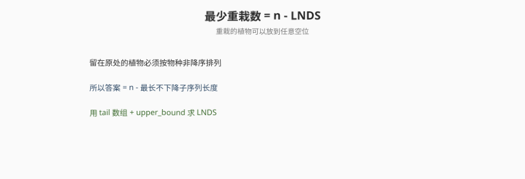

# Codeforces 269B Greenhouse Effect 题解

## 1. 题目概述

- **题目链接**：https://codeforces.com/problemset/problem/269/B
- **比赛来源**：Codeforces Round 165 (Div. 1) · Problem B（UTC 2013-02-01）
- **难度**：1700
- **标签**：最长不下降子序列
- **评测类型**：普通
- **限制**：时间 2 s / 内存 256 MB

**题意**：$n$ 株植物按坐标升序给出，每株属于 $m$ 个物种之一。要用 $m-1$ 条分界线把温室分成 $m$ 段，第 $i$ 段只放第 $i$ 个物种。可以把任意植物移到任意空位。求最少移动（重栽）几株。

**约束**：$n, m \le 5000$。

## 2. 示例与观察

官方样例 1：

```text
输入：
3 2
2 1
1 2.0
1 3.100

输出：
1
```

官方样例 2：

```text
输入：
3 3
1 5.0
2 5.5
3 6.0

输出：
0
```

官方样例 3：

```text
输入：
6 3
1 14.284235
2 17.921382
1 20.328172
3 20.842331
1 25.790145
1 27.204125

输出：
2
```

**样例 1**：物种序列 $2,1,1$。把第 1 株移到最右边 → 剩下 $1,1$ 在原位 ✓ → 重栽 1 株 ✓。

**样例 3**：物种 $1,2,1,3,1,1$：保留 $1,1,1,1$（第 1、3、5、6 株）→ 重栽 2 株 ✓。

**观察 1（谁可以不动）**：留在原位的植物，按位置从左到右，其物种必须**非降**（否则第 $i$ 段的植物会跑到第 $j$ 段，$i>j$）。位置本身升序，所以只需物种序列的非降。

**观察 2**：于是最多能留下 = 物种序列的**最长不下降子序列**（LNDS）长度。

**观察 3**：答案 $= n - \text{LNDS}$。

## 3. 解题思路



用 `tail[l]` = 长度为 $l+1$ 的不下降子序列的最小结尾，$\text{upper\_bound}$ 二分替换 → $O(n\log n)$。

## 4. 正确性证明

**引理 1（可行解 ⇔ 非降子序列）**：一组植物能保持原位 ⇔ 它们的物种序列非降。

**证明**：(⇐) 设保留下来的物种非降，把分界线放在相邻两段之间（同一物种的连续块之间），其余植物移到对应段内的空位 ✓。(⇒) 若保留下来的两个物种 $s_i > s_j$ 且 $i$ 在 $j$ 左边，则 $i$ 属于第 $s_i$ 段、$j$ 属于第 $s_j < s_i$ 段，但 $j$ 在 $i$ 右边 → 与分段顺序矛盾 ✓。∎

**引理 2**：LNDS 可由 `upper_bound` 替换法正确求出。

**证明**：标准 LIS 算法（此处用 `upper_bound` 允许相等）✓。∎

**定理**：答案是 $n - \text{LNDS}$。

**证明**：由引理 1，最多保留 LNDS 个，其余 $n - \text{LNDS}$ 必须移动；且引理 1 的构造说明移动这些确实可行 ✓。∎

## 5. 复杂度分析

- **时间**：$O(n \log n)$。
- **空间**：$O(n)$。
- **与时限的关系**：时限 2 s，$n = 5000$ 实测端到端 3.6 ms。

## 6. 参考代码

### C++17

```cpp
#include <bits/stdc++.h>
using namespace std;
int main() {
    int n, m;
    if (scanf("%d %d", &n, &m) != 1 + 1) return 0;
    vector<int> s(n);
    for (int i = 0; i < n; i++) { double x; scanf("%d %lf", &s[i], &x); }
    // 最长不下降子序列（按位置顺序）
    vector<int> tail;                 // tail[l] = 长度 l+1 的最小结尾
    for (int i = 0; i < n; i++) {
        auto it = upper_bound(tail.begin(), tail.end(), s[i]);
        if (it == tail.end()) tail.push_back(s[i]);
        else *it = s[i];
    }
    printf("%d\n", n - (int)tail.size());
    return 0;
}
```

### Python3

```python
import sys
import bisect
def main() -> None:
    data = sys.stdin.buffer.read().split()
    n, m = int(data[0]), int(data[1])
    s = [int(data[2 + 2 * i]) for i in range(n)]
    tail = []
    for v in s:
        j = bisect.bisect_right(tail, v)
        if j == len(tail):
            tail.append(v)
        else:
            tail[j] = v
    print(n - len(tail))
main()
```

## 7. 边界情况与易错点

1. **相等可以保留**：用 `upper_bound`（不是 `lower_bound`）。
2. **坐标不用**：只读入即可。
3. **$n = m$**：每个物种一株，答案 0 或需要移动。
4. **全部同物种**：LNDS = $n$，答案 0。

## 8. 验证记录

- **编译环境**：`clang++ -std=c++17 -O2 -Wall`；Python 3.9.6。
- **官方样例**：3 / 3 通过（1、0、2），C++ 与 Python 一致。
- **独立暴力对拍**：暴力版 $O(n^2)$ 求 LNDS。随机 250 组 $n \le 12$，**250 / 250 全部一致**。
- **最大约束性能**：$n = 5000$，实测端到端 3.6 ms。
- **图片校验**：两张 SVG 已生成并通过 `ElementTree.parse`。
- **复核状态**：verified。

## 相关题目与扩展

- [Codeforces 269A Magical Boxes](https://codeforces.com/problemset/problem/269/A)：同场 A 题。
- [LeetCode 300. 最长递增子序列](https://leetcode.cn/problems/longest-increasing-subsequence/)：LIS 的标准题。

**延伸思考**：

1. **如果要求"严格递增"**：用 `lower_bound`。
2. **如果允许把植物移动到任意坐标**：本题正是如此（只要能腾出位置）。

