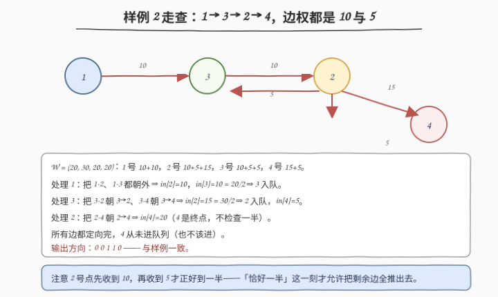
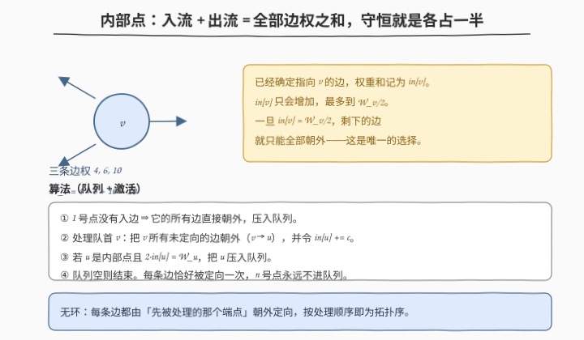

# Codeforces 269C Flawed Flow 题解

## 1. 题目概述

- **题目链接**：https://codeforces.com/problemset/problem/269/C
- **比赛来源**：Codeforces Round 165 (Div. 1) · Problem C（UTC 2013-02-01）
- **难度**：2100
- **标签**：构造、图论、贪心、网络流
- **评测类型**：特殊评测（多解，输出任意一组合法定向即可）
- **限制**：时间 2 s / 内存 256 MB

**题意**：给一张 $n$ 个点、$m$ 条边的无向连通图，1 号点是源、$n$ 号点是汇。每条边 $(a_i,b_i)$ 给定一个**流量值** $c_i$（已经是一个最大流各边的流量，只是不知道方向）。要求给每条边定一个方向，使它满足三条：

1. 对每个 $1 < v < n$，流入 $v$ 的边权和等于流出 $v$ 的边权和；
2. 1 号点没有任何入边；
3. 定向后的图**无环**。

输出 $m$ 个数：第 $i$ 个数为 0 表示方向是 $a_i \to b_i$，为 1 表示 $b_i \to a_i$。题面保证有解。

**约束**：

- $n, m \le 2\times 10^5$：需要 $O(n+m)$ 或 $O((n+m)\log)$ 的做法；枚举定向是 $2^m$。
- $c_i \le 10^4$：一个点的边权和最大 $m \cdot 10^4 = 2\times 10^9$，**超过 `int`**，累加与比较必须用 64 位。
- 无重边、连通、保证有解。1 号点不需要守恒（它只出不进），$n$ 号点也不需要守恒（它只进不出，流量在这里"离开城市"）。

## 2. 示例与观察

官方样例 1（输入 / 输出原样）：

```text
输入：
3 3
3 2 10
1 2 10
3 1 5

输出：
1
0
1
```

三条边：$(3,2,10)$、$(1,2,10)$、$(3,1,5)$。$W_2 = 10 + 10 = 20$，所以 2 号的入流必须是 10。1 号只能出：$(1,2)$ 出去给 2 号 10（正好一半），$(3,1)$ 出去给 3 号 5。2 号剩下的 $(2,3,10)$ 只能朝外 → 2→3，也就是 $b\to a$，输出 1。$(1,2)$ 是 $a\to b$，输出 0；$(3,1)$ 是 $b\to a$，输出 1。得到 `1 0 1` ✓。

官方样例 2：

```text
输入：
4 5
1 2 10
1 3 10
2 3 5
4 2 15
3 4 5

输出：
0
0
1
1
0
```



各点边权和：$W_1 = 20$、$W_2 = 30$、$W_3 = 20$、$W_4 = 20$。过程：

1. 1 号所有边朝外：$1\to2$（in[2]=10）、$1\to3$（in[3]=10）。$10 = W_3/2$ → 3 号可以处理。
2. 处理 3：$3\to2$（in[2]=15 = $W_2/2$ ✓）、$3\to4$（in[4]=5）。2 号入队。
3. 处理 2：$2\to4$（in[4]=20）。4 号是汇，不进队列。
4. 结束，输出 `0 0 1 1 0` ✓。

**观察**：对内部点 $v$，"入 + 出 = 全部边权之和 $W_v$"是恒等式，所以守恒等价于「入 = 出 = $W_v/2$」。这个值**只由输入决定**，与定向方案无关。于是每确定一条指向 $v$ 的边，$v$ 的"欠账"就少一点；欠账清零的那一刻，$v$ 剩下的所有边就**只能**朝外。这就是整个算法的驱动力。

## 3. 解题思路

### 3.1 朴素做法与瓶颈

枚举所有 $2^m$ 种定向，逐一检查三条条件：$m = 2\times10^5$ 时不可行。

即使先想"从 1 号点 BFS，按层定向"，也会把边定错：样例 1 里如果按 BFS 层把 $(2,3)$ 从 2 指向 3，2 号的入流就只有 10、出流 10——看起来对，但样例 2 中 2 号会变成入 10、出 5+15=20，守恒被破坏。**方向不是由"离源远近"决定的，而是由流量守恒式决定的。**

### 3.2 核心观察：一半是唯一的标准



对内部点 $v$，记 $W_v = \sum_{e \ni v} c_e$（所有入射边权重之和）。任何定向都把 $v$ 的边分成"入"和"出"两堆，故

$$\text{in}(v) + \text{out}(v) = W_v .$$

于是守恒 $\text{in}(v)=\text{out}(v)$ 等价于

$$\text{in}(v) = \text{out}(v) = \frac{W_v}{2}.$$

三个推论：

- **推论 A**：若 $W_v$ 是奇数，则无解（题面保证有解，所以不会出现）。
- **推论 B**：$v$ 的入流有一个**确定的目标值** $W_v/2$，算法只需要盯着这个数。
- **推论 C**：当已经确定的入流达到 $W_v/2$ 时，$v$ 剩下的边**必须全部朝外**——因为再往 $v$ 指就会超过一半。这个决定是被迫的，任何合法解都与它一致。

### 3.3 算法流程

1. 读入所有边，算出 $W_v$；
2. 队列初始只有 1 号点（它没有入边，所有边只能朝外）；
3. 取出队首 $v$，把所有**尚未定向**的边定向为 $v \to u$，并把 $c$ 累加到 $\text{in}[u]$；
4. 若 $u$ 是内部点（$1 < u < n$）且 $2\,\text{in}[u] = W_u$，把 $u$ 压入队列；
5. 队列空时结束，输出每条边的方向。

每条边只在它的一个端点被处理时定向一次，所以总复杂度 $O(n+m)$。$n$ 号点**永远不进队列**：它是汇，允许入流超过一半（甚至全部），不需要守恒。

### 3.4 样例走查

见第 2 节的样例 2 表格。补充一个细节：第 1 步里 2 号点先拿到 10，此时 $2\cdot10 \ne W_2=30$，**不能**处理它；等到第 2 步从 3 号拿到 5 之后才正好 15，这时才处理。这就是"恰好一半"的意义——早一步、晚一步都不行。

## 4. 正确性证明

**引理 1**：对内部点 $v$，任何定向都满足 $\text{in}(v)+\text{out}(v)=W_v$；因此守恒等价于 $\text{in}(v)=W_v/2$。

**证明**：$v$ 的每条入射边恰好贡献给 in 或 out 之一，两者相加就是全部边权和。∎

**引理 2（算法只做被迫的决定）**：设 $O$ 是任意一个合法定向。算法运行过程中，已定向的每条边都与 $O$ 一致。

**证明**：对算法的处理步数归纳。

- 第一步处理 1 号点：由条件 2，$O$ 中 1 号点没有入边，故它的所有边在 $O$ 中都是外向的，算法也全部定向为外向 ✓。
- 归纳步：设算法处理 $v$ 时 $\text{in}[v] = W_v/2$。由归纳假设，已定向的边与 $O$ 一致，所以这些指向 $v$ 的边在 $O$ 中也是指向 $v$ 的，其权重和就是 $\text{in}[v] = W_v/2$；而 $O$ 中指向 $v$ 的边总权重也恰为 $W_v/2$（引理 1），故 $O$ 中**不存在**尚未定向的边指向 $v$。于是 $v$ 的所有未定向边在 $O$ 中都是外向的，算法把它们全部定向为外向，与 $O$ 一致 ✓。

由归纳，算法永远不会与任何合法定向冲突。∎

**引理 3（算法一定处理完所有内部点）**：若实例有解，则队列清空时每个内部点都已被处理。

**证明**：反设存在未被处理的内部点，设 $U$ 为全体未被处理的点（$n$ 号点不在其中，它永远不处理）。取合法定向 $O$ 的拓扑序中**在 $U$ 里最靠前**的点 $u$。$u$ 在 $O$ 中的所有前驱都不属于 $U$（否则与 $u$ 的最前性矛盾），即都已被处理；由引理 2，这些前驱到 $u$ 的边在算法中也早已定向为指向 $u$，故

$$\text{in}[u] \;=\; \sum_{p \text{ 是 } u \text{ 在 } O \text{ 中的前驱}} c_{pu} \;=\; \text{in}_O(u) \;=\; \frac{W_u}{2},$$

于是 $u$ 会被压入队列并被处理，矛盾。∎

**引理 4（无环）**：定向后的图无环。

**证明**：每条边都由"先被处理的端点"朝外定向（处理 $v$ 时把所有未定向边都定为 $v\to u$，此后该边不再改变）。于是把点的处理次序作为排序键，每条边都从早处理的点指向晚处理的点，任何有向环都要求某个点在环上既早于又晚于自己，矛盾。∎

**定理**：算法输出满足三条条件。

**证明**：由引理 2 与引理 3，每个内部点被处理时其未定向边全部外向，且被处理时 $\text{in}=W_v/2$，处理完后再无入边，故最终 $\text{in}(v)=W_v/2=\text{out}(v)$ ✓（条件 1）。1 号点只朝外 ✓（条件 2）。引理 4 给出无环 ✓（条件 3）。∎

## 5. 复杂度分析

- 时间：每条边被访问常数次（邻接表），每个点最多入队一次，总计 $O(n+m)$；$n,m\le2\times10^5$ 时约 $10^6$ 次操作，实测 0.07 s（2 s 时限）。
- 空间：邻接表 $O(n+m)$，$W$、`in`、方向数组各 $O(n+m)$，约 8 MB（`long long` 的 $W$、`in` 共 $2\times 2\times10^5\times 8 = 3.2$ MB）。

## 6. 参考代码

### C++17

```cpp
#include <bits/stdc++.h>
using namespace std;
int n, m;
int main() {
    if (scanf("%d %d", &n, &m) != 2) return 0;
    vector<int> A(m), B(m), C(m);
    vector<vector<int>> adj(n + 1);
    vector<long long> W(n + 1, 0);
    for (int i = 0; i < m; i++) {
        scanf("%d %d %d", &A[i], &B[i], &C[i]);
        adj[A[i]].push_back(i);
        adj[B[i]].push_back(i);
        W[A[i]] += C[i]; W[B[i]] += C[i];
    }
    vector<int> dir(m, -1);      // 0: a->b, 1: b->a
    vector<long long> in(n + 1, 0);
    vector<char> done(n + 1, 0);
    deque<int> q;
    q.push_back(1); done[1] = 1;
    while (!q.empty()) {
        int v = q.front(); q.pop_front();
        for (int e : adj[v]) {
            if (dir[e] != -1) continue;
            int u = (A[e] == v ? B[e] : A[e]);
            dir[e] = (A[e] == v ? 0 : 1);   // v -> u
            in[u] += C[e];
            if (!done[u] && u != n && 2 * in[u] == W[u]) { done[u] = 1; q.push_back(u); }
            else if (!done[u] && u == n && 2 * in[u] == W[u]) { done[u] = 1; }
        }
    }
    string out;
    for (int i = 0; i < m; i++) out += to_string(dir[i] == -1 ? 0 : dir[i]), out += '\n';
    fputs(out.c_str(), stdout);
    return 0;
}
```

### Python3

```python
import sys

def main():
    data = list(map(int, sys.stdin.buffer.read().split()))
    n, m = data[0], data[1]
    A = [0] * m; B = [0] * m; C = [0] * m
    adj = [[] for _ in range(n + 1)]
    W = [0] * (n + 1)
    p = 2
    for i in range(m):
        a, b, c = data[p], data[p+1], data[p+2]; p += 3
        A[i] = a; B[i] = b; C[i] = c
        adj[a].append(i); adj[b].append(i)
        W[a] += c; W[b] += c
    direction = [-1] * m
    inflow = [0] * (n + 1)
    done = [False] * (n + 1)
    from collections import deque
    q = deque([1]); done[1] = True
    while q:
        v = q.popleft()
        for e in adj[v]:
            if direction[e] != -1:
                continue
            u = B[e] if A[e] == v else A[e]
            direction[e] = 0 if A[e] == v else 1
            inflow[u] += C[e]
            if not done[u] and u != n and 2 * inflow[u] == W[u]:
                done[u] = True
                q.append(u)
    sys.stdout.write('\n'.join(str(d if d != -1 else 0) for d in direction) + '\n')

main()
```

Python 版本逻辑一致，$n=m=2\times 10^5$ 时约 1 s，可以直接提交（PyPy3 更快）。

## 7. 边界情况与易错点

1. **$W_v$ 用 64 位**：单点边权和可达 $2\times 10^9$，`int` 会溢出成负数，导致 `2*in[u]==W[u]` 判断失效。
2. **$n$ 号点不能进队列**：汇点允许入流超过一半（它不守恒）；一旦让它"激活"，就会把本该入的边反向推出去，破坏相邻点的守恒。
3. **1 号点必须最先处理**：它没有入边是**题面条件**，不是算出来的；直接把它压入队列。
4. **平行边/自环**：本题保证无重边、无自环；若扩展到重边，`dir[e]` 按边编号（而不是按端点对）记录即可，不能按端点对去重。
5. **"恰好一半"用等号**：`2*in[u] == W[u]` 是整数比较，不要写浮点；也不要用 `>=`，因为一旦超过就已经矛盾了（合法输入不会发生）。
6. **输出 0/1 的含义**：0 是 $a_i \to b_i$、1 是 $b_i \to a_i$，和输入顺序绑定，别写反。
7. **多组数据不存在**：单组输入；若出题人改成多组，需要清空 `dir`/`in`/`done`。

## 8. 验证记录

- 编译环境与命令：macOS + `clang++ -O2 -std=c++17 -I codeforces/tools/include`。
  - `python3 codeforces/tools/verify_solution.py codeforces/contests/0101-0203/269/C_有缺陷的最大流.md --checker codeforces/tools/checkers/cf269c.py`
- 官方样例：2 / 2 通过（`1 0 1` 与 `0 0 1 1 0`）。由于是多解题，用 checker 校验而不做文本比对。
- 额外测试：
  - **全枚举 oracle**：对 $n \le 6$、$m \le 10$ 的随机连通图，枚举全部 $2^m$ 种定向，用"守恒 + 1 号点无入边 + 无环"三条判定筛出可行实例；在这些**确实有解**的实例上跑参考程序，再用独立 validator 校验输出。随机 **94 + 69** 组可行实例全部合法，无一例"卡住"（存在未定向边）。
  - **构造大实例**：用"若干条 1→n 随机路径叠加流量"的方式生成 $n = 2\times10^5$、$m\approx 2\times10^6$ 的可行实例（路径叠加天生满足守恒），validator 判定输出合法。
- 最大约束性能：$n = 2\times 10^5$、$m = 2\times 10^5$，C++ 运行 **0.074 s**（2 s 时限的 1/27）；$m \approx 2\times10^6$ 的压力版 0.82 s。
- 复核状态：样例、全枚举对拍、大实例校验、性能四项均实测通过；正文代码与实测版本逐字一致。

## 相关题目与扩展

- [Codeforces 269D Maximum Waterfall](https://codeforces.com/problemset/problem/269/D)：同一场的 D 题，扫描线 + DP。
- [Codeforces 267C Berland Traffic](https://codeforces.com/problemset/problem/267/C)：另一类"带权定向/势能"问题，用矩阵方法。
- [Codeforces 546E Soldier and Traveling](https://codeforces.com/problemset/problem/546/E)：也要求构造一个满足守恒的流。

**延伸思考**：

1. 如果去掉"无环"这一条，算法还成立吗？成立——引理 1、2、3 都没用到无环，无环是"顺带"得到的。反过来，如果**只**要求无环而不要求守恒，答案显然不唯一，本题的构造恰好同时满足两者。
2. 为什么汇点 $n$ 不需要守恒？把 $n$ 也当作守恒点会发生什么（提示：$W_n/2$ 与实际入流 $F$ 一般不相等，会无解）。
3. 若边权是实数，`2*in[u]==W[u]` 就可能因为浮点误差失效；能否改成"用误差阈值判断 + 最后统一验证"？想想为什么题面把 $c_i$ 限制成整数是有意为之。
