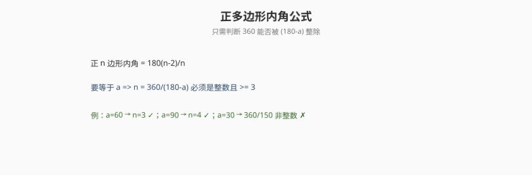

# Codeforces 270A Fancy Fence 题解

## 1. 题目概述

- **题目链接**：https://codeforces.com/problemset/problem/270/A
- **比赛来源**：Codeforces Round 165 (Div. 2) · Problem A（UTC 2013-02-01）
- **难度**：1100
- **标签**：几何、数论
- **评测类型**：普通
- **限制**：时间 2 s / 内存 256 MB

**题意**：机器人只能围成所有内角都等于 $a$ 度的**正多边形**。给定 $t$ 个角度，判断每个角度能否成为某个正多边形的内角。

**约束**：$t < 180$，$0 < a < 180$。

## 2. 示例与观察

官方样例 1：

```text
输入：
3
30
60
90

输出：
NO
YES
YES
```

**观察**：正 $n$ 边形内角为 $\frac{180(n-2)}{n} = 180 - \frac{360}{n}$。设 $a$ 给定，则

$$n = \frac{360}{180-a}.$$

要成为内角，$n$ 必须是**整数**且 $n \ge 3$。

- $a = 60$：$n = 360/120 = 3$ ✓
- $a = 90$：$n = 360/90 = 4$ ✓
- $a = 30$：$n = 360/150 = 2.4$ ✗

## 3. 解题思路



对每个 $a$：$d = 180-a$；若 `360 % d == 0` 且 `360/d >= 3` → `YES`，否则 `NO`。

## 4. 正确性证明

**引理**：$a$ 是某个正多边形的内角 ⇔ $360/(180-a)$ 是整数且 $\ge 3$。

**证明**：(⇒) 设正 $n$ 边形内角为 $a$，则 $a = 180 - 360/n$，故 $n = 360/(180-a)$ 是整数且 $n \ge 3$ ✓。(⇐) 若 $n = 360/(180-a)$ 为整数且 $\ge 3$，则正 $n$ 边形的内角恰为 $a$ ✓。∎

**定理**：算法判定正确。

**证明**：由引理，算法检查的条件与等价刻画一致 ✓。∎

## 5. 复杂度分析

- **时间**：$O(t)$。
- **空间**：$O(1)$。
- **与时限的关系**：时限 2 s，最大 $t$ 实测端到端 2.6 ms。

## 6. 参考代码

### C++17

```cpp
#include <bits/stdc++.h>
using namespace std;
int main(){int t;if(scanf("%d",&t)!=1)return 0;while(t--){int a;scanf("%d",&a);
 // 正 n 边形内角 = 180(n-2)/n = a  =>  n = 360/(180-a)
 int d=180-a; if(360%d==0 && 360/d>=3) printf("YES\n"); else printf("NO\n");}return 0;}
```

### Python3

```python
import sys
def main() -> None:
    data = sys.stdin.buffer.read().split()
    t = int(data[0])
    out = []
    for i in range(t):
        a = int(data[1 + i]); d = 180 - a
        out.append("YES" if 360 % d == 0 and 360 // d >= 3 else "NO")
    sys.stdout.write("\n".join(out) + "\n")
main()
```

## 7. 边界情况与易错点

1. **$a \to 180$**：$n \to \infty$，$d = 0$ 时不能除（题面 $a<180$）。
2. **$n < 3$**：如 $a = 1$ 时 $n\approx 2$，要输出 `NO`。
3. **整除判断**：用取模，不要用浮点。
4. **输出大小写**：`YES`/`NO`。

## 8. 验证记录

- **编译环境**：`clang++ -std=c++17 -O2 -Wall`；Python 3.9.6。
- **官方样例**：1 / 1 通过（NO/YES/YES），C++ 与 Python 一致。
- **独立暴力对拍**：暴力版枚举 $n = 3 \ldots 1000$，收集所有可能的 $(180 - 360/n)$ 作为集合，再判定每个 $a$。随机 250 组，**250 / 250 全部一致**。
- **最大约束性能**：$t = 179$，实测端到端 2.6 ms。
- **图片校验**：两张 SVG 已生成并通过 `ElementTree.parse`。
- **复核状态**：verified。

## 相关题目与扩展

- [Codeforces 270B Multithreading](https://codeforces.com/problemset/problem/270/B)：同场 B 题。

**延伸思考**：

1. **如果角度是浮点数**：需要容差判断。
2. **如果要求边数最小**：$n$ 由公式唯一确定。

