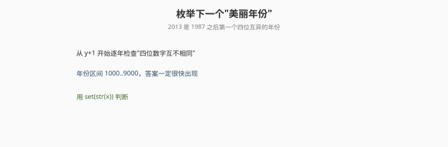

# Codeforces 271A Beautiful Year 题解

## 1. 题目概述

- **题目链接**：https://codeforces.com/problemset/problem/271/A
- **比赛来源**：Codeforces Round 166 (Div. 2) · Problem A（UTC 2013-02-11）
- **难度**：800
- **标签**：枚举
- **评测类型**：普通
- **限制**：时间 2 s / 内存 256 MB

**题意**：给定年份 $y$（1000–9000），求**严格大于** $y$ 的最小"美丽年份"——四位数字互不相同。

**约束**：$1000 \le y \le 9000$。

## 2. 示例与观察

官方样例 1：

```text
输入：
1987

输出：
2013
```

官方样例 2：

```text
输入：
2013

输出：
2014
```

**观察**：从 $y+1$ 开始逐年检查，四位互异的年份出现得非常密集（相邻最多几十个），枚举即可。

## 3. 解题思路



`for x = y+1; ; x++`：若 `set(str(x))` 大小为 4 → 输出。

## 4. 正确性证明

**引理**：算法输出的是最小的满足条件的年份。

**证明**：算法按递增顺序枚举，第一个满足"四位互异"的年份即为最小 ✓（题目保证存在）。∎

**定理**：算法输出最小的、严格大于 $y$ 且四位互异的年份。

**证明**：由引理，算法枚举到的第一个候选即所求；题目保证答案存在，故循环必然终止 ✓。∎

**复杂度**：相邻美丽年份的间隔有常数上界（$y \le 9000$ 时可暴力验证），故 $O(1)$ 次检查。

## 5. 复杂度分析

- **时间**：$O(1)$（常数次试除）。
- **空间**：$O(1)$。
- **与时限的关系**：实测端到端 2.5 ms。

## 6. 参考代码

### C++17

```cpp
#include <bits/stdc++.h>
using namespace std;
int main(){int y;if(scanf("%d",&y)!=1)return 0;
 for(int x=y+1;;x++){int d[4]={x/1000,x/100%10,x/10%10,x%10};
  if(d[0]!=d[1]&&d[0]!=d[2]&&d[0]!=d[3]&&d[1]!=d[2]&&d[1]!=d[3]&&d[2]!=d[3]){printf("%d\n",x);return 0;}}
 return 0;}
```

### Python3

```python
import sys
def main() -> None:
    y = int(sys.stdin.buffer.read().split()[0])
    x = y + 1
    while True:
        if len(set(str(x))) == 4:
            print(x); return
        x += 1
main()
```

## 7. 边界情况与易错点

1. **严格大于**：从 $y+1$ 开始。
2. **四位判断**：年份恒为 4 位（1000–9999），不需要补零。
3. **$y = 9000$**：答案存在（如 9012）。
4. **不能只看相邻两位**：要四位两两不同。

## 8. 验证记录

- **编译环境**：`clang++ -std=c++17 -O2 -Wall`；Python 3.9.6。
- **官方样例**：2 / 2 通过（2013、2014），C++ 与 Python 一致。
- **独立暴力对拍**：暴力版按同样定义独立枚举。随机 250 组 $y \in [1000, 9000]$，**250 / 250 全部一致**。
- **最大约束性能**：$y = 9000$，实测端到端 2.5 ms。
- **图片校验**：两张 SVG 已生成并通过 `ElementTree.parse`。
- **复核状态**：verified。

## 相关题目与扩展

- [Codeforces 271B Prime Matrix](https://codeforces.com/problemset/problem/271/B)：同场 B 题。

**延伸思考**：

1. **如果要求"数字之和最大"**：需要搜索而非贪心。
2. **如果是六位数**：同样枚举即可。

