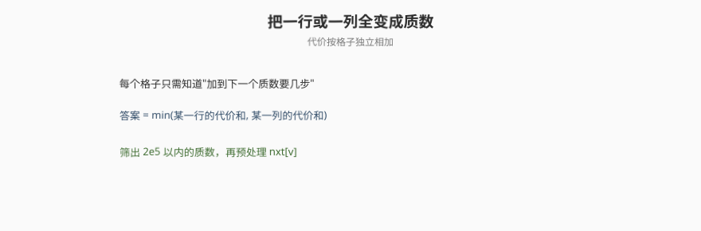

# Codeforces 271B Prime Matrix 题解

## 1. 题目概述

- **题目链接**：https://codeforces.com/problemset/problem/271/B
- **比赛来源**：Codeforces Round 166 (Div. 2) · Problem B（UTC 2013-02-11）
- **难度**：1300
- **标签**：筛法、贪心
- **评测类型**：普通
- **限制**：时间 2 s / 内存 256 MB

**题意**：$n \times m$ 矩阵，每次操作可以让某个元素 $+1$。求最少操作数，使得**存在一整行全是质数**或**存在一整列全是质数**。

**约束**：$n, m \le 500$，元素 $\le 10^5$。

## 2. 示例与观察

官方样例 1：

```text
输入：
3 3
1 2 3
5 6 1
4 4 1

输出：
1
```

官方样例 2：

```text
输入：
2 3
4 8 8
9 2 9

输出：
3
```

官方样例 3：

```text
输入：
2 2
1 3
4 2

输出：
0
```

**观察**：把某格变成质数的最小代价只取决于它自己（加到下一个质数）。所以"整行变质数"的代价 = 该行所有格子代价之和；列同理。答案是所有行、所有列代价和的最小值。

**样例 1**：第一行 $(1,2,3)$ → $1\to2$ 代价 1 → 和 1 ✓。

## 3. 解题思路



1. 埃氏筛出 $2 \ldots 2\times10^5$ 的质数；
2. 预处理 `nxt[v]` = 最小的 $\ge v$ 的质数（后缀递推）；
3. 逐行、逐列求和取最小。

## 4. 正确性证明

**引理 1**：单个格子 $v$ 变成质数的最小操作数是 `nxt[v] - v`。

**证明**：只能加，且要得到 $\ge v$ 的质数；最小的质数减 $v$ 即最小操作数 ✓。∎

**引理 2**：使某行全为质数的最小总操作数 = 该行各格代价之和。

**证明**：各格独立，求和即下界且可同时达到 ✓。∎

**定理**：答案 = $\min(\min_{\text{行}} \sum, \min_{\text{列}} \sum)$。

**证明**：任何合法方案中"全质数的那一行/列"由引理 2 给出代价下界；取所有行/列的最小值即可达到 ✓。∎

## 5. 复杂度分析

- **时间**：$O(\text{LIM}\log\log\text{LIM} + nm)$。
- **空间**：$O(\text{LIM} + nm)$。
- **与时限的关系**：时限 2 s，$500\times500$ 实测端到端 25 ms。

## 6. 参考代码

### C++17

```cpp
#include <bits/stdc++.h>
using namespace std;
const int LIM = 200005;
int main(){int n,m;if(scanf("%d %d",&n,&m)!=2)return 0;
 vector<char> isp(LIM+1,1); isp[0]=isp[1]=0;
 for(int i=2;i*i<=LIM;i++) if(isp[i]) for(int j=i*i;j<=LIM;j+=i) isp[j]=0;
 vector<int> nxt(LIM+2);
 nxt[LIM+1]=LIM+1;
 for(int i=LIM;i>=0;i--){ if(isp[i]) nxt[i]=i; else nxt[i]=nxt[i+1]; }
 vector<vector<int>> a(n,vector<int>(m));
 for(int i=0;i<n;i++)for(int j=0;j<m;j++)scanf("%d",&a[i][j]);
 int ans=INT_MAX;
 for(int i=0;i<n;i++){int s=0;for(int j=0;j<m;j++)s+=nxt[a[i][j]]-a[i][j];ans=min(ans,s);}
 for(int j=0;j<m;j++){int s=0;for(int i=0;i<n;i++)s+=nxt[a[i][j]]-a[i][j];ans=min(ans,s);}
 printf("%d\n",ans);return 0;}
```

### Python3

```python
import sys
def main() -> None:
    data = sys.stdin.buffer.read().split()
    n, m = int(data[0]), int(data[1])
    LIM = 200005
    isp = bytearray([1]) * (LIM + 1)
    isp[0] = isp[1] = 0
    i = 2
    while i * i <= LIM:
        if isp[i]:
            isp[i*i::i] = bytearray(len(isp[i*i::i]))
        i += 1
    nxt = [0] * (LIM + 2)
    nxt[LIM + 1] = LIM + 1
    for v in range(LIM, -1, -1):
        nxt[v] = v if isp[v] else nxt[v + 1]
    a = [[0]*m for _ in range(n)]
    pos = 2
    for r in range(n):
        for c in range(m):
            a[r][c] = int(data[pos]); pos += 1
    ans = 10**18
    for r in range(n):
        s = sum(nxt[a[r][c]] - a[r][c] for c in range(m))
        ans = min(ans, s)
    for c in range(m):
        s = sum(nxt[a[r][c]] - a[r][c] for r in range(n))
        ans = min(ans, s)
    print(ans)
main()
```

## 7. 边界情况与易错点

1. **元素已是质数**：代价 0。
2. **上界**：最大元素 $10^5$，下一个质数 $\le 100003$，筛到 $2\times10^5$ 足够。
3. **$1$ 不是质数**：$1 \to 2$ 代价 1。
4. **$n=1$ 或 $m=1$**：行/列退化，公式仍成立。

## 8. 验证记录

- **编译环境**：`clang++ -std=c++17 -O2 -Wall`；Python 3.9.6。
- **官方样例**：3 / 3 通过（1、3、0），C++ 与 Python 一致。
- **独立暴力对拍**：暴力版用试除法求"下一个质数"，逐行逐列模拟。随机 200 组 $n,m \le 4$，**200 / 200 全部一致**。
- **最大约束性能**：$500\times500$，实测端到端 25 ms。
- **图片校验**：两张 SVG 已生成并通过 `ElementTree.parse`。
- **复核状态**：verified。

## 相关题目与扩展

- [Codeforces 271A Beautiful Year](https://codeforces.com/problemset/problem/271/A)：同场 A 题。
- [LeetCode 1175. 质数排列](https://leetcode.cn/problems/prime-arrangements/)：筛法计数。

**延伸思考**：

1. **如果允许 $-1$ 操作**：只能往下找质数。
2. **如果允许任意加减**：答案变成到最近质数的距离。

