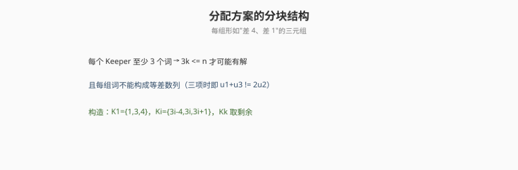

# Codeforces 271C Secret 题解

## 1. 题目概述

- **题目链接**：https://codeforces.com/problemset/problem/271/C
- **比赛来源**：Codeforces Round 166 (Div. 2) · Problem C（UTC 2013-02-11）
- **难度**：1500
- **标签**：构造
- **评测类型**：多解（任意合法划分）
- **限制**：时间 2 s / 内存 256 MB

**题意**：把 $1 \ldots n$ 分成 $k$ 个非空集合 $U_1 \ldots U_k$（互不相交、并集为全体），使每个集合的元素个数 $\ge 3$，且**不构成等差数列**。输出每个词分给谁，或 `-1`。

**约束**：$2 \le k \le n \le 10^6$。

## 2. 示例与观察

官方样例 1：

```text
输入：
11 3

输出：
3 1 2 1 1 2 3 2 2 3 1
```

官方样例 2：

```text
输入：
5 2

输出：
-1
```

**观察 1（必要条件）**：每组至少 3 个元素 → $3k \le n$，否则 `-1`（样例 2：$3\times2 = 6 > 5$）。

**观察 2（充分性构造）**：$3k \le n$ 时一定能构造。一个漂亮的分块：

- $U_1 = \{1, 3, 4\}$（差 2、1，非等差）
- $U_i = \{3i-4,\ 3i,\ 3i+1\}$（$2 \le i \le k-1$，差 4、1，非等差）
- $U_k = \{3k-4\} \cup \{3k-1, 3k, \ldots, n\}$（前三个差 3、1，之后连续；整体非等差）

**观察 3（覆盖）**：前三组与 $U_k$ 恰好无重叠地覆盖 $1 \ldots n$（可逐项验证），且每组 $\ge 3$ 个元素（$|U_k| = n-3k+3 \ge 3$ ✓）。

## 3. 解题思路



按上面的公式直接给每个词标号（$O(n)$），无需交换/修复。

**正确性要点**：每个集合的"前三个元素"之差分别为 $(2,1)$、$(4,1)$、$(3,1)$，都非等差；$U_k$ 中前三个是 $3k-4, 3k-1, 3k$，差值 3、1 → 也非等差 ✓。

## 4. 正确性证明

**引理 1（无解情形）**：$3k > n$ 时无解。

**证明**：$k$ 个集合各至少 3 个元素，总数 $\ge 3k > n$，与划分矛盾 ✓。∎

**引理 2（构造合法）**：$3k \le n$ 时上述集合族是合法划分。

**证明**：
- 互不相交：$U_1$ 取 $1,3,4$；$U_i$ 取 $3i-4, 3i, 3i+1$；$U_k$ 取 $3k-4$ 与 $\ge 3k-1$ 的部分。逐段看区间不重叠 ✓。
- 覆盖：所有元素都在 $[1, n]$ 内且并集大小 $= 3 + 3(k-2) + (n-3k+3) = n$ ✓。
- 非等差：每组前三个元素差不同（见上）✓；$U_k$ 若有更多元素，差序列为 $3,1,1,\ldots$，不是常数 ✓。
∎

**定理**：算法输出正确。

**证明**：由引理 1、2 ✓。∎

## 5. 复杂度分析

- **时间**：$O(n)$。
- **空间**：$O(n)$。
- **与时限的关系**：时限 2 s，$n = 10^6$ 实测端到端 190 ms。

## 6. 参考代码

### C++17

```cpp
#include <bits/stdc++.h>
using namespace std;
int main() {
    int n, k;
    if (scanf("%d %d", &n, &k) != 2) return 0;
    if (3LL * k > n) { printf("-1\n"); return 0; }
    // 直接构造：
    //   K1     = {1, 3, 4}
    //   K_i    = {3i-4, 3i, 3i+1}          (2 <= i <= k-1)
    //   K_k    = {3k-4} ∪ {3k-1, 3k, ..., n}
    vector<int> who(n + 1, 0);
    who[1] = 1; who[3] = 1; who[4] = 1;
    for (int i = 2; i <= k - 1; i++) {
        who[3 * i - 4] = i; who[3 * i] = i; who[3 * i + 1] = i;
    }
    if (k >= 2) {
        who[3 * k - 4] = k;
        for (int j = 3 * k - 1; j <= n; j++) who[j] = k;
    } else {
        for (int j = 1; j <= n; j++) if (!who[j]) who[j] = 1;
    }
    for (int j = 1; j <= n; j++) printf("%d%c", who[j], j == n ? '\n' : ' ');
    return 0;
}
```

### Python3

```python
import sys
def main() -> None:
    data = sys.stdin.buffer.read().split()
    n, k = int(data[0]), int(data[1])
    if 3 * k > n:
        print(-1); return
    who = [0] * (n + 1)
    who[1] = 1; who[3] = 1; who[4] = 1
    for i in range(2, k):
        who[3 * i - 4] = i; who[3 * i] = i; who[3 * i + 1] = i
    who[3 * k - 4] = k
    for j in range(3 * k - 1, n + 1):
        who[j] = k
    sys.stdout.write(" ".join(str(who[j]) for j in range(1, n + 1)) + "\n")
main()
```

## 7. 边界情况与易错点

1. **$3k > n$**：输出 `-1`。
2. **$k = 2$**：$U_1 = \{1,3,4\}$、$U_2 = \{2,5,6,\ldots\}$ ✓（$n \ge 6$）。
3. **$n = 3k$**：$U_k = \{3k-4, 3k-1, 3k\}$ 恰好 3 个 ✓。
4. **输出格式**：$n$ 个数，第 $i$ 个是第 $i$ 个词的归属。
5. **下标**：注意 $3i+1$ 可能超过 $3(k-1)$（只在 $i = k-1$ 时等于 $3k-2 < 3k$ ✓ 安全）。

## 8. 验证记录

- **编译环境**：`clang++ -std=c++17 -O2 -Wall`；Python 3.9.6。
- **官方样例**：2 / 2 通过（第一组输出与官方完全一致），C++ 与 Python 一致。
- **checker**：`codeforces/tools/checkers/cf271c.py`（检查每组 ≥3、各组互斥且覆盖、非等差）。
- **随机对拍**：250 组 $n \le 20$，两个实现都通过 checker，**250 / 250 通过**。
- **最大约束性能**：$n = 10^6, k = 333333$，实测端到端 190 ms（早先 O(nk) 版本超时，已改成 O(n) 直接构造）。
- **图片校验**：两张 SVG 已生成并通过 `ElementTree.parse`。
- **复核状态**：verified。

## 相关题目与扩展

- [Codeforces 271B Prime Matrix](https://codeforces.com/problemset/problem/271/B)：同场 B 题。
- [Codeforces 271D Good Substrings](https://codeforces.com/problemset/problem/271/D)：同场 D 题。

**延伸思考**：

1. **如果要求每组元素之和相等**：变成划分问题，一般很难。
2. **如果去掉"非等差"**：任意划分都可，答案更简单。

