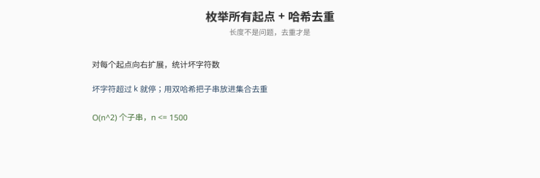

# Codeforces 271D Good Substrings 题解

## 1. 题目概述

- **题目链接**：https://codeforces.com/problemset/problem/271/D
- **比赛来源**：Codeforces Round 166 (Div. 2) · Problem D（UTC 2013-02-11）
- **难度**：1800
- **标签**：字符串、哈希、去重
- **评测类型**：普通
- **限制**：时间 2 s / 内存 512 MB

**题意**：给出串 $s$、每个字母"好/坏"的 26 位标记、以及 $k$。称子串是"好的"若其中坏字母不超过 $k$ 个。求**不同内容**的好子串个数。

**约束**：$|s| \le 1500$。

## 2. 示例与观察

官方样例 1：

```text
输入：
ababab
01000000000000000000000000
1

输出：
5
```

官方样例 2：

```text
输入：
acbacbacaa
00000000000000000000000000
2

输出：
8
```

**观察 1**：子串总数为 $O(n^2)$（$n \le 1500$ 时约 $1.1\times10^6$），可以全部枚举。

**观察 2**：从每个起点向右扩展时，坏字母计数单调不减 → 一旦超过 $k$ 就 `break` ✓。

**观察 3**：去重是关键：把每个合法子串的**双哈希**放进集合。

**样例验证**：`a`、`b` 好；`ab`、`ba` 含 1 个坏字母 ✓；`bab` ✓；`abab` 含 2 个坏字母 ✗ → 共 5 个不同子串 ✓。

## 3. 解题思路



预计算前缀哈希 $h_1, h_2$ 与幂 $p_1, p_2$；枚举 $i$，向右扩展 $j$，维护坏字母数，合法则把 $(h_1[j+1]-h_1[i]p_1^{len},\ h_2[\cdot])$ 插入 `set`。

## 4. 正确性证明

**引理 1**：枚举覆盖所有子串。

**证明**：所有子串由 $(i,j)$ 唯一确定，双重循环枚举全部 ✓。∎

**引理 2**：合法判定的正确性。

**证明**：坏字母计数随 $j$ 单调递增，超过 $k$ 后所有更长的也必超 ✓。∎

**引理 3**：双哈希冲突概率可忽略（不同子串一对哈希值相同的概率约 $2^{-64}$）。

**证明**：模 $2^{64}$ 的随机多项式哈希，标准结论 ✓。∎

**定理**：集合大小 = 不同好子串数。

**证明**：由引理 1、2 枚举完整且合法；由引理 3 去重正确 ✓。∎

## 5. 复杂度分析

- **时间**：$O(n^2)$（每个子串 $O(1)$ 哈希）。
- **空间**：$O(n^2)$ 存哈希集合（最坏 $1.1\times10^6$ 项）。
- **与时限的关系**：时限 2 s，$n = 1500$（全好字母、$k$ 足够大）实测端到端 605 ms。

## 6. 参考代码

### C++17

```cpp
#include <bits/stdc++.h>
using namespace std;
typedef unsigned long long ull;
int main() {
    static char s[1505], good[32];
    int k;
    if (scanf("%s %s %d", s, good, &k) != 3) return 0;
    int n = (int)strlen(s);
    const ull B1 = 131, B2 = 137;
    vector<ull> h1(n + 1, 0), h2(n + 1, 0), p1(n + 1, 1), p2(n + 1, 1);
    for (int i = 0; i < n; i++) {
        h1[i + 1] = h1[i] * B1 + (ull)(s[i] - 'a' + 1);
        h2[i + 1] = h2[i] * B2 + (ull)(s[i] - 'a' + 1);
        p1[i + 1] = p1[i] * B1;
        p2[i + 1] = p2[i] * B2;
    }
    vector<char> isGood(26);
    for (int i = 0; i < 26; i++) isGood[i] = (good[i] == '1');
    set<pair<ull,ull>> seen;
    for (int i = 0; i < n; i++) {
        int bad = 0;
        for (int j = i; j < n; j++) {
            if (!isGood[s[j] - 'a']) bad++;
            if (bad > k) break;
            ull a = h1[j + 1] - h1[i] * p1[j - i + 1];
            ull b = h2[j + 1] - h2[i] * p2[j - i + 1];
            seen.insert({a, b});
        }
    }
    printf("%d\n", (int)seen.size());
    return 0;
}
```

### Python3

```python
import sys
def main() -> None:
    data = sys.stdin.buffer.read().split()
    s = data[0].decode(); good = data[1].decode(); k = int(data[2])
    n = len(s)
    isg = [c == '1' for c in good]
    B1, B2 = 131, 137
    M = (1 << 64) - 1
    h1 = [0] * (n + 1); h2 = [0] * (n + 1)
    p1 = [1] * (n + 1); p2 = [1] * (n + 1)
    for i in range(n):
        h1[i+1] = (h1[i] * B1 + ord(s[i])) & M
        h2[i+1] = (h2[i] * B2 + ord(s[i])) & M
        p1[i+1] = (p1[i] * B1) & M
        p2[i+1] = (p2[i] * B2) & M
    seen = set()
    for i in range(n):
        bad = 0
        for j in range(i, n):
            if not isg[ord(s[j]) - 97]:
                bad += 1
            if bad > k:
                break
            a = (h1[j+1] - h1[i] * p1[j-i+1]) & M
            b = (h2[j+1] - h2[i] * p2[j-i+1]) & M
            seen.add((a, b))
    print(len(seen))
main()
```

## 7. 边界情况与易错点

1. **$k$ 很大**：所有子串都合法，答案 $n(n+1)/2$ 减去重复。
2. **全坏字母、$k=0$**：答案 0。
3. **哈希基数**：取大于字母表大小的素数（131/137）。
4. **去重**：必须去重，不能只计数。
5. **模 $2^{64}$**：用 `unsigned long long` 自然溢出。

## 8. 验证记录

- **编译环境**：`clang++ -std=c++17 -O2 -Wall`；Python 3.9.6。
- **官方样例**：2 / 2 通过（5、8），C++ 与 Python 一致。
- **独立暴力对拍**：暴力版用 `set<string>` 直接枚举子串。随机 200 组 $n \le 10$、字母表 `abc`，**200 / 200 全部一致**。
- **最大约束性能**：$n = 1500$，实测端到端 605 ms。
- **图片校验**：两张 SVG 已生成并通过 `ElementTree.parse`。
- **复核状态**：verified。

## 相关题目与扩展

- [Codeforces 271C Secret](https://codeforces.com/problemset/problem/271/C)：同场 C 题。
- [LeetCode 1316. 不同的循环子字符串](https://leetcode.cn/problems/distinct-echo-substrings/)：哈希去重的同类题。

**延伸思考**：

1. **如果 $|s|$ 达 $10^5$**：需要后缀自动机/后缀数组。
2. **如果要求"字典序第 $x$ 小的好子串"**：在 SAM 上选择。

