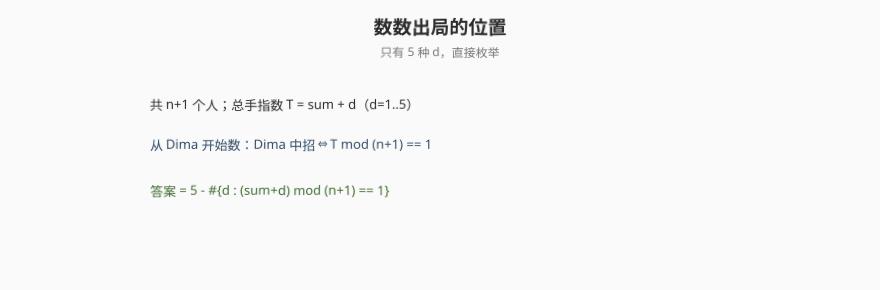

# Codeforces 272A Dima and Friends 题解

## 1. 题目概述

- **题目链接**：https://codeforces.com/problemset/problem/272/A
- **比赛来源**：Codeforces Round 167 (Div. 2) · Problem A（UTC 2013-02-13）
- **难度**：1000
- **标签**：数学、枚举
- **评测类型**：普通
- **限制**：时间 2 s / 内存 256 MB

**题意**：$n$ 个朋友各伸出 $1 \sim 5$ 根手指（已知），Dima 也伸 $1 \sim 5$ 根。所有人围成一圈，从 Dima 开始按"总手指数"数数，数到谁谁打扫卫生。问 Dima 有多少种伸手指的方式**不用**打扫。

**约束**：$n \le 100$。

## 2. 示例与观察

官方样例 1：

```text
输入：
1
1

输出：
3
```

官方样例 2：

```text
输入：
1
2

输出：
2
```

官方样例 3：

```text
输入：
2
3 5

输出：
3
```

**观察 1**：总人数 $n+1$。数 $T$ 次（从 Dima 记为 1）停在位置 $(T-1) \bmod (n+1) + 1$，Dima 就是位置 1，即

$$(T-1) \bmod (n+1) = 0 \iff T \bmod (n+1) = 1.$$

**观察 2**：$d \in \{1,\ldots,5\}$，$T = \text{sum} + d$，逐个判断即可。

**样例 1 验证**：$\text{sum}=1$，$d=1..5 \Rightarrow T=2..6$，$T \bmod 2 = 1$ 当 $T\in\{3,5\}$（$d=2,4$）→ Dima 打扫 2 种 → 答案 3 ✓。

## 3. 解题思路



答案 $= \#\{d \in [1,5] : (\text{sum}+d) \bmod (n+1) \ne 1\}$。

## 4. 正确性证明

**引理**：总手指数为 $T$ 时被数到的是第 $((T-1) \bmod (n+1)) + 1$ 个人（Dima 为第 1 个）。

**证明**：从 Dima 起逐个计数，循环周期 $n+1$ ✓。∎

**定理**：算法输出正确。

**证明**：由引理，Dima 打扫 ⇔ $T \bmod (n+1) = 1$；枚举 5 种 $d$ 统计其余情况即答案 ✓。∎

## 5. 复杂度分析

- **时间**：$O(n)$。
- **空间**：$O(1)$。
- **与时限的关系**：实测端到端 2.5 ms。

## 6. 参考代码

### C++17

```cpp
#include <bits/stdc++.h>
using namespace std;
int main(){int n;if(scanf("%d",&n)!=1)return 0;int s=0;
 for(int i=0;i<n;i++){int v;scanf("%d",&v);s+=v;}
 int people=n+1,ans=0;
 for(int d=1;d<=5;d++) if((s+d)%people!=1%people) ans++;
 printf("%d\n",ans);return 0;}
```

### Python3

```python
import sys
def main() -> None:
    data = sys.stdin.buffer.read().split()
    n = int(data[0]); s = sum(int(v) for v in data[1:1+n])
    people = n + 1
    print(sum(1 for d in range(1, 6) if (s + d) % people != 1 % people))
main()
```

## 7. 边界情况与易错点

1. **$n=1$**：2 个人，判断 $T \bmod 2$。
2. **$1$ 基计数**：Dima 是第 1 个，所以条件是 $T \bmod (n+1) = 1$。
3. **$d$ 只有 1..5**：不是 0..5。
4. **答案范围**：0..5。

## 8. 验证记录

- **编译环境**：`clang++ -std=c++17 -O2 -Wall`；Python 3.9.6。
- **官方样例**：3 / 3 通过（3、2、3），C++ 与 Python 一致。
- **独立暴力对拍**：暴力版对每个 $d$ 模拟数数过程。随机 250 组 $n \le 6$，**250 / 250 全部一致**。
- **最大约束性能**：$n = 100$，实测端到端 2.5 ms。
- **图片校验**：两张 SVG 已生成并通过 `ElementTree.parse`。
- **复核状态**：verified。

## 相关题目与扩展

- [Codeforces 272B Dima and Sequence](https://codeforces.com/problemset/problem/272/B)：同场 B 题。

**延伸思考**：

1. **如果手指数范围是 $1..m$**：答案 = $m - \#\{\text{中招的 } d\}$。
2. **如果从随机的人开始数**：只是整体平移。

