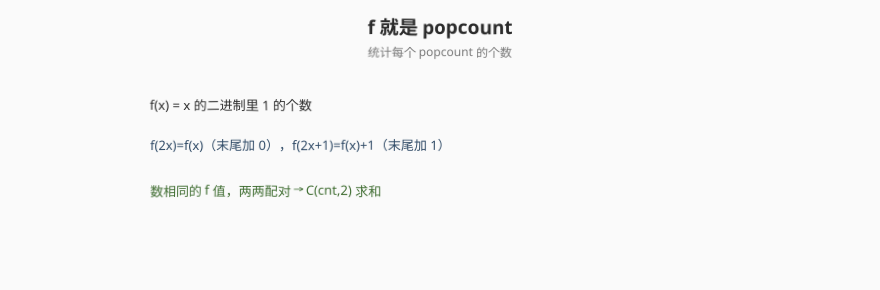

# Codeforces 272B Dima and Sequence 题解

## 1. 题目概述

- **题目链接**：https://codeforces.com/problemset/problem/272/B
- **比赛来源**：Codeforces Round 167 (Div. 2) · Problem B（UTC 2013-02-13）
- **难度**：1400
- **标签**：位运算、计数
- **评测类型**：普通
- **限制**：时间 2 s / 内存 256 MB

**题意**：定义 $f(0)=0$、$f(2x)=f(x)$、$f(2x+1)=f(x)+1$。给定 $n$ 个正整数，问有多少对 $i<j$ 满足 $f(a_i)=f(a_j)$。

**约束**：$n \le 10^5$，$a_i \le 10^9$。

## 2. 示例与观察

官方样例 1：

```text
输入：
3
1 2 4

输出：
3
```

官方样例 2：

```text
输入：
3
5 3 1

输出：
1
```

**观察 1**：递推式正是"二进制末尾是 0 就除以 2，是 1 就除 2 并加 1" → $f(x)$ 就是 $x$ 的二进制中 **1 的个数**（popcount）。

**观察 2**：于是按 popcount 分组，每组 $c$ 个贡献 $\binom{c}{2}$。

**样例验证**：$1,2,4$ 的 popcount 都是 1 → $\binom{3}{2}=3$ ✓；$5,3,1$ 的 popcount 是 $2,2,1$ → 只有 $(1,2)$ → 1 ✓。

## 3. 解题思路



用 `__builtin_popcountll` 分组计数，最后 $\sum \binom{c}{2}$。

## 4. 正确性证明

**引理**：$f(x) = \text{popcount}(x)$。

**证明**：对 $x$ 归纳：$x$ 为偶数时 $x = 2y$，$f(x)=f(y)$ 且 popcount 相同 ✓；$x$ 为奇数时 $x = 2y+1$，$f(x) = f(y)+1$ 且 popcount 也多 1 ✓。∎

**定理**：答案 $= \sum_c \binom{c}{2}$，其中 $c$ 遍历各 popcount 的出现次数。

**证明**：$f(a_i)=f(a_j)$ ⇔ popcount 相同；每组内任取两点即可，共 $\binom{c}{2}$ ✓。∎

## 5. 复杂度分析

- **时间**：$O(n)$。
- **空间**：$O(1)$（bucket 大小 40）。
- **与时限的关系**：时限 2 s，$n = 10^5$ 实测端到端 14.4 ms。

## 6. 参考代码

### C++17

```cpp
#include <bits/stdc++.h>
using namespace std;
int main(){int n;if(scanf("%d",&n)!=1)return 0;
 vector<long long> cnt(40,0);
 for(int i=0;i<n;i++){long long v;scanf("%lld",&v);int c=__builtin_popcountll(v);cnt[c]++;}
 long long ans=0; for(int c=0;c<40;c++) ans+=cnt[c]*(cnt[c]-1)/2;
 printf("%lld\n",ans);return 0;}
```

### Python3

```python
import sys
def main() -> None:
    data = sys.stdin.buffer.read().split()
    n = int(data[0])
    cnt = {}
    for i in range(n):
        v = int(data[1 + i]); c = bin(v).count('1')
        cnt[c] = cnt.get(c, 0) + 1
    print(sum(v * (v - 1) // 2 for v in cnt.values()))
main()
```

## 7. 边界情况与易错点

1. **$a_i$ 可达 $10^9$**：popcount ≤ 30，bucket 开 32+。
2. **答案可能很大**：$\binom{10^5}{2} \approx 5\times10^9$，用 64 位。
3. **$n=1$**：答案 0。
4. **全相同**：答案 $\binom{n}{2}$。

## 8. 验证记录

- **编译环境**：`clang++ -std=c++17 -O2 -Wall`；Python 3.9.6。
- **官方样例**：2 / 2 通过（3、1），C++ 与 Python 一致。
- **独立暴力对拍**：暴力版按递推定义递归求 $f$ 并枚举所有对。随机 250 组 $n \le 8$、$a_i \le 60$，**250 / 250 全部一致**。
- **最大约束性能**：$n = 10^5$，实测端到端 14.4 ms。
- **图片校验**：两张 SVG 已生成并通过 `ElementTree.parse`。
- **复核状态**：verified。

## 相关题目与扩展

- [Codeforces 272A Dima and Friends](https://codeforces.com/problemset/problem/272/A)：同场 A 题。
- [LeetCode 1356. 根据数字二进制下 1 的数目排序](https://leetcode.cn/problems/sort-integers-by-the-number-of-1-bits/)：popcount 的同类应用。

**延伸思考**：

1. **如果定义改成 $f(3x)$**：不再是 popcount，需要另找规律。
2. **如果要求"和为定值"的对数**：换成哈希计数。

