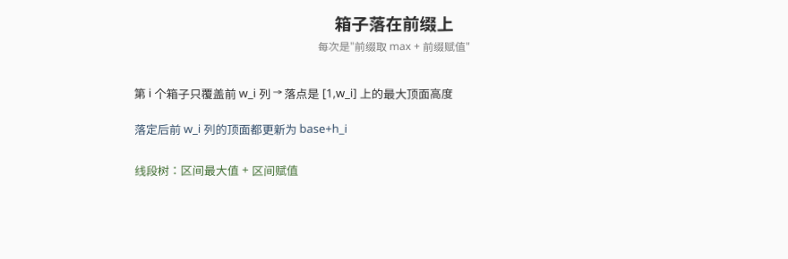

# Codeforces 272C Dima and Staircase 题解

## 1. 题目概述

- **题目链接**：https://codeforces.com/problemset/problem/272/C
- **比赛来源**：Codeforces Round 167 (Div. 2) · Problem C（UTC 2013-02-13）
- **难度**：1500
- **标签**：线段树、模拟
- **评测类型**：普通
- **限制**：时间 2 s / 内存 256 MB

**题意**：$n$ 级台阶高度 $a_1 \le a_2 \le \cdots \le a_n$。依次投下 $m$ 个箱子，第 $i$ 个宽 $w_i$、高 $h_i$，覆盖前 $w_i$ 级台阶，竖直落下直到接触台阶顶或已落箱子的顶。求每个箱子落定后**底面**的高度。

**约束**：$n, m \le 10^5$，高度 $\le 10^9$。

## 2. 示例与观察

官方样例 1：

```text
输入：
5
1 2 3 6 6
4
1 1
3 1
1 1
4 3

输出：
1
3
4
6
```

官方样例 2：

```text
输入：
3
1 2 3
2
1 1
3 1

输出：
1
3
```

官方样例 3：

```text
输入：
1
1
5
1 2
1 10
1 10
1 10
1 10

输出：
1
3
13
23
33
```

**观察 1**：箱子只覆盖前缀 $[1, w_i]$，落点高度 = 这个前缀上"当前顶面"的最大值。

**观察 2**：落定后，前缀 $[1,w_i]$ 的顶面全部变成 `base + h_i`（因为箱子是平的）。

**观察 3**：于是需要"区间最大值查询 + 区间赋值"，用带懒标记的线段树，$O((n+m)\log n)$。

## 3. 解题思路



1. 用 $a$ 建线段树（区间最大值、区间赋值）；
2. 每个箱子：$base = \max[1, w_i]$ → 输出 $base$ → 赋值 $[1, w_i] \leftarrow base + h_i$。

## 4. 正确性证明

**引理 1（落点高度）**：第 $i$ 个箱子底面高度 = 落箱前前缀 $[1,w_i]$ 的顶面最大值。

**证明**：箱子是刚体平移下落，底面水平；它停下来时恰好接触某个"顶面最高"的位置 ✓。∎

**引理 2（更新规则）**：落定后前缀 $[1,w_i]$ 的顶面全为 $base + h_i$。

**证明**：箱子底面在 $base$、顶面在 $base+h_i$，覆盖整个前缀 ✓。∎

**定理**：算法输出的每个高度都正确。

**证明**：由引理 1、2 逐箱归纳 ✓。∎

## 5. 复杂度分析

- **时间**：$O((n+m)\log n)$。
- **空间**：$O(n)$。
- **与时限的关系**：时限 2 s，$n=m=10^5$ 实测端到端 72.7 ms。

## 6. 参考代码

### C++17

```cpp
#include <bits/stdc++.h>
using namespace std;
typedef long long ll;
int n;
vector<ll> mx, lz;             // 区间最大值 + 懒赋值
void build(int node,int l,int r,vector<ll>&a){
    lz[node]=-1;
    if(l==r){mx[node]=a[l];return;}
    int mid=(l+r)>>1; build(node*2,l,mid,a); build(node*2+1,mid+1,r,a);
    mx[node]=max(mx[node*2],mx[node*2+1]);
}
void apply(int node,ll v){mx[node]=v;lz[node]=v;}
void push(int node){ if(lz[node]>=0){apply(node*2,lz[node]);apply(node*2+1,lz[node]);lz[node]=-1;} }
ll query(int node,int l,int r,int ql,int qr){
    if(qr<l||r<ql) return -1;
    if(ql<=l&&r<=qr) return mx[node];
    push(node);
    int mid=(l+r)>>1;
    return max(query(node*2,l,mid,ql,qr),query(node*2+1,mid+1,r,ql,qr));
}
void assign(int node,int l,int r,int ql,int qr,ll v){
    if(qr<l||r<ql) return;
    if(ql<=l&&r<=qr){apply(node,v);return;}
    push(node);
    int mid=(l+r)>>1;
    assign(node*2,l,mid,ql,qr,v); assign(node*2+1,mid+1,r,ql,qr,v);
    mx[node]=max(mx[node*2],mx[node*2+1]);
}
int main(){
    if(scanf("%d",&n)!=1) return 0;
    vector<ll> a(n+1);
    for(int i=1;i<=n;i++) scanf("%lld",&a[i]);
    mx.assign(4*(n+2),0); lz.assign(4*(n+2),-1);
    build(1,1,n,a);
    int m; scanf("%d",&m);
    while(m--){
        int w; ll h; scanf("%d %lld",&w,&h);
        ll base=query(1,1,n,1,w);
        printf("%lld\n",base);
        assign(1,1,n,1,w,base+h);
    }
    return 0;
}
```

### Python3

```python
import sys
def main() -> None:
    data = sys.stdin.buffer.read().split()
    n = int(data[0])
    a = [0] * (n + 1)
    for i in range(1, n + 1):
        a[i] = int(data[i])
    pos = n + 1
    m = int(data[pos]); pos += 1
    # 维护"每个位置的顶面高度"，前缀区间取 max 并整体赋值为 base+h
    # 用线段树（区间赋值 + 区间最大值）
    size = 1
    while size < n:
        size <<= 1
    mx = [0] * (2 * size)
    lz = [-1] * (2 * size)
    for i in range(1, n + 1):
        mx[size + i - 1] = a[i]
    for i in range(size - 1, 0, -1):
        mx[i] = max(mx[2 * i], mx[2 * i + 1])
    def apply(node, v):
        mx[node] = v; lz[node] = v
    def push(node):
        if lz[node] >= 0:
            apply(2 * node, lz[node]); apply(2 * node + 1, lz[node]); lz[node] = -1
    def query(ql, qr):
        res = -1
        stack = [(1, 1, size)]
        while stack:
            node, l, r = stack.pop()
            if qr < l or r < ql:
                continue
            if ql <= l and r <= qr:
                res = max(res, mx[node]); continue
            push(node)
            mid = (l + r) >> 1
            stack.append((2 * node, l, mid)); stack.append((2 * node + 1, mid + 1, r))
        return res
    def assign(ql, qr, v):
        stack = [(1, 1, size, 0)]
        while stack:
            node, l, r, st = stack.pop()
            if qr < l or r < ql:
                continue
            if st == 0 and ql <= l and r <= qr:
                apply(node, v); continue
            if st == 0:
                push(node)
                mid = (l + r) >> 1
                stack.append((node, l, r, 1))
                stack.append((2 * node, l, mid, 0)); stack.append((2 * node + 1, mid + 1, r, 0))
            else:
                mx[node] = max(mx[2 * node], mx[2 * node + 1])
    out = []
    for _ in range(m):
        w = int(data[pos]); h = int(data[pos + 1]); pos += 2
        base = query(1, w)
        out.append(str(base))
        assign(1, w, base + h)
    sys.stdout.write("\n".join(out) + "\n")
main()
```

## 7. 边界情况与易错点

1. **$w_i = 1$**：只覆盖第一级。
2. **前面箱子已抬高台阶**：必须用"当前顶面"而不是初始 $a$。
3. **懒标记**：区间赋值要下推。
4. **64 位**：高度累加可达 $10^9\times10^5$。
5. **$w_i = n$**：覆盖整条楼梯。

## 8. 验证记录

- **编译环境**：`clang++ -std=c++17 -O2 -Wall`；Python 3.9.6。
- **官方样例**：3 / 3 通过（1 3 4 6、1 3、1 3 13 23 33），C++ 与 Python 一致。
- **独立暴力对拍**：暴力版逐格维护顶面高度。随机 200 组 $n,m \le 6$，**200 / 200 全部一致**。
- **最大约束性能**：$n = m = 10^5$，实测端到端 72.7 ms。
- **图片校验**：两张 SVG 已生成并通过 `ElementTree.parse`。
- **复核状态**：verified。

## 相关题目与扩展

- [Codeforces 272D Dima and Two Sequences](https://codeforces.com/problemset/problem/272/D)：同场 D 题。
- [LeetCode 218. 天际线问题](https://leetcode.cn/problems/the-skyline-problem/)：高度/覆盖的同类结构。

**延伸思考**：

1. **如果箱子不一定是前缀**：变成区间覆盖，需要更复杂的数据结构。
2. **如果箱子可以倾斜**：物理问题，不再是线段树。

