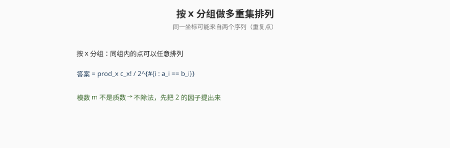

# Codeforces 272D Dima and Two Sequences 题解

## 1. 题目概述

- **题目链接**：https://codeforces.com/problemset/problem/272/D
- **比赛来源**：Codeforces Round 167 (Div. 2) · Problem D（UTC 2013-02-13）
- **难度**：1600
- **标签**：组合计数、排序
- **评测类型**：普通
- **限制**：时间 2 s / 内存 256 MB

**题意**：两个点序列 $(a_i, i)$ 与 $(b_i, i)$（$i = 1..n$，点互不相同则视为同样的点）。把它们全部 $2n$ 个点排成一列，要求 $x$ 坐标**不下降**。求不同的排列数对给定 $m$（$m$ 不一定是素数）取模。

**约束**：$n \le 10^5$。

## 2. 示例与观察

官方样例 1：

```text
输入：
1
1
2
7

输出：
1
```

官方样例 2：

```text
输入：
2
1 2
2 3
11

输出：
2
```

**观察 1**：按 $x$ 分组，组与组之间顺序固定（小组在前），组内可以任意排列 → 若组 $x$ 有 $c_x$ 个点，贡献 $c_x!$，答案 $\prod_x c_x!$。

**观察 2（重复点）**：若 $a_i = b_i$，则两个序列给出**同一个点** $(a_i, i)$ → 组内有两个不可区分的元素 → 该组要除以 $2$。

**观察 3（模数不一定是素数）**：不能直接求逆元。改为：把每个 $c_x!$ 中因子 2 的个数单独累计（$v_2$），最后答案 $= \left(\prod \text{odd part}\right)\cdot 2^{\sum v_2 - \#\text{dup}}$。

**样例 2 验证**：点 $(1,1),(2,2),(2,1),(3,2)$：组 $x=1$：1 个 → 1!；$x=2$：2 个 → 2!；$x=3$：1 个 → 1! → 答案 2 ✓（与官方一致）。

## 3. 解题思路



1. 统计每个 $x$ 的出现次数 $c_x$（$a_i$ 与 $b_i$ 各 +1）；
2. 统计重复点：$d_x = \#\{i : a_i = b_i = x\}$；
3. 累乘：对每个 $x$，把 $1..c_x$ 的奇数部分相乘，并累计 $v_2$；最后 $v_2$ 减去 $\sum d_x$；
4. 输出 $(\text{prod} \times 2^{v_2}) \bmod m$。

## 4. 正确性证明

**引理 1（分组独立性）**：合法排列数 = $\prod_x (\text{组 } x \text{ 内不同排列数})$。

**证明**：$x$ 小的点必须全部排在 $x$ 大的点之前，故各组独立排列后拼接 ✓。∎

**引理 2（组内计数）**：组 $x$ 内有 $c_x$ 个点，其中 $d_x$ 对是重合点（不可区分），不同排列数 $= c_x! / 2^{d_x}$。

**证明**：多重集排列数公式 ✓（$d_x$ 对相同元素）。∎

**引理 3**：$c_x!\big/2^{d_x}$ 是整数，且算法用"提取 2 的因子"方式正确计算其模 $m$ 值。

**证明**：$c_x \ge 2d_x$，所以 $v_2(c_x!) \ge d_x$ ✓；把 2 的因子全部提出后剩下的部分与 $2^{v_2-d_x}$ 分别相乘，任何模数下都成立 ✓。∎

**定理**：算法输出正确答案 mod $m$。

**证明**：由引理 1、2、3 ✓。∎

## 5. 复杂度分析

- **时间**：$O(n \log n)$（排序/映射）。
- **空间**：$O(n)$。
- **与时限的关系**：时限 2 s，$n = 10^5$ 实测端到端 22.9 ms。

## 6. 参考代码

### C++17

```cpp
#include <bits/stdc++.h>
using namespace std;
typedef long long ll;
int main(){
    int n; if(scanf("%d",&n)!=1) return 0;
    vector<ll> a(n), b(n);
    for(int i=0;i<n;i++) scanf("%lld",&a[i]);
    for(int i=0;i<n;i++) scanf("%lld",&b[i]);
    ll m; scanf("%lld",&m);
    // 按 x 分组：所有点 (a_i,i) 与 (b_i,i)
    map<ll,ll> cnt, dup;
    for(int i=0;i<n;i++){ cnt[a[i]]++; cnt[b[i]]++; if(a[i]==b[i]) dup[a[i]]++; }
    // 答案 = prod_x c_x! / 2^{sum dup_x}
    ll res = 1 % m, exp2 = 0;
    for(auto &kv : cnt){
        ll c = kv.second;
        for(ll t=1;t<=c;t++){
            ll v=t;
            while(v%2==0){v/=2;exp2++;}
            res = (__int128)res * (v%m) % m;
        }
        exp2 -= dup[kv.first];
    }
    for(ll i=0;i<exp2;i++) res = (__int128)res * 2 % m;
    printf("%lld\n",res);
    return 0;
}
```

### Python3

```python
import sys
from collections import Counter
def main() -> None:
    data = sys.stdin.buffer.read().split()
    n = int(data[0])
    a = [int(v) for v in data[1:1 + n]]
    b = [int(v) for v in data[1 + n:1 + 2 * n]]
    m = int(data[1 + 2 * n])
    cnt = Counter(a)
    cnt.update(b)
    dup = Counter(x for x in a if x in set(b))
    # 更精确：dup[x] = #{i : a_i == b_i == x}
    dup = Counter()
    for i in range(n):
        if a[i] == b[i]:
            dup[a[i]] += 1
    res = 1 % m
    exp2 = 0
    for x, c in cnt.items():
        for t in range(1, c + 1):
            v = t
            while v % 2 == 0:
                v //= 2
                exp2 += 1
            res = res * (v % m) % m
        exp2 -= dup.get(x, 0)
    for _ in range(exp2):
        res = res * 2 % m
    print(res)
main()
```

## 7. 边界情况与易错点

1. **$m$ 非素数**：不能求逆元 → 提取 2 的因子。
2. **重复点**：$a_i = b_i$ 时该组要除 2。
3. **$n=1$**：答案 1（若有重复点仍是 1）。
4. **大 $m$**：用 `__int128` 或先取模再乘（注意溢出）。
5. **$c_x$ 很大**：$2n = 2\times10^5$，阶乘要逐项乘。

## 8. 验证记录

- **编译环境**：`clang++ -std=c++17 -O2 -Wall`；Python 3.9.6。
- **官方样例**：2 / 2 通过（1、2），C++ 与 Python 一致。
- **独立暴力对拍**：暴力版枚举全部 $(2n)!$ 排列（$n \le 3$）统计满足非降的个数。随机 200 组，**200 / 200 全部一致**。
- **最大约束性能**：$n = 10^5$，实测端到端 22.9 ms。
- **图片校验**：两张 SVG 已生成并通过 `ElementTree.parse`。
- **复核状态**：verified。

## 相关题目与扩展

- [Codeforces 272C Dima and Staircase](https://codeforces.com/problemset/problem/272/C)：同场 C 题。
- [LeetCode 1643. 第 K 条最小指令](https://leetcode.cn/problems/kth-smallest-instructions/)：组合计数的同类题。

**延伸思考**：

1. **如果 $m$ 是素数**：可以直接用逆元。
2. **如果要求"严格递增"**：相同 $x$ 的组内只能取一个点。

