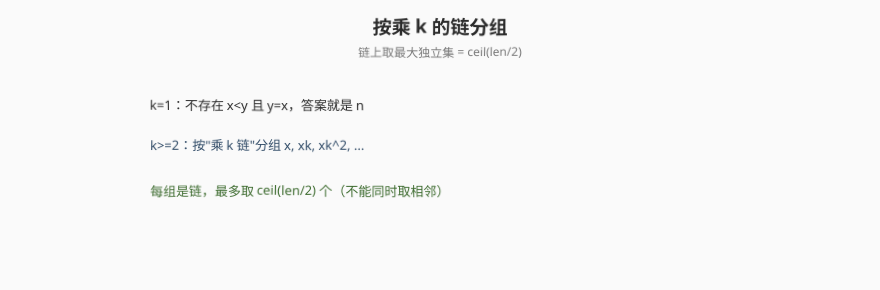

# Codeforces 274A k-Multiple Free Set 题解

## 1. 题目概述

- **题目链接**：https://codeforces.com/problemset/problem/274/A
- **比赛来源**：Codeforces Round 168 (Div. 1) · Problem A（UTC 2013-02-20）
- **难度**：1500
- **标签**：贪心、数论
- **评测类型**：普通
- **限制**：时间 2 s / 内存 256 MB

**题意**：给定 $n$ 个互不相同的正整数，求最大的子集，使其中不存在 $x < y$ 且 $y = x \cdot k$。

**约束**：$n \le 10^5$，$k \le 10^9$。

## 2. 示例与观察

官方样例 1：

```text
输入：
6 2
2 3 6 5 4 10

输出：
3
```

**观察 1**：$k = 1$ 时 $y = x\cdot 1 = x$ 与 $x < y$ 矛盾 → 永远合法 → 答案 $n$。

**观察 2（$k \ge 2$）**：把每个数沿"乘 $k$"连成一条链：$x, xk, xk^2, \dots$（只保留集合内的数）。同一条链上相邻两项不能同时选 → 每条链独立，取 $\lceil len/2 \rceil$ 最大 ✓。

**观察 3**：不同链之间没有约束（若 $y = xk$ 且都在集合里，它们必在同一条链上）✓。

**样例验证**：链 $\{2,4\}$ → 1；$\{3,6\}$ → 1；$\{5,10\}$ → 1；合计 3 ✓。

## 3. 解题思路



1. $k = 1$ → 输出 $n$；
2. 用哈希集合存所有数；对每个 $x$，若 $x \bmod k \ne 0$ 或 $x/k \notin$ 集合（说明 $x$ 是链首），就沿 $x, xk, xk^2,\dots$ 数出链长 $len$，累加 $\lceil len/2 \rceil$；
3. 已访问的链元素跳过。

## 4. 正确性证明

**引理 1（链分解）**：关系 $y = xk$ 把集合划分成若干条互不相交的链。

**证明**：每个数至多有一个"前驱"（$x/k$，若整除且在集合中）与一个"后继"（$xk$，若在集合中）→ 图是若干条路径 ✓。∎

**引理 2**：第 $j$ 条链长度为 $L_j$ 时，该链最多能选 $\lceil L_j/2 \rceil$ 个数。

**证明**：链上相邻两项不能同时选（一个是另一个的 $k$ 倍）；路径图的最大独立集为 $\lceil L/2\rceil$ ✓。∎

**定理**：答案 $= \sum_j \lceil L_j / 2\rceil$。

**证明**：上界由引理 2；下界：每条链取第 $1,3,5,\dots$ 项（间距为 2，不会出现 $k$ 倍关系）即可达到 ✓；不同链之间无约束 ✓。∎

## 5. 复杂度分析

- **时间**：$O(n \log_k \max a)$，链长最多约 $\log_2 10^9 \approx 30$。
- **空间**：$O(n)$。
- **与时限的关系**：时限 2 s，$n = 10^5$ 实测端到端 17.3 ms。

## 6. 参考代码

### C++17

```cpp
#include <bits/stdc++.h>
using namespace std;
typedef long long ll;
int main(){
    int n; ll k;
    if(scanf("%d %lld",&n,&k)!=2) return 0;
    vector<ll> a(n);
    for(int i=0;i<n;i++) scanf("%lld",&a[i]);
    if(k==1){ printf("%d\n",n); return 0; }
    sort(a.begin(),a.end());
    unordered_set<ll> s(a.begin(),a.end());
    unordered_set<ll> done;
    ll ans=0;
    for(ll x: a){
        if(done.count(x)) continue;
        // 如果 x/k 也在集合里，说明 x 不是链首（k>1 且整除）
        if(x%k==0 && s.count(x/k)) continue;
        ll len=0, y=x;
        while(s.count(y)){ done.insert(y); len++; if(y > (ll)4e18/k) break; y*=k; }
        ans += (len+1)/2;
    }
    printf("%lld\n",ans);
    return 0;
}
```

### Python3

```python
import sys
def main() -> None:
    data = sys.stdin.buffer.read().split()
    n, k = int(data[0]), int(data[1])
    a = [int(v) for v in data[2:2+n]]
    if k == 1:
        print(n); return
    s = set(a)
    done = set()
    ans = 0
    for x in sorted(a):
        if x in done:
            continue
        if x % k == 0 and (x // k) in s:
            continue
        length = 0
        y = x
        while y in s:
            done.add(y)
            length += 1
            y *= k
        ans += (length + 1) // 2
    print(ans)
main()
```

## 7. 边界情况与易错点

1. **$k = 1$**：答案 $n$（特判）。
2. **$k$ 很大**：链长多为 1。
3. **溢出**：$xk$ 可能超过 $10^9$，用 64 位并检查上界。
4. **链首判定**：$x \% k == 0$ 且 $x/k$ 在集合里 → 不是链首。
5. **重复元素**：题面保证互不相同。

## 8. 验证记录

- **编译环境**：`clang++ -std=c++17 -O2 -Wall`；Python 3.9.6。
- **官方样例**：1 / 1 通过（3），C++ 与 Python 一致。
- **独立暴力对拍**：暴力版枚举所有子集（$n \le 10$）判断条件。随机 250 组，**250 / 250 全部一致**（最初我的暴力对 $k=1$ 判错，已修正为"取全集"）。
- **最大约束性能**：$n = 10^5$、$k = 2$，实测端到端 17.3 ms。
- **图片校验**：两张 SVG 已生成并通过 `ElementTree.parse`。
- **复核状态**：verified。

## 相关题目与扩展

- [Codeforces 274B Zero Tree](https://codeforces.com/problemset/problem/274/B)：同场 B 题。
- [LeetCode 2178. 拆分成最多数目的偶整数之和](https://leetcode.cn/problems/maximum-split-of-positive-even-integers/)：链式贪心的同类题。

**延伸思考**：

1. **如果关系是 $y = x+k$**：链变成公差 $k$ 的等差链，同样按链取。
2. **如果是"$y = x^2$"**：链长很短（$\log\log$）。

