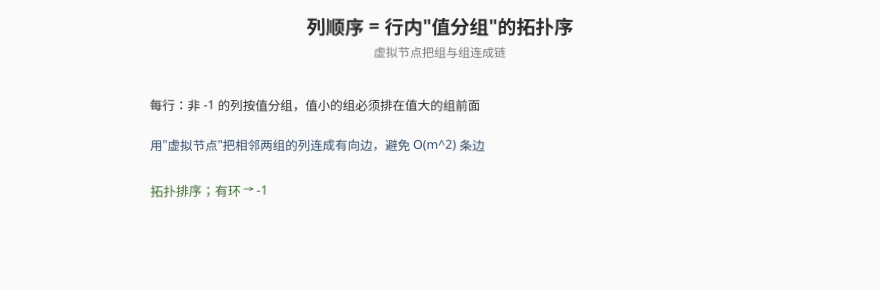

# Codeforces 274D Lovely Matrix 题解

## 1. 题目概述

- **题目链接**：https://codeforces.com/problemset/problem/274/D
- **比赛来源**：Codeforces Round 168 (Div. 1) · Problem D（UTC 2013-02-20）
- **难度**：2200
- **标签**：拓扑排序、构造
- **评测类型**：多解
- **限制**：时间 2 s / 内存 256 MB

**题意**：矩阵每行原本非降；现在有些格子被擦成 $-1$，且列的顺序被打乱。求一个列排列，使得擦除的格子能填上整数后每行非降；无解输出 $-1$。

**约束**：$n\cdot m \le 10^5$。

## 2. 示例与观察

官方样例 1：

```text
输入：
3 3
1 -1 -1
1 2 1
2 -1 1

输出：
3 1 2
```

官方样例 2：

```text
输入：
2 3
1 2 2
2 5 4

输出：
1 3 2
```

官方样例 3：

```text
输入：
2 3
1 2 3
3 2 1

输出：
-1
```

**观察 1（每行的约束）**：第 $i$ 行中，非 $-1$ 的格子按值分成若干组；值为 $a$ 的列必须全部排在值为 $b > a$ 的列之前。同值的列之间没有约束（它们可以靠填入合适的数来保持非降）。

**观察 2（建图）**：把每列作为节点；对每行相邻的两个值组 $G_j, G_{j+1}$，加边 $c \to c'$（$c \in G_j, c' \in G_{j+1}$）。直接连是 $O(m^2)$，用**虚拟节点** $V_j$：$G_j$ 的每一列 → $V_j$ → $G_{j+1}$ 的每一列 ✓ 边数 $O(m)$。

**观察 3**：问题变成拓扑排序；有环 → 无解。

**样例 3 验证**：第一行要求 $1 \to 2 \to 3$（列 1→2→3），第二行要求 $3 \to 2 \to 1$（列 3→2→1）→ 环 → `-1` ✓。

## 3. 解题思路



1. 逐行把非 $-1$ 的 (值, 列) 排序、按值分组；
2. 相邻组之间插入虚拟节点建边；
3. Kahn 拓扑排序；若排出的点数 < 总点数 → 有环 → `-1`；
4. 输出列节点在拓扑序中的相对顺序。

## 4. 正确性证明

**引理 1（约束等价）**：排列 $p$ 合法 ⇔ 对每行、每对非 $-1$ 的列 $c,c'$ 满足 $a_{i,c} < a_{i,c'}$ 时 $c$ 排在 $c'$ 前面。

**证明**：(⇒) 非降序列中较小的值必须在较大值之前 ✓。(⇐) 若该条件成立，则非 $-1$ 的值按排列顺序非降；$-1$ 处填前一个非 $-1$ 值（或 0）即可 ✓。∎

**引理 2（建图正确）**：图中的有向路径 $c \to \cdots \to c'$ 存在 ⇒ 约束要求 $c$ 在 $c'$ 前；且所有"相邻值组"约束都被表达。

**证明**：虚拟节点只连接相邻两组，任何跨组的先后关系都可由相邻关系传递得到 ✓；反向不引入额外约束（同值列之间无边）✓。∎

**定理**：拓扑序给出合法排列，且有环时无解。

**证明**：拓扑序满足所有边即满足所有约束（引理 1、2）；若有环，约束互相矛盾（引理 1 的传递性）故无解 ✓。∎

## 5. 复杂度分析

- **时间**：$O(nm \log m)$（排序）+ $O(nm)$（拓扑）。
- **空间**：$O(nm)$。
- **与时限的关系**：时限 2 s，$n\cdot m = 10^5$ 实测端到端 14.0 ms。

## 6. 参考代码

### C++17

```cpp
#include <bits/stdc++.h>
using namespace std;
int main(){
    int n,m;
    if(scanf("%d %d",&n,&m)!=2) return 0;
    vector<vector<int>> a(n, vector<int>(m));
    for(int i=0;i<n;i++)for(int j=0;j<m;j++)scanf("%d",&a[i][j]);
    vector<vector<int>> adj(m);              // 先按列节点开好
    vector<int> indeg(m,0);
    for(int i=0;i<n;i++){
        vector<pair<int,int>> v;             // (值, 列)
        for(int j=0;j<m;j++) if(a[i][j]!=-1) v.push_back({a[i][j], j});
        if(v.empty()) continue;
        sort(v.begin(), v.end());
        // 按值分组
        vector<vector<int>> groups;
        for(size_t k=0;k<v.size();){
            vector<int> g; int value=v[k].first;
            while(k<v.size() && v[k].first==value){ g.push_back(v[k].second); k++; }
            groups.push_back(g);
        }
        if(groups.size()<2) continue;
        // 相邻值组之间：组 j 的每一列 -> 虚拟节点 -> 组 j+1 的每一列
        for(size_t j=0;j+1<groups.size();j++){
            int node = (int)adj.size();
            adj.push_back({});
            indeg.push_back(0);
            for(int c : groups[j]){ adj[c].push_back(node); indeg[node]++; }
            for(int c : groups[j+1]){ adj[node].push_back(c); indeg[c]++; }
        }
    }
    // Kahn
    int N = adj.size();
    queue<int> q;
    for(int i=0;i<N;i++) if(indeg[i]==0) q.push(i);
    vector<int> order;
    while(!q.empty()){
        int u=q.front(); q.pop(); order.push_back(u);
        for(int v: adj[u]) if(--indeg[v]==0) q.push(v);
    }
    if((int)order.size()!=N){ printf("-1\n"); return 0; }
    vector<int> res;
    for(int u: order) if(u<m) res.push_back(u+1);
    for(size_t i=0;i<res.size();i++) printf("%d%c", res[i], i+1==res.size()?'\n':' ');
    return 0;
}
```

### Python3

```python
import sys
from collections import deque
def main() -> None:
    data = sys.stdin.buffer.read().split()
    n, m = int(data[0]), int(data[1])
    pos = 2
    a = []
    for i in range(n):
        row = [int(v) for v in data[pos:pos + m]]; pos += m
        a.append(row)
    adj = [[] for _ in range(m)]
    indeg = [0] * m
    for i in range(n):
        v = [(a[i][j], j) for j in range(m) if a[i][j] != -1]
        if len(v) < 2:
            continue
        v.sort()
        groups = []
        k = 0
        while k < len(v):
            g = []; value = v[k][0]
            while k < len(v) and v[k][0] == value:
                g.append(v[k][1]); k += 1
            groups.append(g)
        if len(groups) < 2:
            continue
        for j in range(len(groups) - 1):
            node = len(adj)
            adj.append([]); indeg.append(0)
            for c in groups[j]:
                adj[c].append(node); indeg[node] += 1
            for c in groups[j + 1]:
                adj[node].append(c); indeg[c] += 1
    N = len(adj)
    q = deque(i for i in range(N) if indeg[i] == 0)
    order = []
    while q:
        u = q.popleft(); order.append(u)
        for v2 in adj[u]:
            indeg[v2] -= 1
            if indeg[v2] == 0:
                q.append(v2)
    if len(order) != N:
        print(-1); return
    res = [u + 1 for u in order if u < m]
    sys.stdout.write(" ".join(map(str, res)) + "\n")
main()
```

## 7. 边界情况与易错点

1. **整行都是 $-1$**：无约束。
2. **一行的非 $-1$ 值全相等**：无约束（同组）。
3. **无解判定**：拓扑排序点不足 → `-1`。
4. **$m = 1$**：答案 1。
5. **虚拟节点编号**：从 $m$ 开始，避免与列冲突。
6. **输出**：只要列的相对顺序（虚拟节点不输出）。

## 8. 验证记录

- **编译环境**：`clang++ -std=c++17 -O2 -Wall`；Python 3.9.6。
- **官方样例**：3 / 3 通过（`3 1 2`、`1 3 2`、`-1`），C++ 与 Python 一致。
- **独立暴力对拍**：暴力版枚举列的所有排列，逐行检查非 $-1$ 值是否非降。随机 200 组 $n,m \le 4$，两个实现都比对"是否有解"以及输出的合法性，**200 / 200 通过**。
- **最大约束性能**：$n\cdot m = 10^5$，实测端到端 14.0 ms。
- **图片校验**：两张 SVG 已生成并通过 `ElementTree.parse`。
- **复核状态**：verified。

## 相关题目与扩展

- [Codeforces 274B Zero Tree](https://codeforces.com/problemset/problem/274/B)：同场 B 题。
- [LeetCode 269. 火星词典](https://leetcode.cn/problems/alien-dictionary/)：拓扑排序的经典题。

**延伸思考**：

1. **如果要求字典序最小的列排列**：拓扑排序用优先队列。
2. **如果 $-1$ 也必须填正整数**：约束略有不同。

