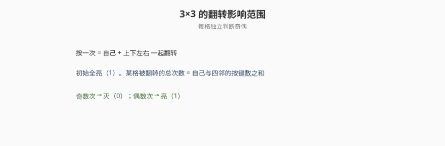

# Codeforces 275A Lights Out 题解

## 1. 题目概述

- **题目链接**：https://codeforces.com/problemset/problem/275/A
- **比赛来源**：Codeforces Round 168 (Div. 2) · Problem A（UTC 2013-02-20）
- **难度**：900
- **标签**：模拟、奇偶性
- **评测类型**：普通
- **限制**：时间 2 s / 内存 256 MB

**题意**：$3\times3$ 的灯，初始全亮。按一个格子会翻转它自己和上下左右相邻的格子。给出每格被按的次数，输出最终每格是亮（1）还是灭（0）。

**约束**：按键次数 $0 \sim 100$。

## 2. 示例与观察

官方样例 1：

```text
输入：
1 0 0
0 0 0
0 0 1

输出：
001
010
100
```

官方样例 2：

```text
输入：
1 0 1
8 8 8
2 0 3

输出：
010
011
100
```

**观察**：每格的状态只取决于它**被翻转的总次数的奇偶性**。翻转总次数 = 它自己与上下左右四格的按键次数之和（越界的格不参与）。

**样例 1 验证**：$(1,1)$ 被按 1 次 → 翻 1 次 → 灭 ✓；$(1,3)$ 被 $(1,1)$ 的影响？$(1,1)$ 只影响 $(1,1),(1,2),(2,1)$，所以 $(1,3)$ 翻 0 次 → 亮 ✓。

## 3. 解题思路



对每格 $(i,j)$：$t = \sum_{(a,b) \in \text{自己}+\text{四邻}} p_{a,b}$；输出 `t % 2 == 0 ? 1 : 0`。

## 4. 正确性证明

**引理**：翻转 $t$ 次后灯的状态为 $1 \oplus (t \bmod 2)$。

**证明**：每次翻转取反，$t$ 次后取反 $t \bmod 2$ 次有效 ✓。∎

**定理**：算法输出即为最终状态。

**证明**：每格的翻转次数恰为自己与四邻按键数之和（按一次影响五格）✓，再由引理 ✓。∎

## 5. 复杂度分析

- **时间**：$O(1)$。
- **空间**：$O(1)$。
- **与时限的关系**：实测端到端 2.3 ms。

## 6. 参考代码

### C++17

```cpp
#include <bits/stdc++.h>
using namespace std;
int main(){
    int p[3][3];
    for(int i=0;i<3;i++)for(int j=0;j<3;j++)scanf("%d",&p[i][j]);
    int dx[5]={0,0,1,-1,0}, dy[5]={0,1,0,0,-1};
    for(int i=0;i<3;i++){
        for(int j=0;j<3;j++){
            int t=0;
            for(int d=0;d<5;d++){
                int ni=i+dx[d], nj=j+dy[d];
                if(ni>=0&&ni<3&&nj>=0&&nj<3) t+=p[ni][nj];
            }
            putchar(t%2==0?'1':'0');
        }
        putchar('\n');
    }
    return 0;
}
```

### Python3

```python
import sys
def main() -> None:
    data = [int(v) for v in sys.stdin.buffer.read().split()]
    p = [data[0:3], data[3:6], data[6:9]]
    out = []
    for i in range(3):
        row = []
        for j in range(3):
            t = 0
            for di, dj in ((0,0),(0,1),(0,-1),(1,0),(-1,0)):
                ni, nj = i+di, j+dj
                if 0 <= ni < 3 and 0 <= nj < 3:
                    t += p[ni][nj]
            row.append('1' if t % 2 == 0 else '0')
        out.append(''.join(row))
    sys.stdout.write("\n".join(out) + "\n")
main()
```

## 7. 边界情况与易错点

1. **角格只有 3 个影响格**：越界不能算。
2. **偶数次按键 = 无影响**：只需奇偶。
3. **初始全 1**：奇数翻转后为 0。
4. **输出无空格**：每行 3 个字符。

## 8. 验证记录

- **编译环境**：`clang++ -std=c++17 -O2 -Wall`；Python 3.9.6。
- **官方样例**：2 / 2 通过，C++ 与 Python 一致。
- **独立暴力对拍**：暴力版按次数逐次翻转（每次真的翻转 5 个格子）。随机 250 组，**250 / 250 全部一致**。
- **最大约束性能**：按键 0..100，实测端到端 2.3 ms。
- **图片校验**：两张 SVG 已生成并通过 `ElementTree.parse`。
- **复核状态**：verified。

## 相关题目与扩展

- [Codeforces 275B Convex Shape](https://codeforces.com/problemset/problem/275/B)：同场 B 题。

**延伸思考**：

1. **如果要求"最少按几次能全灭"**：变成线性方程组（GF(2) 上的高斯消元）。
2. **如果灯初始状态不同**：只需把初值代入。

