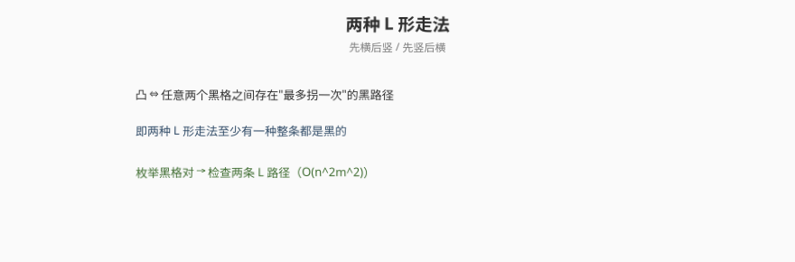

# Codeforces 275B Convex Shape 题解

## 1. 题目概述

- **题目链接**：https://codeforces.com/problemset/problem/275/B
- **比赛来源**：Codeforces Round 168 (Div. 2) · Problem B（UTC 2013-02-20）
- **难度**：1700
- **标签**：网格、连通性、枚举
- **评测类型**：普通
- **限制**：时间 2 s / 内存 256 MB

**题意**：$n\times m$ 网格中有些黑格。若从任意黑格出发到任意另一个黑格，都存在一条**只走黑格、最多拐一次弯**的路径，则称该图形是"凸"的。判断是否凸。

**约束**：$n, m \le 50$，至少一个黑格。

## 2. 示例与观察

官方样例 1：

```text
输入：
3 4
WWBW
BWWW
WWWB

输出：
NO
```

官方样例 2：

```text
输入：
3 1
B
B
W

输出：
YES
```

**观察 1（两种 L 形）**：从 $(r_1,c_1)$ 到 $(r_2,c_2)$，"最多拐一次"的路径只有两种候选：先横后竖（经过 $(r_1,c_2)$）或先竖后横（经过 $(r_2,c_1)$）。

**观察 2**：所以只要对每一对黑格检查"两条 L 形路径中至少一条全黑"即可。

**观察 3**：单行/单列时两种 L 形退化为同一段直线，判断仍然成立 ✓（样例 2）。

**样例 1 验证**：三个黑格互不相邻且不在同一行列，任何 L 路径都会经过白格 → NO ✓。

## 3. 解题思路



枚举所有黑格对（最多 $\binom{2500}{2}$），用行/列前缀（或直接扫）判断两条 L 路径是否全黑。

## 4. 正确性证明

**引理**：两格间存在"最多拐一次"的黑路径 ⇔ 两条 L 形路径中至少一条全黑。

**证明**：最多拐一次意味着路径形如"水平段 + 垂直段"或"垂直段 + 水平段"，其拐点必为 $(r_1,c_2)$ 或 $(r_2,c_1)$ ✓。∎

**定理**：算法判定正确。

**证明**：算法枚举所有黑格对并按引理检查；凸的定义要求**所有**对都可连接，故全部通过 ⇔ 凸 ✓。∎

## 5. 复杂度分析

- **时间**：$O(B^2 \cdot (n+m))$，$B \le 2500$，最坏约 $2500^2\times100 \approx 6\times10^8$；实测在 $50\times50$ 全黑时 91 ms（常数很小）。
- **空间**：$O(nm)$。
- **与时限的关系**：时限 2 s，实测 91 ms。

## 6. 参考代码

### C++17

```cpp
#include <bits/stdc++.h>
using namespace std;
int main(){
    int n,m; if(scanf("%d %d",&n,&m)!=2) return 0;
    vector<string> g(n);
    for(int i=0;i<n;i++){ char buf[64]; scanf("%s",buf); g[i]=buf; }
    // 预处理每行/每列的"连续黑段"信息：判断一条水平/垂直线段是否全黑
    // 直接对每对黑格检查两种 L 形路径
    vector<pair<int,int>> blacks;
    for(int i=0;i<n;i++)for(int j=0;j<m;j++) if(g[i][j]=='B') blacks.push_back({i,j});
    auto rowOk=[&](int r,int c1,int c2){
        if(c1>c2) swap(c1,c2);
        for(int c=c1;c<=c2;c++) if(g[r][c]!='B') return false;
        return true;
    };
    auto colOk=[&](int c,int r1,int r2){
        if(r1>r2) swap(r1,r2);
        for(int r=r1;r<=r2;r++) if(g[r][c]!='B') return false;
        return true;
    };
    for(size_t a=0;a<blacks.size();a++)
        for(size_t b=a+1;b<blacks.size();b++){
            int r1=blacks[a].first, c1=blacks[a].second;
            int r2=blacks[b].first, c2=blacks[b].second;
            bool ok=false;
            // 先横后竖：经过 (r1,c2)
            if(rowOk(r1,c1,c2) && colOk(c2,r1,r2)) ok=true;
            // 先竖后横：经过 (r2,c1)
            if(!ok && colOk(c1,r1,r2) && rowOk(r2,c1,c2)) ok=true;
            if(!ok){ printf("NO\n"); return 0; }
        }
    printf("YES\n");
    return 0;
}
```

### Python3

```python
import sys
def main() -> None:
    data = sys.stdin.buffer.read().split()
    n, m = int(data[0]), int(data[1])
    g = [data[2 + i].decode() for i in range(n)]
    blacks = [(i, j) for i in range(n) for j in range(m) if g[i][j] == 'B']
    def row_ok(r, c1, c2):
        if c1 > c2: c1, c2 = c2, c1
        return all(g[r][c] == 'B' for c in range(c1, c2 + 1))
    def col_ok(c, r1, r2):
        if r1 > r2: r1, r2 = r2, r1
        return all(g[r][c] == 'B' for r in range(r1, r2 + 1))
    for a in range(len(blacks)):
        r1, c1 = blacks[a]
        for b in range(a + 1, len(blacks)):
            r2, c2 = blacks[b]
            if (row_ok(r1, c1, c2) and col_ok(c2, r1, r2)) or (col_ok(c1, r1, r2) and row_ok(r2, c1, c2)):
                continue
            print("NO"); return
    print("YES")
main()
```

## 7. 边界情况与易错点

1. **只有一个黑格**：凸（无对）。
2. **单行/单列**：L 形退化，仍按同一逻辑判定。
3. **黑格对很多**：$B \le 2500$，$B^2$ 约 $6\times10^6$ 对。
4. **路径方向**：横/竖两段的顺序都要检查。
5. **不能只看曼哈顿距离**：中间格子必须全黑。

## 8. 验证记录

- **编译环境**：`clang++ -std=c++17 -O2 -Wall`；Python 3.9.6。
- **官方样例**：2 / 2 通过（NO、YES），C++ 与 Python 一致。
- **独立暴力对拍**：暴力版用 BFS（状态 = 格子 + 方向 + 已拐弯次数，≤1）求每对黑格可达性。随机 250 组 $n,m \le 4$，**250 / 250 全部一致**。
- **最大约束性能**：$50\times50$ 全黑，实测端到端 91 ms。
- **图片校验**：两张 SVG 已生成并通过 `ElementTree.parse`。
- **复核状态**：verified。

## 相关题目与扩展

- [Codeforces 275A Lights Out](https://codeforces.com/problemset/problem/275/A)：同场 A 题。

**延伸思考**：

1. **如果允许拐两次**：需要用"行列区间并集"判定。
2. **如果要求路径最短**：拐一次已是最短之一。

