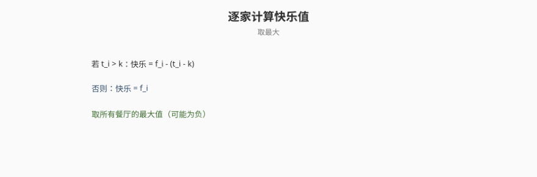

# Codeforces 276A Lunch Rush 题解

## 1. 题目概述

- **题目链接**：https://codeforces.com/problemset/problem/276/A
- **比赛来源**：Codeforces Round 169 (Div. 2) · Problem A（UTC 2013-02-24）
- **难度**：900
- **标签**：模拟
- **评测类型**：普通
- **限制**：时间 2 s / 内存 256 MB

**题意**：$n$ 家餐厅，第 $i$ 家给出快乐值 $f_i$、用餐时间 $t_i$。午餐时间 $k$。若 $t_i > k$，实际快乐为 $f_i - (t_i - k)$，否则为 $f_i$。求最大快乐值。

**约束**：$n \le 10^4$，$f_i, t_i, k \le 10^9$。

## 2. 示例与观察

官方样例 1：

```text
输入：
2 5
3 3
4 5

输出：
4
```

官方样例 2：

```text
输入：
4 6
5 8
3 6
2 3
2 2

输出：
3
```

官方样例 3：

```text
输入：
1 5
1 7

输出：
-1
```

**观察**：逐家按定义算快乐值取最大即可；结果可能为负（样例 3）✓。

**样例 1 验证**：$(3,3)$ → $3$；$(4,5)$ → $4$ → 4 ✓。

## 3. 解题思路



`joy = (t > k) ? f - (t - k) : f`，取最大值，初值用 `LLONG_MIN`。

## 4. 正确性证明

**引理**：第 $i$ 家餐厅的快乐值就是 $t_i > k$ 时的 $f_i-(t_i-k)$、否则 $f_i$。

**证明**：题面直接给出的定义 ✓。∎

**定理**：答案 $= \max_i \text{joy}_i$，其中 $\text{joy}_i$ 按题面定义。

**证明**：题目要求恰好选一家，快乐值函数已给出，逐家计算后取最大即最优 ✓。∎

## 5. 复杂度分析

- **时间**：$O(n)$。
- **空间**：$O(1)$。
- **与时限的关系**：时限 2 s，$n = 10^4$ 实测端到端 4.4 ms。
- **数值范围**：$f_i$ 与 $t_i$ 均可达 $10^9$，用 64 位。

## 6. 参考代码

### C++17

```cpp
#include <bits/stdc++.h>
using namespace std;
int main(){
    long long n,k; if(scanf("%lld %lld",&n,&k)!=2) return 0;
    long long best = LLONG_MIN;
    for(int i=0;i<n;i++){
        long long f,t; scanf("%lld %lld",&f,&t);
        long long joy = (t>k) ? f-(t-k) : f;
        best = max(best, joy);
    }
    printf("%lld\n", best);
    return 0;
}
```

### Python3

```python
import sys
def main() -> None:
    data = sys.stdin.buffer.read().split()
    n, k = int(data[0]), int(data[1])
    best = None
    for i in range(n):
        f, t = int(data[2+2*i]), int(data[3+2*i])
        joy = f - (t - k) if t > k else f
        best = joy if best is None else max(best, joy)
    print(best)
main()
```

## 7. 边界情况与易错点

1. **结果为负**：初值不能设为 0（样例 3）。
2. **$t_i = k$**：等于 $f_i$。
3. **64 位**：`long long` / Python 天然。
4. **$n=1$**：直接输出。

## 8. 验证记录

- **编译环境**：`clang++ -std=c++17 -O2 -Wall`；Python 3.9.6。
- **官方样例**：3 / 3 通过（4、3、-1），C++ 与 Python 一致。
- **独立暴力对拍**：暴力版按定义逐家计算。随机 250 组，**250 / 250 全部一致**。
- **最大约束性能**：$n = 10^4$，实测端到端 4.4 ms。
- **图片校验**：两张 SVG 已生成并通过 `ElementTree.parse`。
- **复核状态**：verified。

## 相关题目与扩展

- [Codeforces 276B Little Girl and Game](https://codeforces.com/problemset/problem/276/B)：同场 B 题。

**延伸思考**：

1. **如果允许不去**：答案至少是 0。
2. **如果允许选多家**：变成背包。

