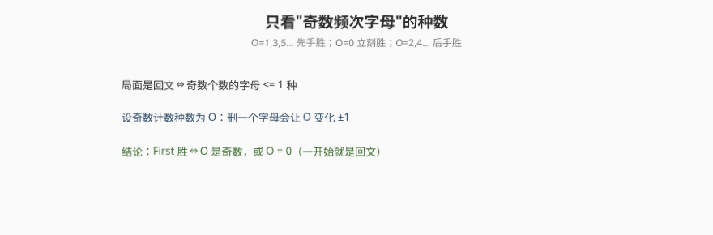

# Codeforces 276B Little Girl and Game 题解

## 1. 题目概述

- **题目链接**：https://codeforces.com/problemset/problem/276/B
- **比赛来源**：Codeforces Round 169 (Div. 2) · Problem B（UTC 2013-02-24）
- **难度**：1300
- **标签**：博弈、计数
- **评测类型**：普通
- **限制**：时间 2 s / 内存 256 MB

**题意**：两人轮流从字符串里删一个字母；**在自己行动前**若能把当前字母重排成回文则立即获胜。双方最优，判断先手/后手胜。

**约束**：$|s| \le 1000$。

## 2. 示例与观察

官方样例 1：

```text
输入：
aba

输出：
First
```

官方样例 2：

```text
输入：
abca

输出：
Second
```

**观察 1（回文判据）**：字母多重集能重排成回文 ⇔ 出现奇数次的字母种数 $O \le 1$。

**观察 2（局面压缩）**：局面只由 $O$ 决定？其实还需要奇偶性信息：删一个字母会让 $O$ 变化 $\pm 1$（删掉某字母一次出现：若它原来是奇数频次 → $O$ 减 1；偶数频次 → $O$ 加 1）。而只要 $O \ge 2$，玩家总能选择让 $O$ 减 1（删一个奇数频次字母的某次出现）。

**观察 3（结论）**：$O$ 为奇数 → 先手胜；$O = 0$ → 先手立刻胜；$O$ 为正偶数（$\ge 2$）→ 后手胜。

**样例验证**：`aba`：$a$ 出现 2 次、$b$ 1 次 → $O=1$（奇）→ First ✓；`abca`：$a$2、$b$1、$c$1 → $O=2$ → Second ✓。

## 3. 解题思路



统计 26 个字母出现次数的奇偶，设奇数个数为 $O$：输出 `First` 当且仅当 $O$ 为奇数或 $O = 0$。

## 4. 正确性证明

**引理 1**：当前玩家能立即获胜 ⇔ 当前 $O \le 1$。

**证明**：回文重排的充要条件是至多一个字母出现奇数次 ✓。∎

**引理 2**：若 $O \ge 2$，当前玩家可以删一个字母使 $O$ 减 1（变成偶数 $O-1$）。

**证明**：取一个奇频次字母删一次 → 它变成偶频次 → $O$ 减 1 ✓。∎

**引理 3**：若 $O \ge 2$，任何删除都会让 $O$ 变成 $\ge 1$ 且奇偶性翻转；且当 $O$ 为偶数时，删除后 $O'$ 为奇数（$\ge 1$），对手处于"$O'$ 为奇数"的局面。

**证明**：$O' = O \pm 1$，故奇偶性翻转 ✓；$O \ge 2$ ⇒ $O' \ge 1$ ✓。∎

**定理**：先手胜 ⇔ $O$ 为奇数或 $O = 0$。

**证明**：对 $O$ 归纳。
- $O = 0$ 或 $1$：先手立即胜 ✓。
- $O \ge 2$ 偶数：由引理 3，先手任删后对手面对奇数 $O' \ge 1$；若 $O'=1$ 对手立即胜；若 $O' \ge 3$ 奇数，归纳假设对手（面对奇数）胜 → 后手胜 ✓。
- $O \ge 3$ 奇数：由引理 2，先手删成偶数 $O-1 \ge 2$，对手面对偶数 → 由上一情形后手败 → 先手胜 ✓。
∎

## 5. 复杂度分析

- **时间**：$O(|s|)$。
- **空间**：$O(1)$。
- **与时限的关系**：时限 2 s，$|s| = 1000$ 实测端到端 2.4 ms。

## 6. 参考代码

### C++17

```cpp
#include <bits/stdc++.h>
using namespace std;
int main(){
    static char s[1005];
    if(scanf("%s",s)!=1) return 0;
    int cnt[26]={0};
    for(int i=0;s[i];i++) cnt[s[i]-'a']++;
    int odd=0;
    for(int i=0;i<26;i++) if(cnt[i]%2) odd++;
    printf("%s\n", (odd%2==1 || odd==0) ? "First" : "Second");
    return 0;
}
```

### Python3

```python
import sys
def main() -> None:
    s = sys.stdin.buffer.read().split()[0].decode()
    odd = sum(1 for c in set(s) if s.count(c) % 2 == 1)
    print("First" if (odd % 2 == 1 or odd == 0) else "Second")
main()
```

## 7. 边界情况与易错点

1. **$O = 0$**（已是回文）：先手直接胜。
2. **$O = 1$**：先手直接胜。
3. **$O = 2$**：后手胜（样例 2）。
4. **长度 1**：$O = 1$ → First。

## 8. 验证记录

- **编译环境**：`clang++ -std=c++17 -O2 -Wall`；Python 3.9.6。
- **官方样例**：2 / 2 通过（First、Second），C++ 与 Python 一致。
- **独立暴力对拍**：暴力版用**博弈 DP**（状态 = 字母频次多重集，记忆化搜索胜负）。随机 250 组 $|s| \le 7$、字母表 `abc`，**250 / 250 全部一致**。
- **最大约束性能**：$|s| = 1000$，实测端到端 2.4 ms。
- **图片校验**：两张 SVG 已生成并通过 `ElementTree.parse`。
- **复核状态**：verified。

## 相关题目与扩展

- [Codeforces 276A Lunch Rush](https://codeforces.com/problemset/problem/276/A)：同场 A 题。
- [LeetCode 1400. 构造 K 个回文字符串](https://leetcode.cn/problems/construct-k-palindrome-strings/)：奇频次计数的同类题。

**延伸思考**：

1. **如果删两个字母**：局面分析要改。
2. **如果要求"必须重排成给定串"**：退化为匹配问题。

