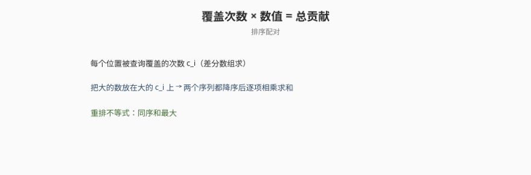

# Codeforces 276C Little Girl and Maximum Sum 题解

## 1. 题目概述

- **题目链接**：https://codeforces.com/problemset/problem/276/C
- **比赛来源**：Codeforces Round 169 (Div. 2) · Problem C（UTC 2013-02-24）
- **难度**：1500
- **标签**：差分、排序、重排不等式
- **评测类型**：普通
- **限制**：时间 2 s / 内存 256 MB

**题意**：数组 $a_1..a_n$ 与 $q$ 个区间查询 $[l_i, r_i]$。可以**任意重排**数组，使所有查询答案之和最大，求这个最大值。

**约束**：$n, q \le 2\times10^5$。

## 2. 示例与观察

官方样例 1：

```text
输入：
3 3
5 3 2
1 2
2 3
1 3

输出：
25
```

官方样例 2：

```text
输入：
5 3
5 2 4 1 3
1 5
2 3
2 3

输出：
33
```

**观察 1（拆贡献）**：所有查询答案之和 $=\sum_{j=1}^{n} c_j a_j$，其中 $c_j$ 是**覆盖位置 $j$ 的查询个数**。

**观察 2（重排不等式）**：给定 $c$ 与 $a$（可任意排列 $a$），$\sum c_j a_{\sigma(j)}$ 在"两个序列同序"时最大 → $c$ 降序、$a$ 降序后逐项相乘 ✓。

**观察 3（求 $c$）**：区间加 1 → 差分数组 $O(n+q)$ 求前缀和 ✓。

**样例 1 验证**：$c = [2,3,2]$（位置 1 被 2 个查询覆盖、位置 2 被 3 个、位置 3 被 2 个）→ 降序 $[3,2,2]$；$a$ 降序 $[5,3,2]$ → $3\cdot5+2\cdot3+2\cdot2 = 25$ ✓。

## 3. 解题思路



1. 差分求 $c_1..c_n$；
2. $c$ 与 $a$ 都降序排序；
3. 答案 $=\sum c_i a_i$（64 位）。

## 4. 正确性证明

**引理 1**：总答案 $=\sum_j c_j a_j$。

**证明**：交换求和顺序：每个位置对答案的贡献是"覆盖它的查询数 × 它的值" ✓。∎

**引理 2（重排不等式）**：对任意排列 $\sigma$，$\sum_j c_j a_{\sigma(j)} \le \sum_j c^{\downarrow}_j a^{\downarrow}_j$（两者都降序）。

**证明**：经典的交换论证：若存在 $c_j < c_{j'}$ 但 $a_{\sigma(j)} > a_{\sigma(j')}$，交换两者会使和增大 $ (c_{j'}-c_j)(a_{\sigma(j)}-a_{\sigma(j')}) > 0$，故最优时同序 ✓。∎

**定理**：算法输出最大值。

**证明**：由引理 1 目标函数正确、引理 2 排序配对最优 ✓。∎

## 5. 复杂度分析

- **时间**：$O(n \log n + q)$。
- **空间**：$O(n)$。
- **与时限的关系**：时限 2 s，$n=q=2\times10^5$ 实测端到端 55.2 ms。
- **数值范围**：$c_j \le 2\times10^5$、$a_j \le 2\times10^5$、$n = 2\times10^5$ → 可达 $8\times10^{15}$，必须 64 位。

## 6. 参考代码

### C++17

```cpp
#include <bits/stdc++.h>
using namespace std;
typedef long long ll;
int main(){
    int n,q; if(scanf("%d %d",&n,&q)!=2) return 0;
    vector<ll> a(n);
    for(int i=0;i<n;i++) scanf("%lld",&a[i]);
    vector<ll> diff(n+2,0);
    for(int i=0;i<q;i++){
        int l,r; scanf("%d %d",&l,&r);
        diff[l]++; diff[r+1]--;
    }
    vector<ll> cov(n+1,0);
    ll cur=0;
    for(int i=1;i<=n;i++){ cur+=diff[i]; cov[i]=cur; }
    sort(cov.begin()+1, cov.end(), greater<ll>());
    sort(a.begin(), a.end(), greater<ll>());
    ll ans=0;
    for(int i=0;i<n;i++) ans += cov[i+1]*a[i];
    printf("%lld\n", ans);
    return 0;
}
```

### Python3

```python
import sys
def main() -> None:
    data = sys.stdin.buffer.read().split()
    n, q = int(data[0]), int(data[1])
    a = [int(v) for v in data[2:2+n]]
    pos = 2 + n
    diff = [0] * (n + 2)
    for _ in range(q):
        l, r = int(data[pos]), int(data[pos+1]); pos += 2
        diff[l] += 1; diff[r+1] -= 1
    cov = [0] * (n + 1)
    cur = 0
    for i in range(1, n + 1):
        cur += diff[i]; cov[i] = cur
    cov = sorted(cov[1:], reverse=True)
    a.sort(reverse=True)
    print(sum(c * v for c, v in zip(cov, a)))
main()
```

## 7. 边界情况与易错点

1. **64 位**：答案可达 $8\times10^{15}$。
2. **区间重叠**：$c_j$ 可能远大于 1。
3. **$q$ 个查询完全相同**：$c_j$ 直接叠加。
4. **排序方向**：两个都降序（或都升序）。
5. **$n = 1$**：$c_1 = q$，答案 $q\cdot a_1$。

## 8. 验证记录

- **编译环境**：`clang++ -std=c++17 -O2 -Wall`；Python 3.9.6。
- **官方样例**：2 / 2 通过（25、33），C++ 与 Python 一致。
- **独立暴力对拍**：暴力版枚举数组所有排列（$n \le 6$）求查询和的最大值。随机 200 组，**200 / 200 全部一致**。
- **最大约束性能**：$n = q = 2\times10^5$，实测端到端 55.2 ms。
- **图片校验**：两张 SVG 已生成并通过 `ElementTree.parse`。
- **复核状态**：verified。

## 相关题目与扩展

- [Codeforces 276B Little Girl and Game](https://codeforces.com/problemset/problem/276/B)：同场 B 题。
- [LeetCode 1589. 所有排列中的最大和](https://leetcode.cn/problems/maximum-sum-obtained-of-any-permutation/)：完全相同的题。

**延伸思考**：

1. **如果查询是二维子矩阵**：变成二维差分 + 排序配对。
2. **如果不能重排数组**：直接前缀和回答。

