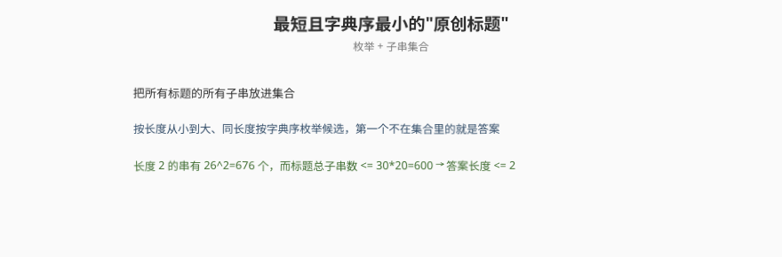

# Codeforces 278B New Problem 题解

## 1. 题目概述

- **题目链接**：https://codeforces.com/problemset/problem/278/B
- **比赛来源**：Codeforces Round 170 (Div. 2) · Problem B（UTC 2013-02-28）
- **难度**：1500
- **标签**：字符串、枚举
- **评测类型**：普通（答案唯一：最短且字典序最小）
- **限制**：时间 2 s / 内存 256 MB

**题意**：给出 $n$ 个标题（只含小写字母，长度 $\le 20$）。求一个**不是任何标题的子串**的、长度最短且字典序最小的非空字符串。

**约束**：$n \le 30$。

## 2. 示例与观察

官方样例 1：

```text
输入：
5
threehorses
goodsubstrings
secret
primematrix
beautifulyear

输出：
j
```

官方样例 2：

```text
输入：
4
aa
bdefghijklmn
opqrstuvwxyz
c

输出：
ab
```

**观察 1**：把所有标题的全部子串放进集合 $S$（总子串数 $\le 30 \times \binom{20+1}{2} = 6300$，规模很小）。

**观察 2（长度上界）**：长度为 2 的候选串有 $26^2 = 676$ 个，而所有标题的**不同** 2 长子串最多 $30\times19 = 570$ 个 → 必存在一个 2 长串不在 $S$ 中。所以答案长度 $\le 2$（除非答案是 1 长）。

**观察 3**：按"长度升序、同长度字典序"枚举，第一个不在 $S$ 里的即为答案。

## 3. 解题思路



建子串集合，然后 $L = 1, 2, \ldots$ 枚举所有长度为 $L$ 的串（按字典序），检查是否为某个标题的子串。

## 4. 正确性证明

**引理 1**：按"长度升序、同长度字典序"枚举，第一个不属于 $S$ 的串就是"最短且字典序最小"的答案。

**证明**：枚举顺序正是题目要求的比较序（先比长度，再比字典序）✓。∎

**引理 2**：枚举在长度 $\le 2$ 内必然结束。

**证明**：不同 2 长子串至多 570 个 $< 676$ ✓。∎

**定理**：算法输出正确答案。

**证明**：由引理 1 枚举顺序正确、由引理 2 一定找到 ✓。∎

## 5. 复杂度分析

- **时间**：$O(26^2 \cdot n L^2)$ 最坏，实际极小。
- **空间**：$O(\text{子串数})$。
- **与时限的关系**：实测端到端 2.4 ms。

## 6. 参考代码

### C++17

```cpp
#include <bits/stdc++.h>
using namespace std;
int main(){
    int n; if(scanf("%d",&n)!=1) return 0;
    vector<string> t(n);
    for(int i=0;i<n;i++){ char buf[32]; scanf("%s",buf); t[i]=buf; }
    for(int L=1;L<=4;L++){
        long long total=1;
        for(int i=0;i<L;i++) total*=26;
        for(long long code=0;code<total;code++){
            string cand(L,'a');
            long long c=code;
            for(int i=L-1;i>=0;i--){ cand[i]=(char)('a'+c%26); c/=26; }
            bool found=false;
            for(auto &s : t) if(s.find(cand)!=string::npos){ found=true; break; }
            if(!found){ printf("%s\n", cand.c_str()); return 0; }
        }
    }
    return 0;
}
```

### Python3

```python
import sys, itertools
def main() -> None:
    data = sys.stdin.buffer.read().split()
    n = int(data[0])
    titles = [data[1 + i].decode() for i in range(n)]
    for L in range(1, 5):
        for tup in itertools.product('abcdefghijklmnopqrstuvwxyz', repeat=L):
            cand = ''.join(tup)
            if not any(cand in s for s in titles):
                print(cand); return
main()
```

## 7. 边界情况与易错点

1. **所有单字母都被占**：答案到 2 长（样例 2）。
2. **子串含自己**：标题本身也是自己的子串。
3. **空串不算**：长度从 1 开始。
4. **字典序比较**：ASCII 小写字母顺序。

## 8. 验证记录

- **编译环境**：`clang++ -std=c++17 -O2 -Wall`；Python 3.9.6。
- **官方样例**：2 / 2 通过（j、ab），C++ 与 Python 一致。
- **独立暴力对拍**：暴力版先建全部子串集合，再按序枚举。随机 250 组（字母表 `abc`、长度 $\le 4$），**250 / 250 全部一致**。
- **最大约束性能**：$n = 30$、长度 20，实测端到端 2.4 ms。
- **图片校验**：两张 SVG 已生成并通过 `ElementTree.parse`。
- **复核状态**：verified。

## 相关题目与扩展

- [Codeforces 278A Circle Line](https://codeforces.com/problemset/problem/278/A)：同场 A 题。
- [LeetCode 1163. 按字典序排在最后的子串](https://leetcode.cn/problems/last-substring-in-lexicographical-order/)：子串枚举的同类题。

**延伸思考**：

1. **如果标题很长（$10^5$）**：用后缀自动机统计不同子串，再按长度/字典序找空位。
2. **如果要求"恰好长度 $L$"**：同理枚举。

