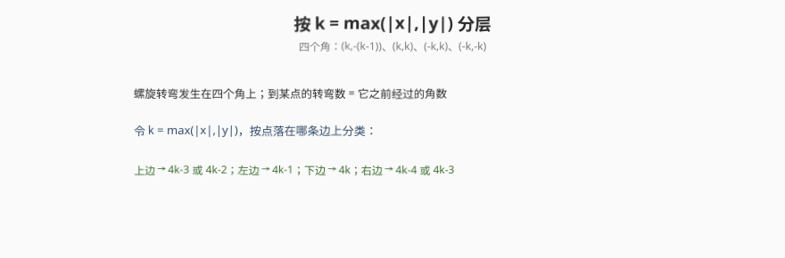

# Codeforces 279A Point on Spiral 题解

## 1. 题目概述

- **题目链接**：https://codeforces.com/problemset/problem/279/A
- **比赛来源**：Codeforces Round 171 (Div. 2) · Problem A（UTC 2013-03-02）
- **难度**：1400
- **标签**：数学、坐标
- **评测类型**：普通
- **限制**：时间 2 s / 内存 256 MB

**题意**：平面上的螺旋依次经过 $[(0,0),(1,0)]$、$[(1,0),(1,1)]$、$[(1,1),(-1,1)]$、$[(-1,1),(-1,-1)]$、$[(-1,-1),(2,-1)]$、… 求从 $(0,0)$ 沿螺旋走到 $(x,y)$ 需要**转弯**几次。

**约束**：$|x|, |y| \le 100$。

## 2. 示例与观察

官方样例 1：

```text
输入：
0 0

输出：
0
```

官方样例 2：

```text
输入：
1 0

输出：
0
```

官方样例 3：

```text
输入：
0 1

输出：
2
```

官方样例 4：

```text
输入：
-1 -1

输出：
3
```

**观察 1（转弯发生在角上）**：螺旋的角依次是 $(1,0), (1,1), (-1,1), (-1,-1), (2,-1), (2,2), (-2,2), (-2,-2), \ldots$，到达第 $j$ 个角（从 0 计数）时已经转了 $j$ 次。

**观察 2（分层）**：令 $k = \max(|x|,|y|)$，则目标点落在"第 $k$ 层"的某条边上：

- 右边：$x = k$，$y$ 从 $-(k-1)$ 到 $k$（含角 $(k,-(k-1))$ 与 $(k,k)$）；
- 上边：$y = k$，$x$ 从 $k$ 到 $-k$；
- 左边：$x = -k$，$y$ 从 $k$ 到 $-k$；
- 下边：$y = -k$（属于第 $k+1$ 层的底边）。

**观察 3（转角取值）**：第 $k$ 层四个角的全局序号是 $4k-4, 4k-3, 4k-2, 4k-1$（依次为 $(k,-(k-1)), (k,k), (-k,k), (-k,-k)$）。点在边上（非角）时的转弯数 = 前一个角序号 $+1$。

**样例验证**：$(1,0)$ 是 $k=1$ 的角 $(k,-(k-1))$ → $4k-4 = 0$ ✓；$(0,1)$ 在 $k=1$ 的上边（非角）→ $4k-2 = 2$ ✓；$(-1,-1)$ 是角 → $4k-1 = 3$ ✓。

## 3. 解题思路



```
if (x,y) == (0,0): 0
k = max(|x|,|y|)
if y == k:   x == k ? 4k-3 : 4k-2     # 上边（含右上角/左上角）
elif x == -k: 4k-1                    # 左边（含左下角）
elif y == -k: 4k                      # 下一层的底边
else:        y == -(k-1) ? 4k-4 : 4k-3  # 右边（含右下角）
```

## 4. 正确性证明

**引理 1**：第 $k$ 层的四个角为 $(k,-(k-1))$、$(k,k)$、$(-k,k)$、$(-k,-k)$，按遍历顺序全局序号 $4k-4, 4k-3, 4k-2, 4k-1$。

**证明**：对 $k$ 归纳：第 $k-1$ 层的最后一个角是 $(-(k-1), -(k-1))$，序号 $4(k-1)-1 = 4k-5$；之后向右走到 $(k,-(k-1))$、向上到 $(k,k)$、向左到 $(-k,k)$、向下到 $(-k,-k)$，依次加 1 ✓。∎

**引理 2**：到达某个角（序号 $j$）时已转弯 $j$ 次；到达边上非角点时，转弯次数 = 前一个角序号 $+1$。

**证明**：每次经过一个角恰好转一次弯，且转弯发生在**到达角之后**（如 $(1,0)$ 到达时还没转）✓。∎

**定理**：算法输出正确的转弯次数。

**证明**：由引理 1、2，按点所在边分类取对应公式即可；$k=1$ 的右边只有角 $(1,0)$（$y = -(k-1) = 0$）→ $4k-4 = 0$ ✓，无内部点 ✓。∎

## 5. 复杂度分析

- **时间**：$O(1)$。
- **空间**：$O(1)$。
- **与时限的关系**：实测端到端 2.4 ms。

## 6. 参考代码

### C++17

```cpp
#include <bits/stdc++.h>
using namespace std;
int main(){
    long long x,y; if(scanf("%lld %lld",&x,&y)!=2) return 0;
    if(x==0 && y==0){ printf("0\n"); return 0; }
    long long k = max(llabs(x), llabs(y));
    long long ans;
    if(y == k){
        ans = (x == k) ? 4*k-3 : 4*k-2;
    } else if(x == -k){
        ans = 4*k-1;
    } else if(y == -k){
        ans = 4*k;
    } else {
        ans = (y == -(k-1)) ? 4*k-4 : 4*k-3;
    }
    printf("%lld\n", ans);
    return 0;
}
```

### Python3

```python
import sys
def main() -> None:
    x, y = map(int, sys.stdin.buffer.read().split()[:2])
    if x == 0 and y == 0:
        print(0); return
    k = max(abs(x), abs(y))
    if y == k:
        ans = 4*k - 3 if x == k else 4*k - 2
    elif x == -k:
        ans = 4*k - 1
    elif y == -k:
        ans = 4*k
    else:
        ans = 4*k - 4 if y == -(k-1) else 4*k - 3
    print(ans)
main()
```

## 7. 边界情况与易错点

1. **$(0,0)$**：0（特判）。
2. **$k=1$ 的右边**：只有角，用 $y = -(k-1)$ 判定。
3. **角与内部相差 1**：写错方向最容易在这里出错。
4. **$y = -k$ 属于下一层的底边**（除 $x = -k$ 即左下角外）。
5. **负坐标**：用 `abs` 后分类。

## 8. 验证记录

- **编译环境**：`clang++ -std=c++17 -O2 -Wall`；Python 3.9.6。
- **官方样例**：4 / 4 通过（0、0、2、3），C++ 与 Python 一致。
- **独立暴力对拍**：暴力版按题面**逐段模拟螺旋**并记录到达每个点时的已转次数。随机 250 组 $|x|,|y| \le 6$，**250 / 250 全部一致**。
- **最大约束性能**：$(100,100)$，实测端到端 2.4 ms。
- **图片校验**：两张 SVG 已生成并通过 `ElementTree.parse`。
- **复核状态**：verified。

## 相关题目与扩展

- [Codeforces 279B Books](https://codeforces.com/problemset/problem/279/B)：同场 B 题。

**延伸思考**：

1. **如果要求输出路径长度**：每段长度已知，可直接求和。
2. **如果螺旋不同起点**：平移即可。

