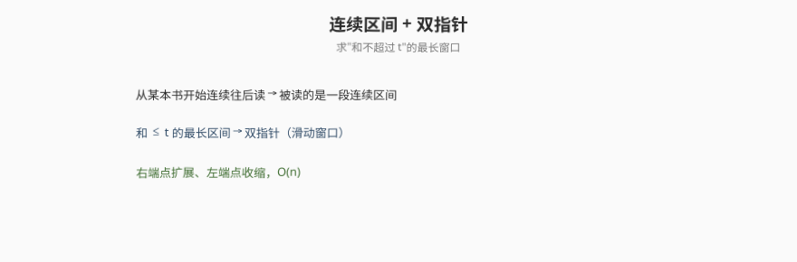

# Codeforces 279B Books 题解

## 1. 题目概述

- **题目链接**：https://codeforces.com/problemset/problem/279/B
- **比赛来源**：Codeforces Round 171 (Div. 2) · Problem B（UTC 2013-03-02）
- **难度**：1400
- **标签**：双指针
- **评测类型**：普通
- **限制**：时间 2 s / 内存 256 MB

**题意**：$n$ 本书排成一列，第 $i$ 本需 $a_i$ 分钟。总时间 $t$。选一个起点 $i$，从 $i$ 开始**连续**往后读，每本要么读完要么不开始。求最多能读完几本。

**约束**：$n \le 10^5$，$t \le 10^9$。

## 2. 示例与观察

官方样例 1：

```text
输入：
4 5
3 1 2 1

输出：
3
```

官方样例 2：

```text
输入：
3 3
2 2 3

输出：
1
```

**观察 1**：能读的是一段**连续区间** $[l, r]$，且 $\sum_{i=l}^{r} a_i \le t$。

**观察 2**：求"和不超过 $t$ 的最长区间" → 经典**双指针（滑动窗口）**，$O(n)$。

**样例 1 验证**：$[2,4] = 1+2+1 = 4 \le 5$ → 3 本 ✓。

## 3. 解题思路



右端点逐格右移，若和超过 $t$ 就左移左端点，每次用窗口长度更新答案。

## 4. 正确性证明

**引理 1**：任意合法读法对应一个连续区间；反之任意和 $\le t$ 的连续区间都是一个合法读法。

**证明**：从某本开始连续读 → 区间；读完的条件是总时间不超过 $t$ ✓。∎

**引理 2（双指针正确）**：对每个右端点 $r$，算法维护的是"以 $r$ 结尾、和 $\le t$ 的最长区间"的左端点。

**证明**：左端点单调不减（因为 $a_i > 0$，去掉左边的书只会让和变小）；内层 `while` 恰好把和收缩到 $\le t$，且此时左端点不能再右移（否则丢失合法解），故为最长 ✓。∎

**定理**：算法输出最大可读书数。

**证明**：由引理 1、2，算法枚举了每个右端点的最优区间长度并取最大 ✓。∎

## 5. 复杂度分析

- **时间**：$O(n)$（每个元素最多进出窗口一次）。
- **空间**：$O(n)$。
- **与时限的关系**：时限 2 s，$n = 10^5$ 实测端到端 10.1 ms。

## 6. 参考代码

### C++17

```cpp
#include <bits/stdc++.h>
using namespace std;
int main(){
    int n; long long t;
    if(scanf("%d %lld",&n,&t)!=2) return 0;
    vector<long long> a(n);
    for(int i=0;i<n;i++) scanf("%lld",&a[i]);
    int ans=0, l=0; long long sum=0;
    for(int r=0;r<n;r++){
        sum+=a[r];
        while(sum>t){ sum-=a[l]; l++; }
        ans=max(ans, r-l+1);
    }
    printf("%d\n", ans);
    return 0;
}
```

### Python3

```python
import sys
def main() -> None:
    data = sys.stdin.buffer.read().split()
    n, t = int(data[0]), int(data[1])
    a = [int(v) for v in data[2:2+n]]
    ans = 0; l = 0; s = 0
    for r in range(n):
        s += a[r]
        while s > t:
            s -= a[l]; l += 1
        ans = max(ans, r - l + 1)
    print(ans)
main()
```

## 7. 边界情况与易错点

1. **一本都读不完**：答案 0。
2. **全部能读完**：答案 $n$。
3. **$t$ 很大**：和用 64 位。
4. **$a_i > 0$**：保证左端点单调，双指针成立。

## 8. 验证记录

- **编译环境**：`clang++ -std=c++17 -O2 -Wall`；Python 3.9.6。
- **官方样例**：2 / 2 通过（3、1），C++ 与 Python 一致。
- **独立暴力对拍**：暴力版枚举每个起点向后累加。随机 250 组 $n \le 8$，**250 / 250 全部一致**。
- **最大约束性能**：$n = 10^5$，实测端到端 10.1 ms。
- **图片校验**：两张 SVG 已生成并通过 `ElementTree.parse`。
- **复核状态**：verified。

## 相关题目与扩展

- [Codeforces 279A Point on Spiral](https://codeforces.com/problemset/problem/279/A)：同场 A 题。
- [LeetCode 209. 长度最小的子数组](https://leetcode.cn/problems/minimum-size-subarray-sum/)：滑动窗口的镜像问题。

**延伸思考**：

1. **如果可以从任意起点、不要求连续**：排序后贪心。
2. **如果要求恰好 $k$ 本**：取最小和。

