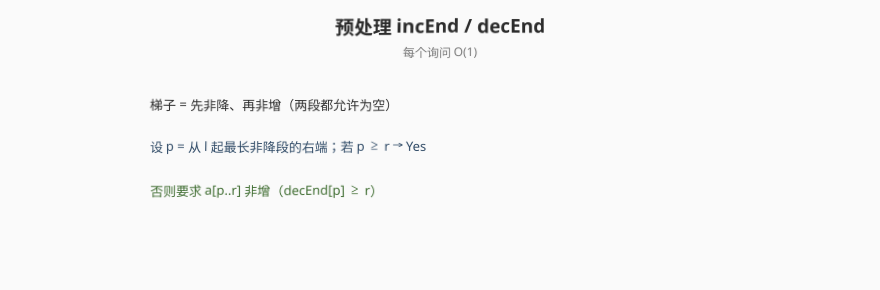

# Codeforces 279C Ladder 题解

## 1. 题目概述

- **题目链接**：https://codeforces.com/problemset/problem/279/C
- **比赛来源**：Codeforces Round 171 (Div. 2) · Problem C（UTC 2013-03-02）
- **难度**：1700
- **标签**：预处理、区间判定
- **评测类型**：普通
- **限制**：时间 2 s / 内存 256 MB

**题意**：序列 $a_1..a_n$，$m$ 个询问 $[l,r]$。判断子段是否为"梯子"：存在 $x$ 使 $b_1 \le \dots \le b_x \ge b_{x+1} \ge \dots \ge b_k$（非降段或非增段也算梯子）。

**约束**：$n, m \le 10^5$。

## 2. 示例与观察

官方样例 1：

```text
输入：
8 6
1 2 1 3 3 5 2 1
1 3
2 3
2 4
8 8
1 4
5 8

输出：
Yes
Yes
No
Yes
No
Yes
```

**观察 1（峰值位置）**：若 $[l,r]$ 是梯子且不是全程非降，则下降必须从"从 $l$ 开始的最长非降段的末端" $p$ 开始 —— 若更早开始下降，那么 $a_p$ 之后又出现上升就破坏了梯子形状。

**观察 2（所以只需判两件事）**：令 $p = \text{incEnd}[l]$（从 $l$ 起最长非降段的右端）。若 $p \ge r$ → Yes；否则检查 $[p, r]$ 是否**非增**（即 $\text{decEnd}[p] \ge r$）。

**样例验证**：$a = 1,2,1,3,3,5,2,1$：
- $[1,3]$：$\text{incEnd}[1] = 2$，$[2,3] = 2,1$ 非增 ✓ Yes
- $[2,4]$：$\text{incEnd}[2] = 2$，$[2,4] = 2,1,3$ 非增？✗ No
- $[5,8]$：$\text{incEnd}[5] = 6$，$[6,8] = 5,2,1$ 非增 ✓ Yes

## 3. 解题思路



倒序预处理两个数组，每个询问 $O(1)$ 判定。

## 4. 正确性证明

**引理 1**：若 $[l,r]$ 是梯子，则其峰值位置 $x$ 满足 $x \ge \text{incEnd}[l]$（当 $\text{incEnd}[l] < r$ 时取等号）。

**证明**：梯子的非降段从 $l$ 开始，长度至多到 $\text{incEnd}[l]$；若峰值 $x < \text{incEnd}[l]$，则 $a_x \le a_{x+1}$ 与"非增段从 $x$ 开始"矛盾（严格地说：$x < \text{incEnd}[l]$ 意味着 $a_x \le a_{x+1}$ 且后续仍非降，而梯子在 $x$ 之后要求非增，两者同时成立只能是全等，此时 $x$ 可以右移到 $\text{incEnd}[l]$ 而不破坏条件）✓。∎

**引理 2**：$[l,r]$ 是梯子 ⇔ $\text{incEnd}[l] \ge r$ 或 $[\text{incEnd}[l], r]$ 非增。

**证明**：(⇐) 前一段非降、后一段非增，拼起来就是梯子 ✓。(⇒) 由引理 1 可把峰值右移到 $p = \text{incEnd}[l]$，此时 $[p,r]$ 必非增 ✓。∎

**定理**：算法判定正确。

**证明**：由引理 2 的充要条件，算法检查的正是它 ✓。∎

## 5. 复杂度分析

- **时间**：$O(n + m)$。
- **空间**：$O(n)$。
- **与时限的关系**：时限 2 s，$n = m = 10^5$ 实测端到端 36.0 ms。

## 6. 参考代码

### C++17

```cpp
#include <bits/stdc++.h>
using namespace std;
int main(){
    int n,m; if(scanf("%d %d",&n,&m)!=2) return 0;
    vector<long long> a(n+2);
    for(int i=1;i<=n;i++) scanf("%lld",&a[i]);
    vector<int> incEnd(n+2), decEnd(n+2);
    incEnd[n]=n;
    for(int i=n-1;i>=1;i--) incEnd[i] = (a[i]<=a[i+1]) ? incEnd[i+1] : i;
    decEnd[n]=n;
    for(int i=n-1;i>=1;i--) decEnd[i] = (a[i]>=a[i+1]) ? decEnd[i+1] : i;
    while(m--){
        int l,r; scanf("%d %d",&l,&r);
        int p = incEnd[l];
        if(p>=r || decEnd[p]>=r) printf("Yes\n");
        else printf("No\n");
    }
    return 0;
}
```

### Python3

```python
import sys
def main() -> None:
    data = sys.stdin.buffer.read().split()
    n, m = int(data[0]), int(data[1])
    a = [0] + [int(v) for v in data[2:2+n]]
    inc_end = [0]*(n+2); dec_end = [0]*(n+2)
    inc_end[n] = n; dec_end[n] = n
    for i in range(n-1, 0, -1):
        inc_end[i] = inc_end[i+1] if a[i] <= a[i+1] else i
        dec_end[i] = dec_end[i+1] if a[i] >= a[i+1] else i
    pos = 2+n
    out = []
    for _ in range(m):
        l, r = int(data[pos]), int(data[pos+1]); pos += 2
        p = inc_end[l]
        out.append("Yes" if (p >= r or dec_end[p] >= r) else "No")
    sys.stdout.write("\n".join(out) + "\n")
main()
```

## 7. 边界情况与易错点

1. **$l = r$**：Yes。
2. **全程非降/非增**：Yes。
3. **相等元素**：`<=` 与 `>=`（非严格）。
4. **峰值判定**：$p$ 一定要取到 $\text{incEnd}[l]$。

## 8. 验证记录

- **编译环境**：`clang++ -std=c++17 -O2 -Wall`；Python 3.9.6。
- **官方样例**：1 / 1 通过（Yes Yes No Yes No Yes），C++ 与 Python 一致。
- **独立暴力对拍**：暴力版枚举所有可能的峰值位置 $x$ 判定。随机 250 组 $n \le 8$、$m \le 5$、值域 $[1,4]$，**250 / 250 全部一致**。
- **最大约束性能**：$n = m = 10^5$，实测端到端 36.0 ms。
- **图片校验**：两张 SVG 已生成并通过 `ElementTree.parse`。
- **复核状态**：verified。

## 相关题目与扩展

- [Codeforces 279B Books](https://codeforces.com/problemset/problem/279/B)：同场 B 题。
- [LeetCode 1095. 山脉数组中查找目标值](https://leetcode.cn/problems/find-in-mountain-array/)：山脉/梯子形结构的同类题。

**延伸思考**：

1. **如果允许"下降后再上升"（V 形）**：换成 $\text{decEnd}$ 优先即可。
2. **如果要求统计梯子个数**：需要更复杂的计数。

