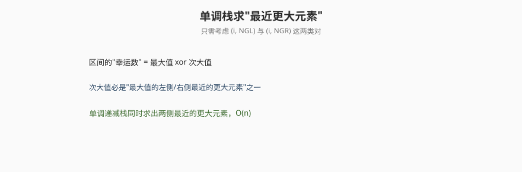

# Codeforces 280B Maximum Xor Secondary 题解

## 1. 题目概述

- **题目链接**：https://codeforces.com/problemset/problem/280/B
- **比赛来源**：Codeforces Round 172 (Div. 1) · Problem B（UTC 2013-03-10）
- **难度**：1800
- **标签**：单调栈
- **评测类型**：普通
- **限制**：时间 1 s / 内存 256 MB

**题意**：序列中互不相同的正整数。对每个长度 $\ge 2$ 的区间，定义"幸运数" = 区间最大值 $\oplus$ 次大值。求所有区间的幸运数的最大值。

**约束**：$n \le 10^5$，$s_i \le 10^9$。

## 2. 示例与观察

官方样例 1：

```text
输入：
5
5 2 1 4 3

输出：
7
```

官方样例 2：

```text
输入：
5
9 8 3 5 7

输出：
15
```

**观察 1（次大值只在两侧最近更大处）**：设区间 $[l,r]$ 的最大值在位置 $i$。次大值 $x$ 要么在 $i$ 左边、要么在右边，且它是该侧区间内最大的元素。若把区间向里收缩到"只包含 $i$ 与 $x$"，$x$ 仍是次大值且区间合法 → 只需考虑"$x$ 是 $i$ 左侧/右侧**最近的**更大元素"的情形 ✓。

**观察 2**：于是对每个 $i$ 求 $L_i$（左侧最近的 $> s_i$）与 $R_i$（右侧最近的 $> s_i$），答案 = $\max_i \max(s_i \oplus s_{L_i},\ s_i \oplus s_{R_i})$。

**观察 3**：用单调递减栈一遍求出 $L_i, R_i$ ✓。

**样例 1 验证**：$s = 5,2,1,4,3$；候选对：$(2,5) \to 7$、$(2,4)\to 6$、$(1,2)\to3$、$(1,4)\to5$、$(4,5)\to1$、$(3,4)\to7$ → 最大 7 ✓。

## 3. 解题思路



从左到右维护**递减栈**：遇到 $s_i$ 时，把栈中所有 $< s_i$ 的元素弹出（此时 $s_i$ 是它们右侧最近的更大元素，更新答案），弹完后栈顶（若存在）就是 $i$ 左侧最近的更大元素，也更新答案。

## 4. 正确性证明

**引理 1**：对任意区间，若最大值在 $i$、次大值在 $j$，则 $j$ 是 $i$ 某一侧的"最近更大元素"（在区间内）。

**证明**：次大值是区间内除 $s_i$ 外的最大者，位于 $i$ 的左侧或右侧；该侧区间内比 $s_i$ 大的元素中最靠近 $i$ 的那个就是该侧最大者（若有更近的更大元素，它才是次大值）✓。∎

**引理 2**：单调栈求出的 $L_i$、$R_i$ 是**全数组**范围内的最近更大元素。

**证明**：标准单调栈性质：弹出条件 `s[top] < s[i]` 恰好把 $i$ 作为这些元素的右侧最近更大元素；栈顶是 $i$ 的左侧最近更大元素 ✓。∎

**定理**：算法输出正确答案。

**证明**：由引理 1，最优区间对应的对 $(i,j)$ 中 $j$ 必是 $i$ 在区间内的最近更大元素；而区间内的最近更大元素就是全数组的最近更大元素（因为区间可以收缩到 $i$ 与 $j$ 之间，不影响 $j$ 是"最近"的），故引理 2 求出的对覆盖了所有候选 ✓。∎

## 5. 复杂度分析

- **时间**：$O(n)$。
- **空间**：$O(n)$。
- **与时限的关系**：时限 1 s，$n = 10^5$ 实测端到端 10.0 ms。

## 6. 参考代码

### C++17

```cpp
#include <bits/stdc++.h>
using namespace std;
int main(){
    int n; if(scanf("%d",&n)!=1) return 0;
    vector<long long> s(n);
    for(int i=0;i<n;i++) scanf("%lld",&s[i]);
    long long ans = 0;
    stack<int> st;                       // 单调递减栈
    for(int i=0;i<n;i++){
        while(!st.empty() && s[st.top()] < s[i]){   // s[i] 是 st.top() 右侧最近的更大元素
            ans = max(ans, s[st.top()] ^ s[i]);
            st.pop();
        }
        if(!st.empty()) ans = max(ans, s[st.top()] ^ s[i]);  // 左侧最近的更大元素
        st.push(i);
    }
    printf("%lld\n", ans);
    return 0;
}
```

### Python3

```python
import sys
def main() -> None:
    data = sys.stdin.buffer.read().split()
    n = int(data[0]); s = [int(v) for v in data[1:1+n]]
    ans = 0
    st = []
    for i in range(n):
        while st and s[st[-1]] < s[i]:
            ans = max(ans, s[st[-1]] ^ s[i])
            st.pop()
        if st:
            ans = max(ans, s[st[-1]] ^ s[i])
        st.append(i)
    print(ans)
main()
```

## 7. 边界情况与易错点

1. **$n = 2$**：只有一对。
2. **严格递减序列**：每个 $i$ 只有左侧更大元素。
3. **严格递增序列**：只在弹出时更新。
4. **值互不相同**：题面保证，简化了"最近更大"的唯一性。
5. **答案用 64 位**：$s_i \le 10^9$，异或不超过 $2^{30}$，`long long` 安全。

## 8. 验证记录

- **编译环境**：`clang++ -std=c++17 -O2 -Wall`；Python 3.9.6。
- **官方样例**：2 / 2 通过（7、15），C++ 与 Python 一致。
- **独立暴力对拍**：暴力版枚举所有区间求最大值与次大值再异或。随机 250 组 $n \le 8$，**250 / 250 全部一致**。
- **最大约束性能**：$n = 10^5$（递增序列，栈最深），实测端到端 10.0 ms。
- **图片校验**：两张 SVG 已生成并通过 `ElementTree.parse`。
- **复核状态**：verified。

## 相关题目与扩展

- [Codeforces 280A Rectangle Puzzle](https://codeforces.com/problemset/problem/280/A)：同场 A 题。
- [LeetCode 907. 子数组的最小值之和](https://leetcode.cn/problems/sum-of-subarray-minimums/)：单调栈的另一经典应用。

**延伸思考**：

1. **如果允许重复元素**：需要处理相等时的方向约定。
2. **如果要求"第三大值"**：需要更多候选（栈深度 2）。

