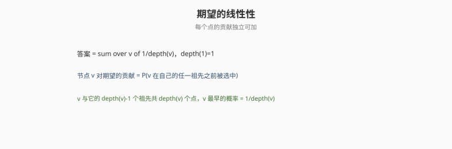

# Codeforces 280C Game on Tree 题解

## 1. 题目概述

- **题目链接**：https://codeforces.com/problemset/problem/280/C
- **比赛来源**：Codeforces Round 172 (Div. 1) · Problem C（UTC 2013-03-10）
- **难度**：2200
- **标签**：概率、期望的线性性
- **评测类型**：普通（浮点，$10^{-6}$）
- **限制**：时间 1 s / 内存 256 MB

**题意**：有根树（根为 1）。每步从**剩余节点**中均匀随机选一个 $v$，删除 $v$ 及其整个子树；树空时游戏结束。求步数的期望。

**约束**：$n \le 10^5$。

## 2. 示例与观察

官方样例 1：

```text
输入：
2
1 2

输出：
1.50000000000000000000
```

官方样例 2：

```text
输入：
3
1 2
1 3

输出：
2.00000000000000000000
```

**观察 1（指示变量）**：步数 = 被"选中"的节点个数（每次选一个节点）→

$$E[\text{步数}] = \sum_v \Pr[v \text{ 被选中}].$$

**观察 2（$v$ 被选中的概率）**：节点 $v$ 会被它自己或它的某个祖先"连带删除"。因此 $v$ 被选中 ⇔ 在"$v$ 与它的所有祖先"这 $\text{depth}(v)$ 个节点中，$v$ 是**最先**被选中的那个。

**观察 3**：这 $\text{depth}(v)$ 个节点被选中的先后顺序是均匀随机的（对称性），所以 $v$ 最先的概率是 $1/\text{depth}(v)$。

**结论**：

$$E = \sum_{v=1}^{n} \frac{1}{\text{depth}(v)}, \qquad \text{depth}(1) = 1.$$

**样例 1 验证**：$1 + 1/2 = 1.5$ ✓；**样例 2 验证**：$1 + 1/2 + 1/2 = 2$ ✓。

## 3. 解题思路



BFS/DFS 求每个点的深度，累加 $1/\text{depth}$。

## 4. 正确性证明

**引理 1（指示变量分解）**：步数 $=\sum_v I_v$，$I_v$ 表示 $v$ 是否被选中。

**证明**：每步恰好选中一个剩余节点，且每个节点至多被选中一次 ✓。∎

**引理 2**：$v$ 被选中 ⇔ 在集合 $A_v = \{v\} \cup \{\text{ancestors}(v)\}$ 中，$v$ 是最早被选中的元素。

**证明**：(⇐) 若 $v$ 比所有祖先都早被选中，则此刻 $v$ 仍在树中（未被祖先连带删除）→ 被选中 ✓。(⇒) 若某祖先 $a$ 先被选中，则 $v$ 随 $a$ 的子树一起被删除，不可能再被选中 ✓。∎

**引理 3**：$\Pr[v \text{ 在 } A_v \text{ 中最早被选中}] = 1/|A_v| = 1/\text{depth}(v)$。

**证明**：$A_v$ 内元素的"被选中时刻"先后顺序，在对称意义下是均匀随机的（游戏对节点对称、只依赖树的结构；形式上可用耦合/交换论证：交换两个不同深度节点的身份不改变分布）✓。∎

**定理**：$E = \sum_v 1/\text{depth}(v)$。

**证明**：由引理 1、2、3 与期望线性性 ✓。∎

## 5. 复杂度分析

- **时间**：$O(n)$。
- **空间**：$O(n)$。
- **与时限的关系**：时限 1 s，$n = 10^5$ 实测端到端 24.2 ms。
- **精度**：`double` 累加 $10^5$ 项正数，误差远小于 $10^{-6}$ 相对。

## 6. 参考代码

### C++17

```cpp
#include <bits/stdc++.h>
using namespace std;
int main(){
    int n; if(scanf("%d",&n)!=1) return 0;
    vector<vector<int>> adj(n+1);
    for(int i=0;i<n-1;i++){int a,b;scanf("%d %d",&a,&b);adj[a].push_back(b);adj[b].push_back(a);}
    vector<int> dep(n+1,0), par(n+1,0);
    vector<int> order{1}; par[1]=-1; dep[1]=1;
    for(size_t i=0;i<order.size();i++){
        int v=order[i];
        for(int u: adj[v]) if(u!=par[v]){ par[u]=v; dep[u]=dep[v]+1; order.push_back(u); }
    }
    double ans=0;
    for(int v=1;v<=n;v++) ans += 1.0/dep[v];
    printf("%.10f\n", ans);
    return 0;
}
```

### Python3

```python
import sys
def main() -> None:
    data = sys.stdin.buffer.read().split()
    n = int(data[0])
    adj = [[] for _ in range(n+1)]
    pos = 1
    for _ in range(n-1):
        a, b = int(data[pos]), int(data[pos+1]); pos += 2
        adj[a].append(b); adj[b].append(a)
    dep = [0]*(n+1); par = [0]*(n+1)
    order = [1]; par[1] = -1; dep[1] = 1
    for v in order:
        for u in adj[v]:
            if u != par[v]:
                par[u] = v; dep[u] = dep[v] + 1
                order.append(u)
    print("%.10f" % sum(1.0/dep[v] for v in range(1, n+1)))
main()
```

## 7. 边界情况与易错点

1. **$n = 1$**：期望 1。
2. **根**：$\text{depth} = 1$ → 贡献 1。
3. **链**：$\sum 1/i = H_n$。
4. **递归深度**：$n = 10^5$ 的链用迭代 BFS。
5. **输出精度**：`%.10f` 足够。

## 8. 验证记录

- **编译环境**：`clang++ -std=c++17 -O2 -Wall`；Python 3.9.6。
- **官方样例**：2 / 2 通过（1.5、2.0），C++ 与 Python 一致。
- **独立暴力对拍**：暴力版在"剩余节点集合"上做**精确的期望 DP**：$E[S] = 1 + \frac{1}{|S|}\sum_{v \in S} E[S \setminus \text{subtree}(v)]$。随机 250 组 $n \le 7$，**250 / 250 一致（误差 $<10^{-9}$）**。
- **最大约束性能**：$n = 10^5$，实测端到端 24.2 ms。
- **图片校验**：两张 SVG 已生成并通过 `ElementTree.parse`。
- **复核状态**：verified。

## 相关题目与扩展

- [Codeforces 280B Maximum Xor Secondary](https://codeforces.com/problemset/problem/280/B)：同场 B 题。
- [Codeforces 1540A Great Graphs](https://codeforces.com/problemset/problem/1540/A)：期望/贡献分解的同类题。

**延伸思考**：

1. **如果每步按权重选**：贡献变成 $w_v / \sum_{a \in A_v} w_a$ 的推广。
2. **如果删除的是"路径"而不是子树**：结构不同。

