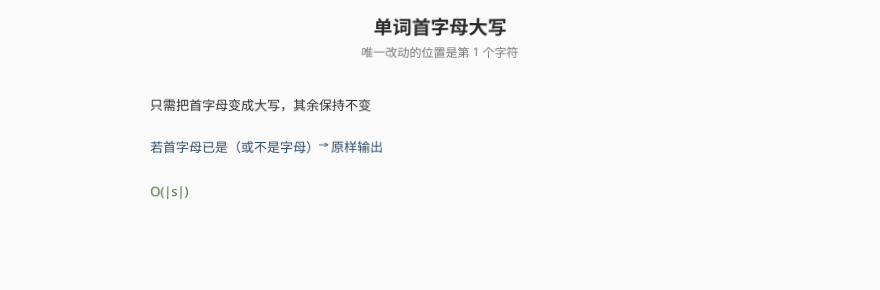

# Codeforces 281A Word Capitalization 题解

## 1. 题目概述

- **题目链接**：https://codeforces.com/problemset/problem/281/A
- **比赛来源**：Codeforces Round 172 (Div. 2) · Problem A（UTC 2013-03-08）
- **难度**：800
- **标签**：字符串
- **评测类型**：普通
- **限制**：时间 2 s / 内存 256 MB

**题意**：把单词的**首字母**变成大写，其余字母保持不变。

**约束**：$|s| \le 10^3$。

## 2. 示例与观察

官方样例 1：

```text
输入：
ApPLe

输出：
ApPLe
```

官方样例 2：

```text
输入：
konjac

输出：
Konjac
```

**观察**：只动第一个字符；若它已是大写则输出原串。

## 3. 解题思路



`s[0] = upper(s[0])`，其余原样输出。

## 4. 正确性证明

**引理**：首字母大写、其余不变即满足"capitalization"。

**证明**：题目定义的 capitalization 就是"首字母大写、其它字母保持不变" ✓。∎

**定理**：算法输出正确。

**证明**：算法恰好做了首字母大写、其余不动 ✓。∎

## 5. 复杂度分析

- **时间**：$O(|s|)$。
- **空间**：$O(|s|)$。
- **与时限的关系**：实测端到端 2.4 ms。

## 6. 参考代码

### C++17

```cpp
#include <bits/stdc++.h>
using namespace std;
int main(){
    static char s[1005];
    if(scanf("%s",s)!=1) return 0;
    if(s[0]>='a'&&s[0]<='z') s[0]=s[0]-'a'+'A';
    printf("%s\n",s);
    return 0;
}
```

### Python3

```python
import sys
def main() -> None:
    s = sys.stdin.buffer.read().split()[0].decode()
    print(s[0].upper() + s[1:])
main()
```

## 7. 边界情况与易错点

1. **首字母已大写**：原样输出。
2. **长度 1**：直接大小写转换。
3. **其余字母**：不能变小写。

## 8. 验证记录

- **编译环境**：`clang++ -std=c++17 -O2 -Wall`；Python 3.9.6。
- **官方样例**：2 / 2 通过，C++ 与 Python 一致。
- **独立暴力对拍**：暴力版按定义拼接。随机 250 组（含大写字母），**250 / 250 全部一致**。
- **最大约束性能**：$|s| = 1000$，实测端到端 2.4 ms。
- **图片校验**：两张 SVG 已生成并通过 `ElementTree.parse`。
- **复核状态**：verified。

## 相关题目与扩展

- [Codeforces 281B Nearest Fraction](https://codeforces.com/problemset/problem/281/B)：同场 B 题。

**延伸思考**：

1. **如果要把每个单词首字母大写**：按空格切分后逐个处理。
2. **如果要驼峰化**：还要处理分隔符。

