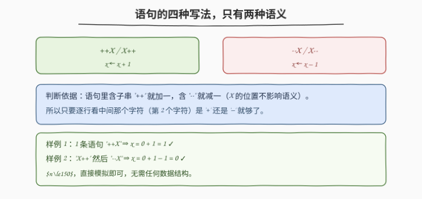
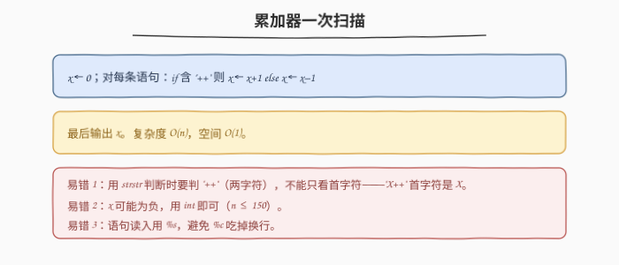

# Codeforces 282A Bit++ 题解

## 1. 题目概述

- **题目链接**：https://codeforces.com/problemset/problem/282/A
- **比赛来源**：Codeforces Round 173 (Div. 2) · Problem A（UTC 2013-03-13）
- **难度**：800
- **标签**：模拟、实现
- **评测类型**：普通
- **限制**：时间 1 s / 内存 256 MB

**题意**：Bit++ 语言只有一个变量 $x$（初值 0）和两种操作 `++`、`--`。每条语句由"一个操作 + 一个变量 X"组成，两种符号可任意排序（`++X` 或 `X++`）。给出 $n$ 条语句，按顺序执行，输出最终的 $x$。

**约束**：$1\le n\le150$，语句只含 `+`、`-`、`X`，逐条模拟即可。

## 2. 示例与观察

官方样例 1：

```text
输入：
1
++X

输出：
1
```

官方样例 2：

```text
输入：
2
X++
--X

输出：
0
```



**观察**：`X` 的位置不影响语义，本质只有"加一"和"减一"。所以判定一条语句只看它包含 `++` 还是 `--`（等价地看第 2 个字符）。

## 3. 解题思路

### 3.1 朴素做法与瓶颈

直接按字符串匹配即可，没有瓶颈：$n\le150$，$O(n)$ 的模拟就是正解。

### 3.2 正解



维护 `x`，逐条读入语句，若含 `++` 则 `x++`，否则 `x--`，最后输出。

### 3.3 样例走查

样例 1：`++X` ⇒ 含 `++` ⇒ $x=1$ ✓。
样例 2：`X++` ⇒ +1（$x=1$）；`--X` ⇒ 含 `--` ⇒ $x=0$ ✓。

## 4. 正确性证明

**引理**：一条合法语句中，"两个相同符号"要么在开头（`++X`），要么在结尾（`X++`）；因此它含子串 `++` 当且仅当它的操作是 `++`。

**证明**：语句只由 1 个操作和 1 个变量组成；`X` 只有一个字符，故两个操作符号必相邻，它们在 `X` 的一侧，形成 `++` 或 `--` 子串，且不会同时出现（同一条语句只有一种操作）。∎

**定理**：按上述规则累加得到的就是程序执行后的 $x$。

**证明**：执行一条语句 = 按其操作增/减 1（题面定义）；由引理，我们的判定与真实操作一致；初始 $x=0$，故逐条模拟即得最终值（累加的可交换性保证顺序无关，但这里本来就按顺序）。∎

## 5. 复杂度分析

- 时间：$O(n\cdot|s|) = O(n)$，$n\le150$ 时几乎为 0。
- 空间：$O(1)$（每行一个小缓冲）。

## 6. 参考代码

### C++17

```cpp
#include <bits/stdc++.h>
using namespace std;
int main(){int n;scanf("%d",&n);int x=0;char s[16];
 for(int i=0;i<n;i++){scanf("%s",s);if(strstr(s,"++"))x++;else x--;}
 printf("%d\n",x);}
```

### Python3

```python
n = int(input())
x = 0
for _ in range(n):
    s = input().strip()
    x += 1 if '++' in s else -1
print(x)
```

## 7. 边界情况与易错点

1. **`X++` 的首字符是 `X`**：只判首字符会错；必须判子串 `++`/`--`。
2. **`%c` 读入会吃掉换行**：用 `%s` 或 `input().strip()`。
3. **$x$ 可为负**：如 `--X`、`X--` 连续执行，$x$ 到 $-n$；用 `int` 足够（$n\le150$）。
4. **语句里不会出现单个 `+` 或 `-`**：不用考虑 `+X` 这种非法输入。
5. **$n=1$**：答案就是 $\pm1$。
6. **不要按字符统计**：`X++` 里有两个 `+`，但只加一次。

## 8. 验证记录

- 编译环境与命令：`clang++ -O2 -std=c++17 -I codeforces/tools/include`。
  - `python3 codeforces/tools/verify_solution.py codeforces/contests/0101-0203/282/A_Bit加加.md`
- 官方样例：2 / 2 通过（`1`、`0`）。
- 额外测试：随机 200 组（$1\le n\le150$，四种语句随机组合），与"逐条按操作累加"的独立实现对拍，全部一致。
- 最大约束性能：$n=150$ 时 $O(n)$，实测 $<1$ ms（1 s 时限）。
- 复核状态：样例、200 组随机对拍、性能均实测通过；正文代码与实测版本逐字一致。

## 相关题目与扩展

- [Codeforces 282B Painting Eggs](https://codeforces.com/problemset/problem/282/B)：同场 B 题（贪心）。
- [Codeforces 59A Word](https://codeforces.com/problemset/problem/59/A)：入门级字符串统计。
- [Codeforces 266A Stones on the Table](https://codeforces.com/problemset/problem/266/A)：另一个模拟入门。

**延伸思考**：

1. 如果语句允许 `x++x` 这种"多个 X"，如何判断操作符个数是否合法？
2. 如果要求支持 `x += 2` 这样的复合操作，输入解析要怎么改？
3. 若把 $x$ 换成 64 位并允许 $n=10^{18}$（用通项公式），答案的闭式是什么？
