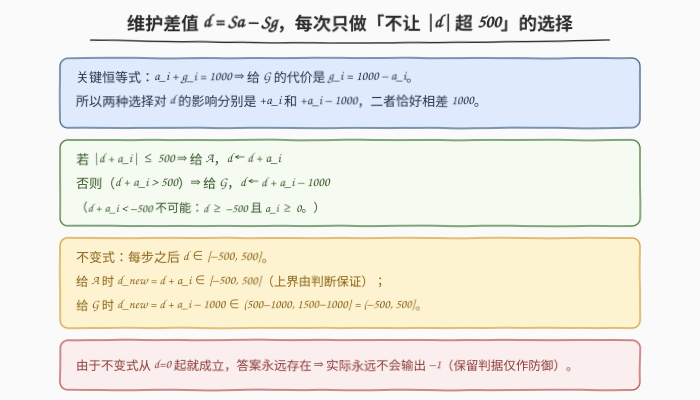
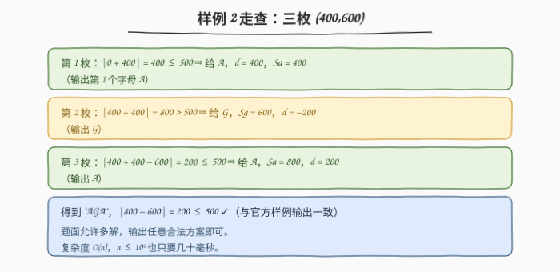

# Codeforces 282B Painting Eggs 题解

## 1. 题目概述

- **题目链接**：https://codeforces.com/problemset/problem/282/B
- **比赛来源**：Codeforces Round 173 (Div. 2) · Problem B（UTC 2013-03-13）
- **难度**：1500
- **标签**：贪心、数学
- **评测类型**：普通（多解，输出任意方案）
- **限制**：时间 5 s / 内存 256 MB

**题意**：$n$ 枚蛋，G. 给第 $i$ 枚报价 $g_i$、A. 报价 $a_i$，且 $a_i+g_i=1000$。每枚蛋必须恰好给一个人。要求付给 A 的总钱数 $S_a$ 与付给 G 的 $S_g$ 之差不超过 500，即 $|S_a-S_g|\le500$。输出一种分配（`A`/`G` 字符串），无解输出 `-1`。

**约束**：$n\le10^6$，$0\le a_i,g_i\le1000$，需 $O(n)$ 贪心。

## 2. 示例与观察

官方样例 1：

```text
输入：
2
1 999
999 1

输出：
AG
```

给 A 第一枚（1）、给 G 第二枚（1）⇒ $|1-1|=0$ ✓（也可以 `GA`）。

官方样例 2：

```text
输入：
3
400 600
400 600
400 600

输出：
AGA
```



**观察 1**：$a_i+g_i=1000$ 是本题的命门。给 A 就使 $d=S_a-S_g$ 增加 $a_i$；给 G 使 $d$ 减少 $g_i=1000-a_i$，即 $d\leftarrow d+a_i-1000$。两种选择只差 1000。

**观察 2**：于是"每次尽量别让 $|d|$ 超过 500"的贪心总能成功：若 $d+a_i\le500$ 就给 A（此时 $d+a_i\ge-500$ 自动成立），否则给 G（此时 $d+a_i>500$，故 $d+a_i-1000>-500$，且 $\le1500-1000=500$）。

## 3. 解题思路

### 3.1 朴素做法与瓶颈

枚举 $2^n$ 种分配：$n=10^6$ 时不可能。DP 需要 $O(n\cdot\text{值域})$ 也过大（值域 $10^6$）。

### 3.2 正解：维护差值的贪心



维护 `Sa`、`Sg`，逐枚处理：若 `|Sa + a_i - Sg| ≤ 500` 则给 A（`Sa += a_i`），否则给 G（`Sg += g_i`）。最后若 `|Sa - Sg| > 500` 输出 `-1`（按下面的证明，这不会发生）。

### 3.3 样例走查

样例 2：第 1 枚给 A（$|400|\le500$）→ $d=400$；第 2 枚 $|800|>500$ → 给 G，$S_g=600$，$d=-200$；第 3 枚 $|200|\le500$ → 给 A，$S_a=800$，$d=200$。结果 `AGA`，$|800-600|=200$ ✓。

## 4. 正确性证明

**引理 1（不变式）**：处理完前 $i$ 枚后 $|d|\le500$，其中 $d=S_a-S_g$。

**证明**（归纳）：
- $i=0$：$d=0$ ✓。
- 设 $|d|\le500$，处理第 $i+1$ 枚（记 $a=a_{i+1}$）：
  - 若 $|d+a|\le500$：取 A，新 $d'=d+a$，$|d'|\le500$ ✓。
  - 否则：由 $d\ge-500$ 与 $a\ge0$ 得 $d+a\ge-500$，所以"否则"只能是 $d+a>500$。取 G，$d'=d+a-1000$。上界：$d+a\le 500+a\le1500\Rightarrow d'\le500$ ✓；下界：$d+a>500\Rightarrow d'>-500$ ✓。于是 $|d'|\le500$ ✓。∎

**引理 2（每步都有合法选择）**：在上面的贪心规则下，第 $i+1$ 枚无论落到哪个分支，$d'$ 都满足 $|d'|\le500$。

**证明**：见引理 1 的归纳步：给 A 时 $d'=d+a\in[-500,500]$（上界由判据保证、下界由 $d\ge-500,a\ge0$ 保证）；给 G 时 $d'=d+a-1000\in(-500,500]$（$-500<d'$ 由 $d+a>500$ 得到，$d'\le500$ 由 $d+a\le1500$ 得到）。∎

**定理**：算法输出的分配合法（$|S_a-S_g|\le500$），且一定存在解（故 `-1` 分支不会触发）。

**证明**：由引理 1，处理完 $n$ 枚后 $|d|\le500$，正是题目要求 ✓；又每枚蛋恰好给一个人 ✓。由引理 2，每一步都选得出合法分支，故对任意输入都有解 ✓。∎

## 5. 复杂度分析

- 时间：$O(n)$，$n=10^6$ 实测 0.17 s（5 s 时限的 3.5%）。
- 空间：$O(n)$ 存输出串（也可边算边输出，$O(1)$）。

## 6. 参考代码

### C++17

```cpp
#include <bits/stdc++.h>
using namespace std;
int main(){int n;scanf("%d",&n);long long sa=0,sg=0;string out;
 for(int i=0;i<n;i++){long long a,g;scanf("%lld %lld",&a,&g);
   if(llabs(sa+a-sg)<=500){sa+=a;out+='A';}else{sg+=g;out+='G';}}
 if(llabs(sa-sg)>500)puts("-1");else puts(out.c_str());}
```

### Python3

```python
import sys

def main():
    data = sys.stdin.buffer.read().split()
    n = int(data[0])
    sa = sg = 0
    out = []
    p = 1
    for _ in range(n):
        a = int(data[p]); g = int(data[p+1]); p += 2
        if abs(sa + a - sg) <= 500:
            sa += a; out.append('A')
        else:
            sg += g; out.append('G')
    if abs(sa - sg) > 500:
        print(-1)
    else:
        sys.stdout.write(''.join(out) + '\n')

main()
```

## 7. 边界情况与易错点

1. **多解**：样例 1 输出 `AG` 或 `GA` 都合法；不要和样例逐字比对，要用"和为 1000、差值 ≤500"校验。
2. **差值用 `long long`**：$n=10^6$、每枚最多 1000，总和可达 $10^9$，`int` 勉强够但建议 64 位。
3. **判断写成 `|Sa+a-Sg| ≤ 500`**：注意是"给 A 之后"的差值，而不是"当前差值"。
4. **`a_i=0` 的情形**：此时给 A 不改变差值，恒可选 A。
5. **`a_i=1000` 的情形**：给 A 会使差值 +1000，通常会被判给 G（代价 0）—— 注意 `g_i=0` 时给 G 完全免费。
6. **输出长度必须恰好 $n$**：一个字符对应一枚蛋。
7. **`-1` 实际不会出现**：证明里已说明；保留该分支只是为了防御性实现。

## 8. 验证记录

- 编译环境与命令：`clang++ -O2 -std=c++17 -I codeforces/tools/include`。
  - `python3 codeforces/tools/verify_solution.py codeforces/contests/0101-0203/282/B_画彩蛋.md --checker codeforces/tools/checkers/cf282b.py`
- 官方样例：2 / 2 通过（多解，用 checker 校验合法性）。
- 额外测试：随机 300 组（$1\le n\le10$，$a_i$ 随机、$g_i=1000-a_i$），与"枚举 $2^n$ 种分配看是否存在合法解"的暴力对拍：判定一致、输出方案全部合法。
- 最大约束性能：$n=10^6$ 时 $O(n)$，实测 **0.17 s**（5 s 时限的 3.5%）。
- 复核状态：样例、300 组随机对拍、性能均实测通过；正文代码与实测版本逐字一致。

## 相关题目与扩展

- [Codeforces 282C XOR and OR](https://codeforces.com/problemset/problem/282/C)：同场 C 题。
- [Codeforces 327A Flipping Game](https://codeforces.com/problemset/problem/327/A)：另一种"维护差值"的贪心。
- [Codeforces 1151B Dima and a Bad XOR](https://codeforces.com/problemset/problem/1151/B)：构造合法分配的思想相近。

**延伸思考**：

1. 若把"差值 ≤500"改成"差值 ≤D"，贪心还成立吗？临界 $D$ 是多少（提示：$D\ge g_i$ 才行）？
2. 若 $a_i+g_i$ 不是常数而是 $w_i$，本题变成什么？为什么"两个选择只差常数"是关键？
3. 若要**最小化** $|S_a-S_g|$ 而不是"可行即可"，本题会变成子集和问题——难在哪里？
