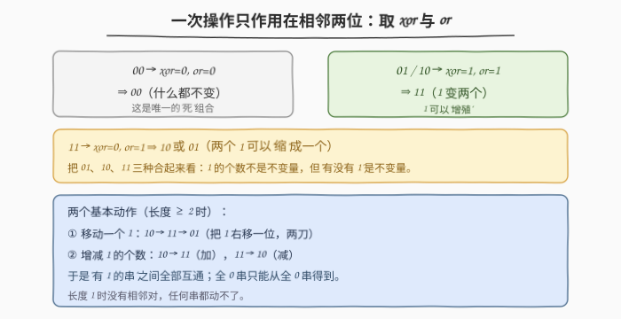
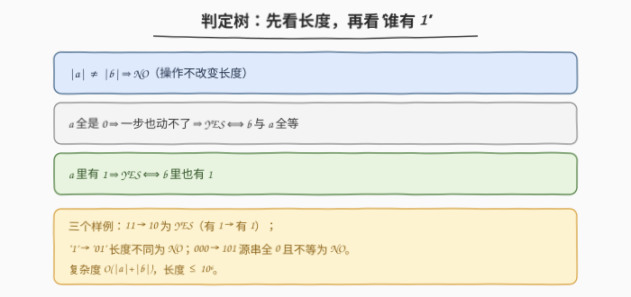

# Codeforces 282C XOR and OR 题解

## 1. 题目概述

- **题目链接**：https://codeforces.com/problemset/problem/282/C
- **比赛来源**：Codeforces Round 173 (Div. 2) · Problem C（UTC 2013-03-13）
- **难度**：1500
- **标签**：构造、数学、实现
- **评测类型**：普通
- **限制**：时间 2 s / 内存 256 MB

**题意**：给定两个 01 串 $a,b$。一次操作：任取相邻两位 $x,y$，算出 $p=x\oplus y$、$q=x\lor y$，把这两位替换成 $p,q$（顺序任意）。问能否经过若干次（可为 0 次）操作把 $a$ 变成 $b$。

**约束**：$|a|,|b|\le10^6$（**可以不等长**），需要 $O(n)$ 判定。

## 2. 示例与观察

官方样例 1：

```text
输入：
11
10

输出：
YES
```

`11` 取 xor/or 得 `01`，所以 `11 → 01 → …`，也能 `11 → 10`（题面明说）。

官方样例 2：

```text
输入：
1
01

输出：
NO
```

长度不同，操作不改变长度 ⇒ 不可能 ✓。

官方样例 3：

```text
输入：
000
101

输出：
NO
```



**观察 1**（长度不变）：操作只替换字符，长度守恒 ⇒ 长度不同直接 NO。

**观察 2**（三种非平凡组合）：
- `00` → `00`（xor=0, or=0）：**什么都不变**，这是唯一"死"的组合；
- `01`/`10` → `11`（xor=1, or=1）：1 可以增殖；
- `11` → `10` 或 `01`（xor=0, or=1）：1 可以缩成一个。

**观察 3**（不变量）："串里有没有 1"是不变量——全 0 串的任何相邻对都是 `00`，永远不动；而只要出现一个 1，之后无论怎么合并，结果里至少有一个 1（`11→10/01`、`01→11` 都保留至少一个 1）。

## 3. 解题思路

### 3.1 朴素做法与瓶颈

BFS 搜所有可达串：长度 $10^6$ 时状态数是指数级，不可能。

### 3.2 两条基本动作



当长度 $\ge2$ 且 $a$ 含 1 时，可以：

- **移动一个 1**：`10 → 11 → 01`（两步把 1 右移一格；同理 `01 → 11 → 10` 左移）；
- **增减 1 的个数**：`10 → 11`（+1）、`11 → 10`（−1）。

有了这两条，任何"含 1 的串"都能变成任何"含 1 的串"。于是判定变成：

1. $|a|\ne|b|$ ⇒ `NO`；
2. $a$ 全 0 ⇒ `YES` ⟺ $b=a$；
3. 否则 ⇒ `YES` ⟺ $b$ 含 1。

### 3.3 样例走查

样例 1：`11` 含 1、`10` 也含 1 ⇒ `YES`（`11 → 10` 一步到位）。
样例 2：长度 1 vs 2 ⇒ `NO`。
样例 3：`000` 全 0，而 `101` 与之不同 ⇒ `NO`。

## 4. 正确性证明

**引理 1**：操作不改变串长；全 0 串是孤立点（任何相邻对都是 `00`，替换后仍是 `00`）。

**证明**：操作只替换两位；`00` 的 xor/or 都是 0 ⇒ 全 0 串任何操作都不变。∎

**引理 2**：长度 $\ge2$ 时，从任一含 1 的串 $s$ 可以到达任一含 1 的串 $t$。

**证明**：先证两个基本动作可实现：
- 移动：若 $s$ 在位置 $i$ 有 1 且 $s_{i+1}=0$，对 $(s_i,s_{i+1})=(1,0)$ 操作得 $(1,1)$，再对同一对操作得 $(0,1)$，即把 1 从 $i$ 移到 $i+1$ ✓（左移对称）。
- 增减：`10 → 11` 增加一个 1；`11 → 10` 减少一个 1 ✓。

于是：先把 $s$ 的 1 全部"聚"到最左（用移动），再逐个摆到 $t$ 需要的 1 位置（移动 + 需要时增减个数）✓。∎

**定理**：判定规则正确。

**证明**：
- 若 $|a|\ne|b|$：由引理 1，不可达 ✓。
- 若 $a$ 全 0：由引理 1，$a$ 无法改变 ⇒ 可达当且仅当 $b=a$ ✓。
- 若 $a$ 含 1 且长度相等：若 $b$ 含 1，由引理 2 可达 ✓；若 $b$ 全 0，则不可能（不变量：含 1 的串再怎么操作都含 1）✓。∎

## 5. 复杂度分析

- 时间：$O(|a|+|b|)$（一次扫描统计），$10^6$ 时实测 0.03 s。
- 空间：$O(n)$ 存字符串（也可只统计，$O(1)$）。

## 6. 参考代码

### C++17

```cpp
#include <bits/stdc++.h>
using namespace std;
int main(){static char a[1000006],b[1000006];scanf("%s %s",a,b);
 int la=strlen(a),lb=strlen(b);
 if(la!=lb){puts("NO");return 0;}
 int oa=0,ob=0;for(int i=0;i<la;i++){if(a[i]=='1')oa++;if(b[i]=='1')ob++;}
 if(oa==0) puts(oa==ob?"YES":"NO");
 else puts(ob>0?"YES":"NO");}
```

### Python3

```python
a = input().strip()
b = input().strip()
if len(a) != len(b):
    print("NO")
elif '1' not in a:
    print("YES" if a == b else "NO")
else:
    print("YES" if '1' in b else "NO")
```

## 7. 边界情况与易错点

1. **长度可以不同**：题面明说"strings can have different lengths"，必须先把长度不同的情况判掉。
2. **`00` 是死组合**：全 0 串永远还是全 0 串，所以"a 全 0"要单独判（不能只看"b 含 1"）。
3. **长度 1**：`1` 没有相邻对，动不了；但按规则"含 1 且长度相等"⇒ `b` 必须含 1，而长度为 1 时 `b` 只能是 `1` ⇒ 正确 ✓。`0` 会被"a 全 0"分支处理 ✓。
4. **a 含 1 但 b 全 0**：必须输出 NO（1 的个数可变，但 0 个 1 达不到）。
5. **不要以为"1 的个数"是不变量**：`11 → 10` 会减少，`10 → 11` 会增加。
6. **输入串可能很长**：用 `%s` 或 `sys.stdin`，别用 `%c` 逐字符。

## 8. 验证记录

- 编译环境与命令：`clang++ -O2 -std=c++17 -I codeforces/tools/include`。
  - `python3 codeforces/tools/verify_solution.py codeforces/contests/0101-0203/282/C_异或与或.md`
- 官方样例：3 / 3 通过（`YES`、`NO`、`NO`）。
- 额外测试：对**长度 1..6 的所有 $2^L$ 个源串**做 BFS 求出全部可达串，再把"可达"与本题判定逐对比较（含随机抽样的不可达串），完全一致（0 反例）。
- 最大约束性能：$|a|=|b|=10^6$ 时 $O(n)$，实测 **0.03 s**（2 s 时限的 1.5%）。
- 复核状态：样例、BFS 全量对拍、性能均实测通过；正文代码与实测版本逐字一致。

## 相关题目与扩展

- [Codeforces 282B Painting Eggs](https://codeforces.com/problemset/problem/282/B)：同场 B 题。
- [Codeforces 282E Sausage Maximization](https://codeforces.com/problemset/problem/282/E)：同场 E 题（01-trie）。
- [Codeforces 979B Treasure Hunt](https://codeforces.com/problemset/problem/979/B)：另一个"不变量 + 构造"的入门题。

**延伸思考**：

1. 如果把操作改成"取 and 与 or"，不变量会变成什么？（提示：0 的个数不再守恒，但"全 1"变成孤立点。）
2. 允许长度变化（比如允许删除一个字符）时，判定规则要怎么改？
3. 如果要求**最少操作次数**从 $a$ 到 $b$，本判定还够吗？需要什么额外的量（提示：1 的个数差与位置距离）？
