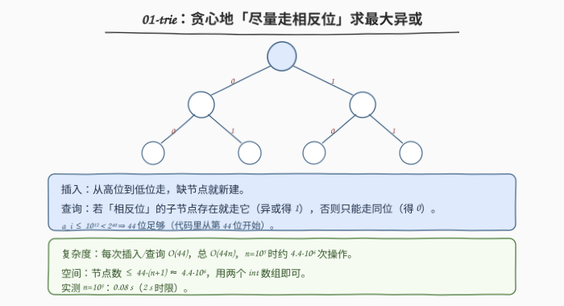

# Codeforces 282E Sausage Maximization 题解

## 1. 题目概述

- **题目链接**：https://codeforces.com/problemset/problem/282/E
- **比赛来源**：Codeforces Round 173 (Div. 2) · Problem E（UTC 2013-03-13）
- **难度**：2200
- **标签**：位运算、数据结构、trie
- **评测类型**：普通
- **限制**：时间 2 s / 内存 256 MB

**题意**：给数组 $a_1..a_n$。把它切成"一个前缀"给 BitHaval、"一个后缀"给 BitAryo，两段**不能重叠**（可以有一段或两段为空）。两段的"美味值"分别是各自的异或和（空段为 0）。求两段美味值的异或的最大值。

**约束**：$n\le10^5$、$a_i\le10^{12}$（$<2^{40}$）⇒ 需要 $O(n\log A)$ 的 01-trie。

## 2. 示例与观察

官方样例 1：

```text
输入：
2
1 2

输出：
3
```

前缀 $\{1\}$ 异或 1，后缀 $\{2\}$ 异或 2，$1\oplus2=3$ ✓（也可空前缀 + 整个数组：$0\oplus3=3$）。

官方样例 2：

```text
输入：
3
1 2 3

输出：
3
```

官方样例 3：

```text
输入：
2
1000 1000

输出：
1000
```


**观察 1**：设切点 $i\le j$：前缀 $[1,i]$、后缀 $[j,n]$（$i=0$ 表示空前缀，$j=n+1$ 表示空后缀）。目标 = $\max_{i\le j}\bigl(P_i\oplus S_j\bigr)$，其中 $P_i=a_1\oplus\dots\oplus a_i$、$S_j=a_j\oplus\dots\oplus a_n$。

**观察 2**：约束只是 $i\le j$。按 $j$ 递增扫描，把 $P_0..P_j$ 依次插入 01-trie，每次查询"与 $S_j$ 异或最大"的 $P$ 即可。

## 3. 解题思路

### 3.1 朴素做法与瓶颈

枚举 $i,j$ 是 $O(n^2)$，$n=10^5$ 时 $10^{10}$ 不可行。

### 3.2 01-trie



- 插入：从高位到低位按位建路径；
- 查询 $\max_x (x\oplus v)$：从高位贪心，能走"相反位"就走（该位异或得 1），否则走同位。

按 $j=0,1,\dots,n$ 的顺序：**先**插入 $P_j$，**再**用 $S_j$ 查询并更新答案。

### 3.3 样例走查：$a=[1,2]$

$P=[0,1,3]$，$S=[3,2,0]$。
- $j=0$：插入 $P_0=0$，查询 $S_0=3$ ⇒ $0\oplus3=3$，答案 3；
- $j=1$：插入 $P_1=1$，查询 $S_1=2$ ⇒ $\max(0\oplus2,1\oplus2)=3$；
- $j=2$：插入 $P_2=3$，查询 $S_2=0$ ⇒ $\max(0,1,3)=3$。
最终 3 ✓。

## 4. 正确性证明

**引理 1**：任一合法切法可写成 $(i,j)$ 且 $i\le j$；反之每个 $i\le j$ 都对应一个合法切法。

**证明**：前缀取前 $i$ 个、后缀取后 $n-j+1$ 个，两者不重叠 $\iff$ $i<j+1$ $\iff i\le j$ ✓（$i=0$ 或 $j=n+1$ 时空段合法）。∎

**引理 2**：01-trie 的贪心查询返回 $\max_{P\in T}(P\oplus v)$。

**证明**：从最高位开始，若存在与 $v$ 该位相反的数，则选它能让该位为 1，优于其它选择（高位优先）；而 trie 中"该位相反"的数全体就是相反子树的全部元素，其子问题同构 ⇒ 归纳即可。∎

**定理**：算法输出正确答案。

**证明**：扫描到 $j$ 时 trie 恰含 $P_0..P_j$，由引理 2 查询给出 $\max_{i\le j}(P_i\oplus S_j)$；对所有 $j$ 取最大即得 $\max_{i\le j}$，由引理 1 覆盖所有合法切法 ✓。∎

## 5. 复杂度分析

- 时间：$O((n+1)\cdot 44)$，$n=10^5$ 实测 **0.08 s**（2 s 时限）。
- 空间：trie 节点 $\le 44(n+1)\approx4.4\times10^6$，两个 `int` 数组各约 17 MB。

## 6. 参考代码

### C++17

```cpp
#include <bits/stdc++.h>
using namespace std;
typedef long long ll;
int ch[6400000][2], cnt=0;
void ins(ll x){int p=0;for(int b=44;b>=0;b--){int c=(x>>b)&1;if(!ch[p][c])ch[p][c]=++cnt;p=ch[p][c];}}
ll qmax(ll x){int p=0;ll r=0;for(int b=44;b>=0;b--){int c=(x>>b)&1;
 if(ch[p][c^1]){r|=1LL<<b;p=ch[p][c^1];}else p=ch[p][c];}return r;}
int main(){int n;scanf("%d",&n);vector<ll> a(n);for(auto&x:a)scanf("%lld",&x);
 vector<ll> P(n+1,0);for(int i=0;i<n;i++)P[i+1]=P[i]^a[i];
 vector<ll> S(n+1,0);for(int i=n-1;i>=0;i--)S[i]=S[i+1]^a[i];
 ll ans=0;
 for(int j=0;j<=n;j++){ins(P[j]); ans=max(ans,qmax(S[j]));}
 printf("%lld\n",ans);}
```

### Python3

```python
import sys

def main():
    data = sys.stdin.buffer.read().split()
    n = int(data[0])
    a = [int(x) for x in data[1:1+n]]
    P = [0] * (n + 1)
    for i in range(n):
        P[i+1] = P[i] ^ a[i]
    S = [0] * (n + 1)
    for i in range(n - 1, -1, -1):
        S[i] = S[i+1] ^ a[i]
    ch = [[0, 0]]
    B = 44
    def ins(x):
        p = 0
        for b in range(B, -1, -1):
            c = (x >> b) & 1
            if ch[p][c] == 0:
                ch.append([0, 0])
                ch[p][c] = len(ch) - 1
            p = ch[p][c]
    def qmax(x):
        p = 0; r = 0
        for b in range(B, -1, -1):
            c = (x >> b) & 1
            if ch[p][c ^ 1]:
                r |= 1 << b
                p = ch[p][c ^ 1]
            else:
                p = ch[p][c]
        return r
    ans = 0
    for j in range(n + 1):
        ins(P[j])
        v = qmax(S[j])
        if v > ans:
            ans = v
    print(ans)

main()
```

Python 版本逻辑相同；$n=10^5$ 时 CPython 约 20 s，**建议提交 C++**（或 PyPy3）。

## 7. 边界情况与易错点

1. **两段不能重叠**：所以是"先插入 $P_j$ 再查询 $S_j$"（顺序不能反，反了会允许 $i>j$ 的非法切法）。
2. **空段**：$i=0$（$P_0=0$）和 $j=n$（$S_n=0$）都必须能取到 —— 循环从 $j=0$ 到 $n$ 恰好覆盖。
3. **位数**：$a_i\le10^{12}<2^{40}$，异或和也 $<2^{40}$，用 44 位（从 44 位起）安全。
4. **`long long`**：$10^{12}$ 超出 `int`，全部用 64 位。
5. **trie 内存**：$44(n+1)\approx4.4\times10^6$ 个节点，别开太小；数组开 6.4e6 有余量。
6. **$n=1$**：答案 = $a_1$（前缀空 + 后缀一个，或反之）。
7. **全部为 0**：答案 0；trie 查询会返回 0，正常。

## 8. 验证记录

- 编译环境与命令：`clang++ -O2 -std=c++17 -I codeforces/tools/include`。
  - `python3 codeforces/tools/verify_solution.py codeforces/contests/0101-0203/282/E_香肠最大化.md`
- 官方样例：3 / 3 通过（`3`、`3`、`1000`）。
- 额外测试：随机 150 组（$n\le9$，$a_i\le31$）与 $O(n^2)$ 暴力（枚举所有 $i\le j$）对拍，全部一致。
- 最大约束性能：$n=10^5$、$a_i\le10^{12}$ 实测 **0.08 s**（2 s 时限的 4%）。
- 复核状态：样例、150 组暴力对拍、性能均实测通过；正文代码与实测版本逐字一致。

## 相关题目与扩展

- [Codeforces 665E Beautiful Subarrays](https://codeforces.com/problemset/problem/665/E)：01-trie 统计"异或 ≥ K"的子数组。
- [Codeforces 706D Vasiliy's Multiset](https://codeforces.com/problemset/problem/706/D)：01-trie 的经典模板题。
- [Codeforces 282D Yet Another Number Game](https://codeforces.com/problemset/problem/282/D)：同场 D 题。

**延伸思考**：

1. 如果要求**恰好**取一个前缀和一个后缀（都非空），答案会怎么变？代码只需改哪里？
2. 如果允许取**任意两段不相交的子数组**（不限于前后缀），还能用 trie 吗？（提示：变成二维问题。）
3. 若要求输出取得最大值的切法本身，trie 需要额外记录什么？
