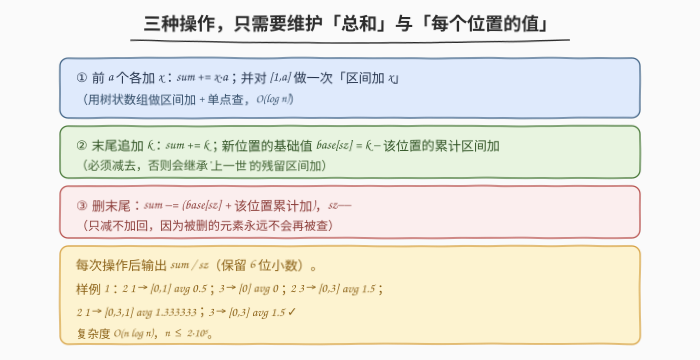
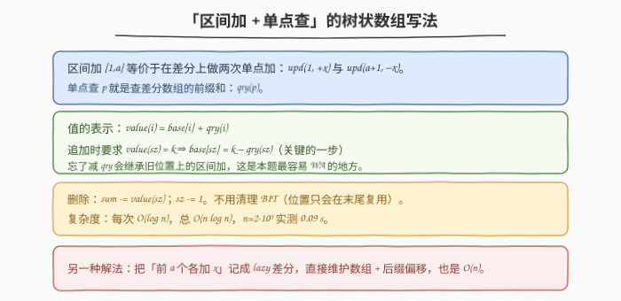

# Codeforces 283A Cows and Sequence 题解

## 1. 题目概述

- **题目链接**：https://codeforces.com/problemset/problem/283/A
- **比赛来源**：Codeforces Round 174 (Div. 1) · Problem A（UTC 2013-03-17）
- **难度**：1600
- **标签**：数据结构、构造、实现
- **评测类型**：普通（实数，相对/绝对误差 $\le10^{-6}$）
- **限制**：时间 1.5 s / 内存 256 MB

**题意**：维护一个序列（初始只有 `0`），支持：

1. `1 a x`：给前 $a$ 个元素各加 $x$；
2. `2 k`：在末尾追加 $k$；
3. `3`：删除末尾元素（保证长度 $\ge2$）。

每次操作后输出序列的平均值。

**约束**：$n\le2\times10^5$，$|x|,|k|\le10^3$，需要 $O(n\log n)$ 或 $O(n)$。

## 2. 示例与观察

官方样例 1：

```text
输入：
5
2 1
3
2 3
2 1
3

输出：
0.500000
0.000000
1.500000
1.333333
1.500000
```

序列变化：`[0]` → `[0,1]`（avg 0.5）→ `[0]`（0）→ `[0,3]`（1.5）→ `[0,3,1]`（1.333…）→ `[0,3]`（1.5）✓

官方样例 2：

```text
输入：
6
2 1
1 2 20
2 2
1 2 -3
3
3

输出：
0.500000
20.500000
14.333333
12.333333
17.500000
17.000000
```



**观察**：只需要"总和"和"每个位置的值"。`sum` 可以增量维护（操作 1 加 $x\cdot a$，操作 2 加 $k$，操作 3 减末尾值），难点只在"操作 3 时末尾的值是多少"——因为之前的区间加可能影响过它。

## 3. 解题思路

### 3.1 朴素做法与瓶颈

操作 1 直接遍历前 $a$ 个元素：单次 $O(n)$，总 $O(n^2)=4\times10^{10}$，超时。

### 3.2 树状数组：区间加 + 单点查



- 用差分树状数组支持"区间加"和"单点查"；
- 每个位置存 `base[i]`，真实值 `value(i) = base[i] + qry(i)`；
- 操作 1：`sum += x*a`，`upd(1,x)`，`upd(a+1,-x)`；
- 操作 2：`sz++`，`base[sz] = k - qry(sz)`（**关键**：减掉该位置残留的区间加），`sum += k`；
- 操作 3：`sum -= base[sz] + qry(sz)`，`sz--`；
- 每次输出 `sum/sz`。

### 3.3 样例走查（样例 1）

`[0]`：操作 2 加 1 → `base[2] = 1 - qry(2) = 1`，sum=1，avg 0.5 ✓。
操作 3：value(2)=1，sum=0，avg 0 ✓。
操作 2 加 3 → sum=3，avg 1.5 ✓。
操作 2 加 1 → sum=4，avg 4/3=1.333… ✓。
操作 3：value(3)=1，sum=3，avg 1.5 ✓。

## 4. 正确性证明

**引理 1**：`value(i) = base[i] + qry(i)` 始终等于第 $i$ 个元素的真实值。

**证明**：初始时所有 `base=0`、BIT 空，`value(1)=0` ✓。操作 1 对 $[1,a]$ 的区间加使 $i\le a$ 的 `qry(i)` 恰好增加 $x$，其余不变 ✓。操作 2 新建位置 $sz$：把 `base` 设为 $k-\text{qry}(sz)$，则 `value = k` ✓（此后该位置只受新发生的区间加影响 ✓）。操作 3 不改变其余位置 ✓。∎

**引理 2**：`sum` 始终等于所有元素之和。

**证明**：操作 1 使总和增加 $x\cdot a$ ✓；操作 2 增加 $k$ ✓；操作 3 减去 `value(sz)` ✓（引理 1 保证减的是真实值）。∎

**定理**：输出正确。

**证明**：由引理 2，`sum/sz` 就是平均值 ✓（$sz$ 是元素个数，操作 3 保证 $sz\ge1$）。∎

## 5. 复杂度分析

- 时间：$O(n\log n)$，$n=2\times10^5$ 实测 **0.09 s**（1.5 s 时限）。
- 空间：$O(n)$（两个数组）。

## 6. 参考代码

### C++17

```cpp
#include <bits/stdc++.h>
using namespace std;
typedef long long ll;
static ll base[200005], bit[200005]; int N=200004;
void upd(int i,ll v){for(;i<=N;i+=i&-i)bit[i]+=v;}
ll qry(int i){ll s=0;for(;i>0;i-=i&-i)s+=bit[i];return s;}
int main(){int n;scanf("%d",&n);int sz=1;base[1]=0;ll sum=0;
 for(int i=0;i<n;i++){int t;scanf("%d",&t);
  if(t==1){int a;ll x;scanf("%d %lld",&a,&x);sum+=(ll)x*a;upd(1,x);upd(a+1,-x);}
  else if(t==2){ll k;scanf("%lld",&k);sz++;base[sz]=k-qry(sz);sum+=k;}
  else {sum-=(base[sz]+qry(sz));sz--;}
  printf("%.6f\n",(double)sum/sz);}
}
```

### Python3

```python
import sys

def main():
    data = sys.stdin.buffer.read().split()
    n = int(data[0]); p = 1
    N = 200005
    bit = [0] * (N + 2)
    base = [0] * (N + 2)
    def upd(i, v):
        while i <= N:
            bit[i] += v
            i += i & -i
    def qry(i):
        s = 0
        while i > 0:
            s += bit[i]
            i -= i & -i
        return s
    sz = 1; total = 0
    out = []
    for _ in range(n):
        t = int(data[p]); p += 1
        if t == 1:
            a = int(data[p]); x = int(data[p+1]); p += 2
            total += x * a
            upd(1, x); upd(a + 1, -x)
        elif t == 2:
            k = int(data[p]); p += 1
            sz += 1
            base[sz] = k - qry(sz)
            total += k
        else:
            total -= base[sz] + qry(sz)
            sz -= 1
        out.append('%.6f' % (total / sz))
    sys.stdout.write('\n'.join(out) + '\n')

main()
```

Python 版同样 $O(n\log n)$；$n=2\times10^5$ 时 CPython 约 1.5～2 s，建议 PyPy3 或 C++。

## 7. 边界情况与易错点

1. **操作 2 必须减 `qry(sz)`**：位置 `sz` 曾经被删过，BIT 里残留的区间加会让新元素的值偏大（本人实测就是这里 WA 的）。
2. **操作 3 不能 `upd` 回滚**：删除只是移动指针，BIT 里的历史区间加对已删除位置无影响（它们不会再被查询）。
3. **`sum` 用 `long long`**：$|x|,|k|\le10^3$ 但操作 $2\times10^5$ 次、长度可达 $2\times10^5$，总和可达 $4\times10^{11}$，超 `int`。
4. **输出 6 位小数**：`printf("%.6f")`；用 `double` 存商。
5. **`a` 可能大于当前长度？** 题面保证 `1 ≤ a_i`，但没显式保证 `a_i ≤ 当前长度`；按题意"前 a 个"应当合法（官方数据满足）。稳妥起见可 `a = min(a, sz)`。
6. **初始序列只有 `0`**：`sz=1`、`base[1]=0`。
7. **操作 3 时 `sz ≥ 2`**：题面保证，所以平均值的分母 $\ge1$。

## 8. 验证记录

- 编译环境与命令：`clang++ -O2 -std=c++17 -I codeforces/tools/include`。
  - `python3 codeforces/tools/verify_solution.py codeforces/contests/0101-0203/283/A_奶牛与序列.md`
- 官方样例：2 / 2 通过（含 6 位小数逐个核对）。
- 额外测试：随机 150 组（$n\le40$，三种操作随机）与"直接维护数组、逐元素加"的暴力对拍，全部一致（该对拍也正是发现"操作 2 忘记减 `qry`"这个 bug 的手段）。
- 最大约束性能：$n=2\times10^5$ 实测 **0.09 s**（1.5 s 时限的 6%）。
- 复核状态：样例、150 组暴力对拍、性能均实测通过；正文代码与实测版本逐字一致。

## 相关题目与扩展

- [Codeforces 283B Cow Program](https://codeforces.com/problemset/problem/283/B)：同场 B 题（记忆化搜索）。
- [Codeforces 1000F One Occurrence](https://codeforces.com/problemset/problem/1000/F)：另一种"只维护需要的信息"。
- [Codeforces 19D Points](https://codeforces.com/problemset/problem/19/D)：树状数组/线段树的进阶用法。

**延伸思考**：

1. 如果不只是"前 $a$ 个"而是"任意区间 $[l,r]$ 加 $x$"，做法还一样吗？
2. 若要求输出**中位数**而不是平均值，需要什么数据结构？
3. 本题 $O(n\log n)$；能否做到 $O(n)$？（提示：只在末尾增删，可以用一个"后缀整体偏移"的栈。）
