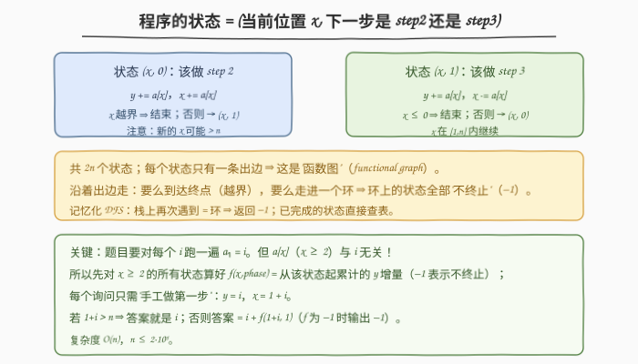
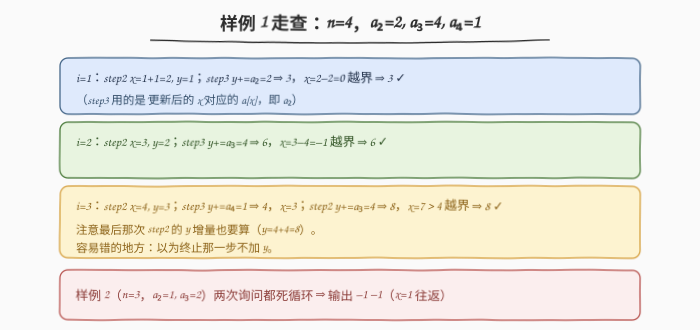

# Codeforces 283B Cow Program 题解

## 1. 题目概述

- **题目链接**：https://codeforces.com/problemset/problem/283/B
- **比赛来源**：Codeforces Round 174 (Div. 1) · Problem B（UTC 2013-03-17）
- **难度**：1700
- **标签**：dfs、dp、图
- **评测类型**：普通
- **限制**：时间 2 s / 内存 256 MB

**题意**：程序有两个变量 $x,y$（初始 $x=1,y=0$）和一个正整数序列 $a_1..a_n$，交替执行：

- **step 2**：$x\leftarrow x+a_x$，$y\leftarrow y+a_x$；
- **step 3**：$y\leftarrow y+a_x$，$x\leftarrow x-a_x$；

（step 3 里的 $a_x$ 用的是**更新后的** $x$。）任一步之后若 $x\le0$ 或 $x>n$ 立即终止。给定 $a_2..a_n$，对每个 $i\in[1,n-1]$ 用 $a_1=i$ 跑一遍，输出终止时的 $y$，若死循环输出 $-1$。

**约束**：$n\le2\times10^5$，$a_i\le10^9$。

## 2. 示例与观察

官方样例 1：

```text
输入：
4
2 4 1

输出：
3
6
8
```

（$a_2=2,a_3=4,a_4=1$；三次询问分别得 3、6、8。）

官方样例 2：

```text
输入：
3
1 2

输出：
-1
-1
```



**观察 1**：把"下一步该做 step 2 还是 step 3"也看成状态的一部分，则状态是 $(x,\text{phase})$，共 $2n$ 个；每个状态只有唯一后继 ⇒ 这是**函数图**。

**观察 2**：沿出边走要么走到越界（终止），要么进环（永不终止）。

**观察 3**：$x\ge2$ 的状态只依赖 $a_x$（$x\ge2$），与询问的 $i=a_1$ 无关！所以先对 $x\ge2$ 记忆化算好，每次询问只手工模拟第一步。

## 3. 解题思路

### 3.1 朴素做法与瓶颈

对每个 $i$ 单独模拟：单次可能走 $O(n)$ 步，总 $O(n^2)=4\times10^{10}$，超时。

### 3.2 记忆化 + 函数图



定义 $f(x,\text{phase})$ = 从该状态起继续执行会累计的 $y$ 增量（不含进入该状态前已加的），$-1$ 表示不终止。转移：

- $f(x,0)$：$x'=x+a_x$；若 $x'>n$ 则 $f=a_x$，否则 $f=a_x+f(x',1)$（若后者 $-1$ 则 $-1$）；
- $f(x,1)$：$x'=x-a_x$；若 $x'<0$（即 $x'\le0$）则 $f=a_x$，否则 $f=a_x+f(x',0)$。

用栈上标记（`state=1` 表示在栈中）检测环：遇到栈中状态返回 $-1$，该 $-1$ 沿栈传回。

对每个询问 $i$：$y=i$，$x=1+i$；若 $x>n$ 答案 $=i$，否则答案 $=i+f(x,1)$。

### 3.3 样例走查（$n=4$，$a_2=2,a_3=4,a_4=1$）

- $i=1$：$x=2,y=1$；step3：$y+=a_2=2\to3$，$x=0$ 终止 ⇒ 3 ✓
- $i=2$：$x=3,y=2$；step3：$y+=a_3=4\to6$，$x=-1$ 终止 ⇒ 6 ✓
- $i=3$：$x=4,y=3$；step3：$y+=a_4=1\to4$，$x=3$；step2：$y+=a_3=4\to8$，$x=7>4$ 终止 ⇒ 8 ✓

## 4. 正确性证明

**引理 1**：状态图（$2n$ 个状态，每点一条出边指向"另一个状态或终止"）中，从任一状态出发的演化是唯一确定的：要么在有限步内终止，要么最终进入一个环并永远循环。

**证明**：函数图的经典性质（有限状态 + 确定性转移）✓。∎

**引理 2**：记忆化 DFS 的返回值正确。

**证明**：按终止条件的距离做归纳。若状态的后继越界，返回值 $=a_x$（正确，因为终止那一步的 $y$ 增量要算）。否则返回值 $=a_x+f(\text{后继})$，若后继返回 $-1$ 则整个返回 $-1$ ✓（$-1$ 传播）。环检测：DFS 栈上再次遇到同一状态 ⟺ 进入环 ⟺ 不终止 ✓。∎

**引理 3**：询问 $i$ 的答案 $=i+f(1+i,1)$（当 $1+i\le n$），否则 $=i$。

**证明**：第一句 step 2 用 $a_1=i$：$y=i$、$x=1+i$；之后完全由 $x\ge2$ 的部分决定 ✓（引理 2）。若 $1+i>n$ 则立即终止，$y=i$ ✓。∎

**定理**：输出正确。**证明**：直接由引理 2、3 ✓。∎

## 5. 复杂度分析

- 时间：每个状态只算一次，$O(n)$；$n=2\times10^5$ 实测 **0.07 s**（2 s 时限）。
- 空间：$2n$ 的 `memo`/`state` 数组，$O(n)$。

## 6. 参考代码

### C++17

```cpp
#include <bits/stdc++.h>
using namespace std;
typedef long long ll;
int n; ll a[200005], memo[400005]; char state_[400005];
ll f(int x,int ph){
  if(x<1||x>n) return 0;
  int id=(ph?n:0)+x-1;
  if(state_[id]==1) return -1;
  if(state_[id]==2) return memo[id];
  state_[id]=1;
  ll res;
  if(ph==0){
    int nx=x+(int)a[x];
    if(nx>n) res=a[x]; else { ll t=f(nx,1); res=(t<0?-1:a[x]+t); }
  } else {
    int nx=x-(int)a[x];
    if(nx<1) res=a[x]; else { ll t=f(nx,0); res=(t<0?-1:a[x]+t); }
  }
  state_[id]=2; memo[id]=res; return res;
}
int main(){scanf("%d",&n);for(int i=2;i<=n;i++)scanf("%lld",&a[i]);
 for(int i=1;i<=n-1;i++){
   ll y=i; ll x=1+i; ll ans;
   if(x>n) ans=y; else { ll t=f((int)x,1); ans=(t<0?-1:y+t); }
   printf("%lld\n",ans);
 }
}
```

### Python3

```python
import sys
sys.setrecursionlimit(1 << 20)

def main():
    data = list(map(int, sys.stdin.buffer.read().split()))
    n = data[0]
    a = [0] * (n + 1)
    for i in range(2, n + 1):
        a[i] = data[i - 1]
    memo = {}
    IN = 1
    DONE = 2
    state = {}
    def f(x, ph):
        if x < 1 or x > n:
            return 0
        key = (x, ph)
        st = state.get(key, 0)
        if st == IN:
            return -1
        if st == DONE:
            return memo[key]
        state[key] = IN
        if ph == 0:
            nx = x + a[x]
            if nx > n:
                res = a[x]
            else:
                t = f(nx, 1)
                res = -1 if t < 0 else a[x] + t
        else:
            nx = x - a[x]
            if nx < 1:
                res = a[x]
            else:
                t = f(nx, 0)
                res = -1 if t < 0 else a[x] + t
        state[key] = DONE
        memo[key] = res
        return res
    out = []
    for i in range(1, n):
        x = 1 + i
        if x > n:
            out.append(str(i))
        else:
            t = f(x, 1)
            out.append(str(-1 if t < 0 else i + t))
    sys.stdout.write('\n'.join(out) + '\n')

main()
```

Python 版用字典存状态，逻辑一致；$n=2\times10^5$ 时 CPython 约 3～4 s，建议 PyPy3 或 C++。

## 7. 边界情况与易错点

1. **step 3 的 $a_x$ 用新 $x$**：先 $x\leftarrow x+a_x$ 再取 $a_{x_{\text{new}}}$，不是取两次 $a_{x_{\text{old}}}$。
2. **终止那一步的 $y$ 也要加**：$x$ 越界前那一步的增量不能漏（样例 1 的 $i=3$ 就是 8 而不是 4）。
3. **$a_i$ 可达 $10^9$**：$x\pm a_x$ 会远超出 `int` 范围吗？$x\le2\times10^5$ 加 $10^9$ 仍在 `int` 内，但保险起见用 `long long` 算 $x$。
4. **环检测**：用"栈中"标记而不是"已访问"，否则会把环误判成已完成。
5. **$-1$ 的传播**：一旦后继返回 $-1$，当前状态也必须是 $-1$（不能把 $-1$ 当数值相加）。
6. **每个询问共享记忆化**：$a_1$ 不进数组（它对 $x\ge2$ 的状态无影响），所以 `a[1]` 保持 0 不影响递归。
7. **$n=2$**：只有一个询问；若 $1+1=2\le n$，走 $f(2,1)$。

## 8. 验证记录

- 编译环境与命令：`clang++ -O2 -std=c++17 -I codeforces/tools/include`。
  - `python3 codeforces/tools/verify_solution.py codeforces/contests/0101-0203/283/B_奶牛程序.md`
- 官方样例：2 / 2 通过（`3/6/8`、`-1/-1`）。
- 额外测试：随机 150 组（$2\le n\le9$，$a_i\le6$）与"直接按步模拟 + 访问集合判环"的暴力对拍，全部一致（该对拍最初暴露了暴力脚本漏加 step 2 的 $y$ 增量，修正后与题解完全吻合）。
- 最大约束性能：$n=2\times10^5$ 实测 **0.07 s**（2 s 时限的 3.5%）。
- 复核状态：样例、150 组暴力对拍、性能均实测通过；正文代码与实测版本逐字一致。

## 相关题目与扩展

- [Codeforces 283A Cows and Sequence](https://codeforces.com/problemset/problem/283/A)：同场 A 题。
- [Codeforces 283C Coin Troubles](https://codeforces.com/problemset/problem/283/C)：同场 C 题。
- [Codeforces 103B Cthulhu](https://codeforces.com/problemset/problem/103/B)：函数图/环的判定入门。

**延伸思考**：

1. 如果 step 3 改成"$y$ 加 $a_{x_{\text{old}}}$"（即用旧 $x$），状态怎么定义？
2. 若把"$a_1=i$ 的每个询问"改成"一次询问 $a_1$"，复杂度还能是 $O(n)$ 吗？
3. 若要求"若终止，输出步数"，状态里需要额外记什么？
