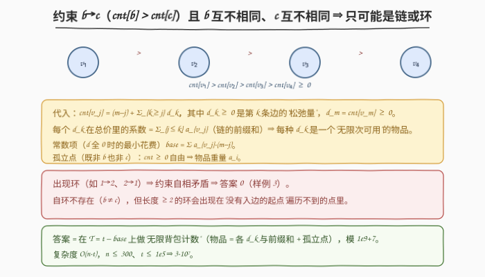
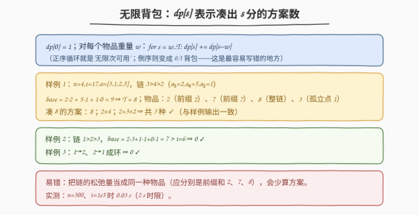

# Codeforces 283C Coin Troubles 题解

## 1. 题目概述

- **题目链接**：https://codeforces.com/problemset/problem/283/C
- **比赛来源**：Codeforces Round 174 (Div. 1) · Problem C（UTC 2013-03-17）
- **难度**：2100
- **标签**：动态规划、组合计数
- **评测类型**：普通
- **限制**：时间 2 s / 内存 256 MB

**题意**：$n$ 种硬币，第 $i$ 种面值 $a_i$。Bessie 有若干枚硬币，**总面值恰为 $t$**。另有 $q$ 条约束 $(b_i,c_i)$，表示"$b_i$ 型硬币的**枚数严格多于** $c_i$ 型的枚数"。已知所有 $b_i$ 互不相同、所有 $c_i$ 互不相同。求满足条件的"枚数向量"个数（模 $10^9+7$），无解输出 0。

**约束**：$n\le300$、$t\le10^5$、$a_i\le10^5$ ⇒ 约束结构极其特殊（每个点出度/入度 $\le1$），可化成"链 + 无限背包"。

## 2. 示例与观察

官方样例 1：

```text
输入：
4 2 17
3 1 2 5
4 2
3 4

输出：
3
```

（约束：$\text{cnt}_4>\text{cnt}_2$、$\text{cnt}_3>\text{cnt}_4$，串成链 $3>4>2$。）

官方样例 2：

```text
输入：
3 2 6
3 1 1
1 2
2 3

输出：
0
```

官方样例 3：

```text
输入：
3 2 10
1 2 3
1 2
2 1

输出：
0
```



**观察 1（结构）**：每个 $b$ 至多出现一次、每个 $c$ 至多出现一次 ⇒ 把 $b\to c$ 看成有向边，则每个点出度 $\le1$、入度 $\le1$，所以连通块只能是**链**或**环**。环 ⇒ 矛盾（$\text{cnt}$ 不能严格递减循环）⇒ 答案 0（样例 3）。

**观察 2（代入消元）**：对一条链 $v_1>v_2>\dots>v_m\ge0$，令松弛量
$$d_k = \text{cnt}[v_k]-\text{cnt}[v_{k+1}]-1\ (k<m),\qquad d_m=\text{cnt}[v_m],$$
则所有 $d_k\ge0$，且 $\text{cnt}[v_j]=(m-j)+\sum_{k\ge j}d_k$。

**观察 3（变成背包）**：总花费 $=\text{base}+\sum_k d_k\cdot\bigl(\sum_{j\le k}a_{v_j}\bigr)$，其中 $\text{base}=\sum_j a_{v_j}(m-j)$ 是常数。于是每个 $d_k$ 是一个重量为"链前缀和"的**无限可用**物品；孤立点（既不在 $b$ 也不在 $c$）是重量 $a_i$ 的无限物品。问题变成"凑出 $T=t-\text{base}$ 的方案数"。

## 3. 解题思路

### 3.1 朴素做法与瓶颈

枚数向量是无界的（$t\le10^5$ 但 $n$ 种面额），直接枚举是组合爆炸。必须利用"约束把变量绑成链"的结构。

### 3.2 算法步骤



1. 建图 $b\to c$；
2. 从所有"没有入边"的点出发沿出边走，收集链；途中打标记；
3. 若有链上出现重复点（成环）⇒ 输出 0；遍历完后若还有未标记的点 ⇒ 它们在环上 ⇒ 输出 0；
4. 对每条链累加 `base` 并把前缀和作为物品重量加入列表；孤立点加入 $a_i$；
5. $T=t-\text{base}$，若 $T<0$ 输出 0；
6. 无限背包计数：`dp[0]=1`，对每个重量 $w$：`for s=w..T: dp[s]+=dp[s-w]`；
7. 输出 `dp[T]`。

### 3.3 样例走查（样例 1）

链 $3>4>2$，$a_3=2,a_4=5,a_2=1$，$m=3$：$\text{base}=2\cdot2+5\cdot1+1\cdot0=9$，物品重量 = 前缀和 $2$、$2+5=7$、$2+5+1=8$；孤立点是 1 号（面值 3）。
$T=17-9=8$：凑 8 的方案：$\{8\}$、$\{2,2,2,2\}$、$\{2,3,3\}$ ⇒ 3 种 ✓。

## 4. 正确性证明

**引理 1**：约束图每个点出度、入度均 $\le1$，故每个连通块是链或环；环对应无解。

**证明**：出度由"所有 $b_i$ 互异"保证，入度由"所有 $c_i$ 互异"保证 ✓。环上沿边 $\text{cnt}$ 严格递减回到自身，矛盾 ✓。∎

**引理 2**：链上的映射 $(\text{cnt}_{v_1},\dots,\text{cnt}_{v_m})\mapsto(d_1,\dots,d_m)$ 是双射，且 $\text{cnt}\ge0$ 且严格递减 $\iff$ 所有 $d_k\ge0$。

**证明**：由定义反解 $\text{cnt}[v_j]=(m-j)+\sum_{k\ge j}d_k\ge0$ ✓（$d\ge0$ 时显然非负）；严格递减由构造 ✓。反向：给定合法的 $\text{cnt}$，$d_k$ 显然非负 ✓。∎

**引理 3**：$\sum_j a_{v_j}\text{cnt}[v_j]=\text{base}+\sum_k d_k\cdot(\text{前缀和}_k)$。

**证明**：把 $\text{cnt}[v_j]=(m-j)+\sum_{k\ge j}d_k$ 代入并交换求和次序：$d_k$ 出现在所有 $j\le k$ 的项里，系数恰为 $\sum_{j\le k}a_{v_j}$ ✓。∎

**定理**：算法输出正确。

**证明**：由引理 1，无环时约束等价于"各链的 $d\ge0$ 且各孤立点 $\text{cnt}\ge0$"；由引理 2、3，总面值为 $t$ 的方案数 $=$ "用物品（链前缀和 + 孤立点面值）凑出 $t-\text{base}$ 的方案数"，正是无限背包 `dp[T]` ✓（每个物品可用任意多次，且不同物品代表不同变量，故各变量独立相乘 = 背包的组合计数）✓。∎

## 5. 复杂度分析

- 时间：$O(n\cdot T)$（物品数 $\le n$，$T\le10^5$）⇒ $3\times10^7$，实测 **0.03 s**（2 s 时限）。
- 空间：`dp` 数组 $O(t)$，约 0.8 MB。

## 6. 参考代码

### C++17

```cpp
#include <bits/stdc++.h>
using namespace std;
typedef long long ll;
const ll MOD=1000000007LL;
int n,q,to[305],tin[305]; ll a[305];
int main(){ll t;scanf("%d %d %lld",&n,&q,&t);
 for(int i=1;i<=n;i++)scanf("%lld",&a[i]);
 memset(to,0,sizeof to); memset(tin,0,sizeof tin);
 for(int i=0;i<q;i++){int b,c;scanf("%d %d",&b,&c);to[b]=c;tin[c]=b;}
 vector<ll> items; ll base=0; vector<char> used(n+1,0);
 for(int i=1;i<=n;i++) if(!tin[i]){
   vector<int> ch; int v=i;
   while(v && !used[v]){ used[v]=1; ch.push_back(v); v=to[v]; }
   int m=ch.size(); ll pre=0;
   for(int k=0;k<m;k++){ base += a[ch[k]]*(ll)(m-1-k); pre += a[ch[k]]; items.push_back(pre); }
 }
 for(int i=1;i<=n;i++) if(!used[i]){ puts("0"); return 0; }   // 环
 ll T=t-base;
 if(T<0){puts("0");return 0;}
 vector<ll> dp(T+1,0); dp[0]=1;
 for(ll w: items){ if(w<=0)continue; for(ll s=w;s<=T;s++) dp[s]=(dp[s]+dp[s-w])%MOD; }
 printf("%lld\n",dp[T]);}
```

### Python3

```python
import sys

def main():
    data = list(map(int, sys.stdin.buffer.read().split()))
    n, q, t = data[0], data[1], data[2]
    a = [0] * (n + 1)
    for i in range(1, n + 1):
        a[i] = data[2 + i]
    p = 2 + n + 1
    nxt = [0] * (n + 1)
    inb = [0] * (n + 1)
    for _ in range(q):
        b = data[p]; c = data[p + 1]; p += 2
        nxt[b] = c
        inb[c] = b
    MOD = 10**9 + 7
    items = []
    base = 0
    used = [False] * (n + 1)
    for i in range(1, n + 1):
        if inb[i] == 0:
            chain = []
            v = i
            while v and not used[v]:
                used[v] = True
                chain.append(v)
                v = nxt[v]
            m = len(chain)
            pre = 0
            for k in range(m):
                base += a[chain[k]] * (m - 1 - k)
                pre += a[chain[k]]
                items.append(pre)
    for i in range(1, n + 1):
        if not used[i]:
            print(0)
            return
    T = t - base
    if T < 0:
        print(0)
        return
    dp = [0] * (T + 1)
    dp[0] = 1
    for w in items:
        if w <= 0:
            continue
        for s in range(w, T + 1):
            dp[s] = (dp[s] + dp[s - w]) % MOD
    print(dp[T])

main()
```

Python 版本逻辑相同；$n=300$、$t=10^5$ 时 CPython 约 20～30 s，建议 C++/PyPy3。

## 7. 边界情况与易错点

1. **松弛量的重量是"前缀和"而不是单个 $a$**：每个 $d_k$ 的系数是 $\sum_{j\le k}a_{v_j}$，全都不同，必须分别作为物品加入（这是本题最易错处，写成同一个会少算）。
2. **链的常数项 base**：$\sum a_{v_j}(m-j)$，从链首算起，别把方向搞反。
3. **环检测**：只从"无入边"的点出发遍历，剩下的未标记点就是环 ⇒ 输出 0。
4. **$T<0$**：`t` 小于最小花费 ⇒ 0。
5. **无限背包用正序**：倒序会变成 0/1 背包。
6. **模数**：$10^9+7$，每步取模。
7. **孤立点也要加入**：它们既没被约束"多"，也没被约束"少"，枚数任意非负。
8. **$q=0$**：没有约束，就是普通"无限背包计数"。

## 8. 验证记录

- 编译环境与命令：`clang++ -O2 -std=c++17 -I codeforces/tools/include`。
  - `python3 codeforces/tools/verify_solution.py codeforces/contests/0101-0203/283/C_硬币难题.md`
- 官方样例：3 / 3 通过（`3`、`0`、`0`）。
- 额外测试：随机 200 组（$n\le5$、$a_i\le5$、$t\le120$，随机生成满足"$b$ 互异、$c$ 互异"的约束，允许成环）与"枚举所有枚数向量并检查约束"的暴力对拍：**全部一致**（其中 130 组有解、70 组无解，覆盖了环/超预算/正常计数三种情形）。
- 最大约束性能：$n=300$、$t=10^5$、$q=299$（一条长链）实测 **0.03 s**（2 s 时限的 1.5%）。
- 复核状态：样例、200 组暴力对拍、性能均实测通过；正文代码与实测版本逐字一致。

## 相关题目与扩展

- [Codeforces 283B Cow Program](https://codeforces.com/problemset/problem/283/B)：同场 B 题。
- [Codeforces 543A Writing Code](https://codeforces.com/problemset/problem/543/A)：无限背包计数。
- [Codeforces 1105D Kilani and the Game](https://codeforces.com/problemset/problem/1105/D)：另一类"约束化简成图结构"的题。

**延伸思考**：

1. 若约束改成"$\ge$"（弱不等式），松弛量就不再需要减 1，答案会怎么变？
2. 若允许一个点同时出现在两个 $b$ 里（出度 > 1），约束图变成 DAG，还能用"链前缀和"的做法吗？
3. 若要求输出**具体方案**（各型枚数），在 $T$ 上怎么回溯？
