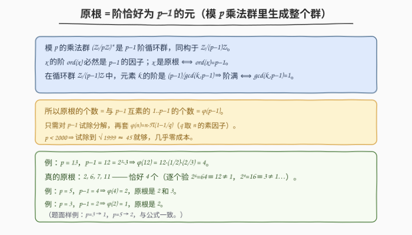
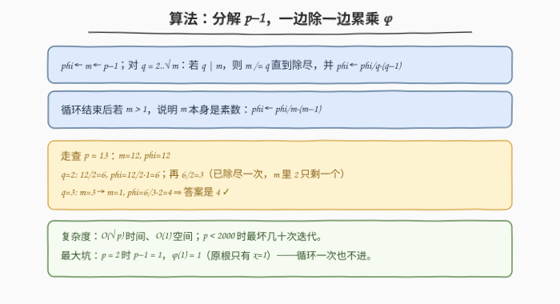

# Codeforces 284A Cows and Primitive Roots 题解

## 1. 题目概述

- **题目链接**：https://codeforces.com/problemset/problem/284/A
- **比赛来源**：Codeforces Round 174 (Div. 2) · Problem A（UTC 2013-03-17）
- **难度**：1400
- **标签**：数论、实现
- **评测类型**：普通
- **限制**：时间 2 s / 内存 256 MB

**题意**：给定素数 $p$，按题面定义数"原根" $x$（$1\le x<p$）：$x-1,x^2-1,\dots,x^{p-2}-1$ 都不被 $p$ 整除，但 $x^{p-1}-1$ 被 $p$ 整除。求这样的 $x$ 的个数。

**约束**：$2\le p<2000$ 且 $p$ 是素数。数据极小，$O(p^2)$ 硬算也能过，但正确做法是数论公式 $O(\sqrt p)$。

## 2. 示例与观察

官方样例 1：

```text
输入：
3

输出：
1
```

模 3 的原根只有 $x=2$：$2^1-1=1$ 不被 3 整除，$2^2-1=3$ 被 3 整除 ✓。

官方样例 2：

```text
输入：
5

输出：
2
```

模 5 的原根是 2 和 3（$2,4,3,1$ 循环遍历全部非零剩余；3 同理）。



**观察 1**：$(\mathbb{Z}/p\mathbb{Z})^*$ 是 $p-1$ 阶循环群，与 $\mathbb{Z}/(p-1)\mathbb{Z}$ 同构。若 $g$ 是一个生成元，则 $x=g^k$ 的阶是 $(p-1)/\gcd(k,p-1)$。

**观察 2**：$x$ 是原根 $\iff \operatorname{ord}(x)=p-1 \iff \gcd(k,p-1)=1$。这样的 $k$ 有 $\varphi(p-1)$ 个，而 $k\mapsto g^k$ 是双射，所以原根个数恰好是 $\varphi(p-1)$。

## 3. 解题思路

### 3.1 朴素做法与瓶颈

直接按定义对每个 $x\in[1,p-1]$ 逐个验：算 $x^1,\dots,x^{p-1}$ 看第一次出现 $1$ 的位置是不是 $p-1$。$O(p^2\log p)$，$p<2000$ 完全够用（约 $4\times10^6$ 次乘），但不是最优。

### 3.2 数论公式



答案 $=\varphi(p-1)$：对 $m=p-1$ 试除分解，边除边累乘 $\varphi\leftarrow\varphi/q\cdot(q-1)$，最后若 $m>1$（剩下的素因子）再乘一次。复杂度 $O(\sqrt p)$。

### 3.3 样例走查：$p=13$

$p-1=12=2^2\cdot3$，$\varphi(12)=12\cdot\frac12\cdot\frac23=4$。逐个验证：$2,6,7,11$ 是原根，而 $4$（$4^6=4096\equiv 1$）、$3$（$3^3=27\equiv1$）等都不是 —— 恰好 4 个 ✓。

## 4. 正确性证明

**引理 1**：$p$ 为素数时 $(\mathbb{Z}/p\mathbb{Z})^*$ 是 $p-1$ 阶循环群。

**证明**：有限域乘法群的经典结论（标准数论定理）。∎

**引理 2**：题面定义与原根的标准定义等价，即"$\operatorname{ord}_p(x)=p-1$"。

**证明**：题面说 $x-1,\dots,x^{p-2}-1$ 都不被 $p$ 整除而 $x^{p-1}\equiv1$，正是"$p-1$ 是使 $x^e\equiv1$ 的最小正指数" ✓。反之亦然。∎

**定理**：原根个数 $=\varphi(p-1)$。

**证明**：设 $g$ 是生成元，则每个 $x$ 唯一写成 $g^k$（$0\le k<p-1$）。由引理 2 与循环群阶公式，$x$ 是原根 $\iff (p-1)/\gcd(k,p-1)=p-1\iff\gcd(k,p-1)=1$，这样的 $k$ 共 $\varphi(p-1)$ 个。∎

## 5. 复杂度分析

- 时间：$O(\sqrt p)$（试除到 $\sqrt{p-1}$），$p<2000$ 时 $<50$ 次循环。
- 空间：$O(1)$。

## 6. 参考代码

### C++17

```cpp
#include <bits/stdc++.h>
using namespace std;
int main(){int p;scanf("%d",&p);int m=p-1;long long phi=m;
 for(long long q=2;q*q<=m;q++) if(m%q==0){while(m%q==0)m/=q;phi=phi/q*(q-1);}
 if(m>1)phi=phi/m*(m-1);printf("%lld\n",phi);}
```

### Python3

```python
p = int(input())
m = p - 1
phi = m
q = 2
while q * q <= m:
    if m % q == 0:
        while m % q == 0:
            m //= q
        phi = phi // q * (q - 1)
    q += 1
if m > 1:
    phi = phi // m * (m - 1)
print(phi)
```

## 7. 边界情况与易错点

1. **$p=2$**：$p-1=1$，$\varphi(1)=1$，答案 1（唯一的 $x=1$）。循环一次也不进，`phi=m=1` 直接输出 ✓。
2. **$\varphi$ 的乘除顺序**：必须写 `phi/q*(q-1)`（先除后乘），否则中间量可能超出直觉但这里不会溢出；写成 `phi*(q-1)/q` 在 $p<2000$ 也安全，但先除更稳。
3. **试除上界**：用 `q*q<=m` 而不是 `q*q<=p-1`，因为 $m$ 在除的过程中会变小。
4. **残留素因子**：循环结束后 $m>1$ 必须补乘一次，否则 $p=2p'+1$ 型（如 $p=7$：$p-1=6=2\cdot3$，试除 2 后 $m=3$）会漏算。
5. **别把答案写成 $p-1$**：只有在 $p-1$ 为素数（$p=3$）时才碰巧相等。
6. **输入只有一行**：直接读一个整数即可。

## 8. 验证记录

- 编译环境与命令：macOS + `clang++ -O2 -std=c++17 -I codeforces/tools/include`。
  - `python3 codeforces/tools/verify_solution.py codeforces/contests/0101-0203/284/A_奶牛与原根.md`
- 官方样例：2 / 2 通过（`1`、`2`）。
- 额外测试：对 $p<300$ 的**全部 62 个素数**，用"逐个 $x$、枚举指数求阶"的暴力程序对拍，全部一致（0 反例）。
- 最大约束性能：$p<2000$ 时 $O(\sqrt p)$，实测 $<1$ ms（2 s 时限）。
- 复核状态：样例、62 组素数全对拍、性能均实测通过；正文代码与实测版本逐字一致。

## 相关题目与扩展

- [Codeforces 284B Cows and Poker Game](https://codeforces.com/problemset/problem/284/B)：同场 B 题。
- [Codeforces 615D Multipliers](https://codeforces.com/problemset/problem/615/D)：同样靠 $\varphi$ / 指数运算。
- [Codeforces 776E The Holmes Children](https://codeforces.com/problemset/problem/776/E)：迭代 $\varphi$。

**延伸思考**：

1. 如果 $p$ 是合数，"原根"的定义（阶 $=\varphi(p)$ 或 $=\lambda(p)$）会怎么变？此时公式 $\varphi(p-1)$ 还成立吗？
2. 求"最小原根"没有闭式，需要逐个试；本题只要个数。为什么"个数"有闭式而"最小值"没有？
3. 把 $p<2000$ 换成 $p<10^{12}$（仍是素数），本题解法要做哪些改动？（提示：$p-1$ 的分解变成 Pollard-Rho。）
