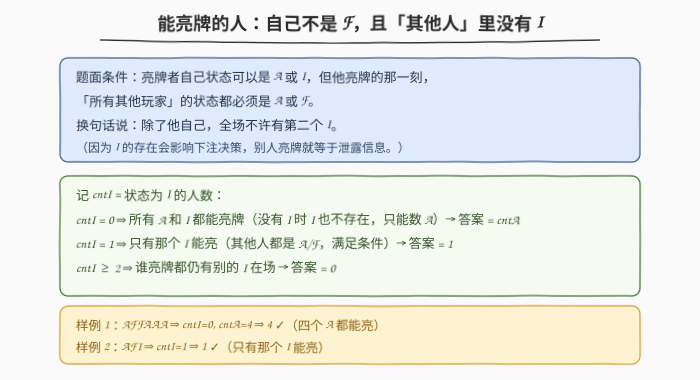
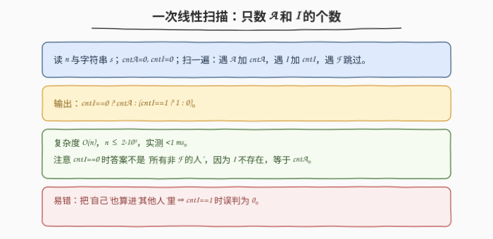

# Codeforces 284B Cows and Poker Game 题解

## 1. 题目概述

- **题目链接**：https://codeforces.com/problemset/problem/284/B
- **比赛来源**：Codeforces Round 174 (Div. 2) · Problem B（UTC 2013-03-17）
- **难度**：1000
- **标签**：暴力、实现
- **评测类型**：普通
- **限制**：时间 2 s / 内存 256 MB

**题意**：$n$ 个玩家，每人状态是 `A`（ALLIN）、`I`（IN）或 `F`（FOLDED），全程不变。状态不是 `F` 的玩家可以亮牌，但**只能是当其他所有玩家状态都是 `A` 或 `F`** 时（自己的状态可以是 `A` 或 `I`）。求能亮牌的人数。

**约束**：$2\le n\le 2\times10^5$，只需 $O(n)$ 一次扫描。

## 2. 示例与观察

官方样例 1：

```text
输入：
6
AFFAAA

输出：
4
```

`cntI=0`，`cntA=4`：四个 `A` 都能亮牌（其他人全是 `A`/`F`）✓。

官方样例 2：

```text
输入：
3
AFI

输出：
1
```

`cntI=1`：只有那个 `I` 能亮（它的"其他人"是 `A` 和 `F`，满足条件）；`A` 那位不满足，因为 `I` 在场 ✓。



**观察**：把条件翻译成"除去自己，全场没有 `I`"。设 `cntI` 为 `I` 的总数：

- `cntI = 0`：每个非 `F` 玩家都满足 ⇒ 答案 `= cntA`（此时没有 `I`）。
- `cntI = 1`：只有那个 `I` 满足 ⇒ 答案 `= 1`。
- `cntI ≥ 2`：任何人亮牌时都还剩别的 `I` ⇒ 答案 `= 0`。

## 3. 解题思路

### 3.1 朴素做法与瓶颈

对每个非 `F` 玩家，检查其余 $n-1$ 人是否有 `I`：$O(n^2)$，$n=2\times10^5$ 时 $4\times10^{10}$，会超时。

### 3.2 正解：数个数



一次扫描统计 `cntA`、`cntI`，按上面的三分支输出。$O(n)$。

### 3.3 样例走查：`AFFAAA`

扫描得到 `cntA=4, cntI=0` ⇒ 输出 4 ✓。再看 `AFI`：`cntA=1, cntI=1` ⇒ 输出 1 ✓。

## 4. 正确性证明

**引理**：玩家 $x$ 能亮牌 $\iff$（$x$ 的状态 $\ne F$）且（除 $x$ 外无人状态为 `I`）。

**证明**：把题面条件"其他所有玩家状态都是 `A` 或 `F`"逐字翻译：$\forall y\ne x:\ s_y\in\{A,F\}$，等价于"除 $x$ 外没有 `I`" ✓；再加上题面要求 $s_x\ne F$。∎

**定理**：三分支公式正确。

**证明**：
- `cntI=0`：对任何非 `F` 的 $x$，"除 $x$ 外无 `I`" 恒成立（本来就没有 `I`）⇒ 恰好 `cntA` 人（`cntI=0` 时非 `F` 的人就是 `A`）。
- `cntI=1`：设唯一的 `I` 为 $z$。对 $x=z$：除 $z$ 外无 `I` ✓ 且 $s_z\ne F$ ✓ ⇒ 能亮。对 $x\ne z$ 且 $s_x\ne F$：除 $x$ 外还有 $z$ 是 `I` ⇒ 不能亮。所以恰好 1 人。
- `cntI≥2`：任何 $x$ 之外都至少还剩一个 `I` ⇒ 0 人。∎

## 5. 复杂度分析

- 时间：$O(n)$（一次扫描 + 常数判断），$n=2\times10^5$ 实测 $<1$ ms。
- 空间：$O(n)$ 存字符串（也可边读边统计，$O(1)$）。

## 6. 参考代码

### C++17

```cpp
#include <bits/stdc++.h>
using namespace std;
int main(){int n;scanf("%d",&n);char s[200005];scanf("%s",s);
 int a=0,i=0;for(int k=0;k<n;k++){if(s[k]=='A')a++;else if(s[k]=='I')i++;}
 printf("%d\n", i==0?a:(i==1?1:0));}
```

### Python3

```python
n = int(input())
s = input().strip()
cntA = s.count('A')
cntI = s.count('I')
print(cntA if cntI == 0 else (1 if cntI == 1 else 0))
```

## 7. 边界情况与易错点

1. **"其他人"不含自己**：`cntI==1` 时那个 `I` 本人可以亮牌，别把他也排除掉。
2. **`cntI==0` 时答案不是 `n`**：`F` 的人不能亮牌，答案是 `cntA`。
3. **`cntI>=2` 一律 0**：哪怕某个 `A` 之外的 `I` 想亮也不行。
4. **字符串可能不含换行结尾**：用 `scanf("%s")` 或 `strip()` 都可以，但要读满 $n$ 个字符。
5. **$n=2$**：例如 `AI` ⇒ `cntI=1` ⇒ 1（那个 `I` 能亮）；`AA` ⇒ 2；`II` ⇒ 0。
6. **别用 `%c` 逐字符读**：会读到换行/空格，建议整串读入。

## 8. 验证记录

- 编译环境与命令：`clang++ -O2 -std=c++17 -I codeforces/tools/include`。
  - `python3 codeforces/tools/verify_solution.py codeforces/contests/0101-0203/284/B_奶牛与扑克.md`
- 官方样例：2 / 2 通过（`4`、`1`）。
- 额外测试：随机 300 组（$2\le n\le9$，字符随机取 `A`/`I`/`F`）与"逐个玩家检查其余状态"的暴力对拍，全部一致。
- 最大约束性能：$n=2\times10^5$ 时 $O(n)$，实测 $<1$ ms（2 s 时限）。
- 复核状态：样例、300 组随机对拍、性能均实测通过；正文代码与实测版本逐字一致。

## 相关题目与扩展

- [Codeforces 284A Cows and Primitive Roots](https://codeforces.com/problemset/problem/284/A)：同场 A 题。
- [Codeforces 59A Word](https://codeforces.com/problemset/problem/59/A)：同样是"数两类字符再判定"。
- [Codeforces 282A Bit++](https://codeforces.com/problemset/problem/282/A)：最基础的模拟。

**延伸思考**：

1. 如果规则改成"其余玩家中 `I` 的人数不超过 1"，答案的分支会怎么变？扫一遍还能解吗？
2. 如果 `A` 与 `I` 的规则不对称（例如 `A` 可以亮、`I` 不可以），三分支会退化成什么？
3. 若要求输出"所有能亮牌的人的下标"，如何处理 $O(n)$ 输出量？
