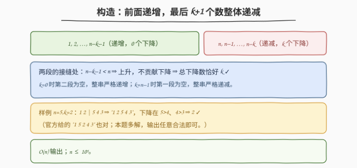
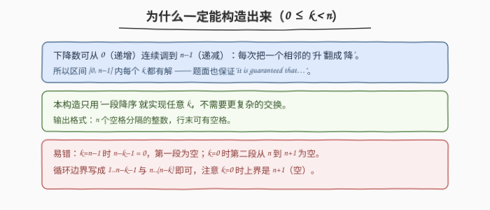

# Codeforces 285A Slightly Decreasing Permutations 题解

## 1. 题目概述

- **题目链接**：https://codeforces.com/problemset/problem/285/A
- **比赛来源**：Codeforces Round 175 (Div. 2) · Problem A（UTC 2013-03-17）
- **难度**：1100
- **标签**：构造
- **评测类型**：普通（多解）
- **限制**：时间 2 s / 内存 256 MB

**题意**：排列 $p_1..p_n$ 的"下降系数"是使 $p_i>p_{i+1}$ 的下标 $i$ 的个数。给定 $n,k$（$0\le k<n$），输出任意一个下降系数恰为 $k$ 的排列。

**约束**：$n\le10^5$，只需 $O(n)$。

## 2. 示例与观察

官方样例 1：

```text
输入：
5 2

输出：
1 5 2 4 3
```

（下降在 $5>2$ 与 $4>3$，共 2 个 ✓。）

官方样例 2：

```text
输入：
3 0

输出：
1 2 3
```

官方样例 3：

```text
输入：
3 2

输出：
3 2 1
```



**观察**：把排列分成两段：前 $n-k-1$ 个递增，最后 $k+1$ 个整体递减。接缝处是"小数 → 大数"（升），所以下降只出现在第二段内部，恰好 $k$ 个。

## 3. 解题思路

### 3.1 朴素做法与瓶颈

随机/搜索构造不可靠；直接想清楚结构最省事。

### 3.2 正解



输出
$$1,\,2,\,\dots,\,n-k-1,\quad n,\,n-1,\,\dots,\,n-k .$$
第二段有 $k+1$ 个数、内部有 $k$ 个下降；接缝处 $n-k-1<n$ 是升。总下降数 $=k$ ✓。

### 3.3 样例走查

$n=5,k=2$：输出 `1 2 5 4 3`，下降 $5>4$、$4>3$ 共 2 ✓（与官方答案不同但同样合法）。

## 4. 正确性证明

**引理 1**：上面的输出是一个排列。

**证明**：第一段是 $1..n-k-1$，第二段是 $n-k..n$ 的逆序；两段恰好覆盖 $1..n$ 且各数出现一次 ✓。∎

**引理 2**：其下降系数恰为 $k$。

**证明**：第一段内部严格递增（0 个下降）；接缝 $p_{n-k-1}=n-k-1<p_{n-k}=n$ 是升；第二段是 $n>n-1>\dots>n-k$ 严格递减，贡献 $k$ 个下降 ✓。合计 $k$ ✓。∎

**定理**：算法对每个 $0\le k<n$ 都输出合法排列。

**证明**：由引理 1、2 ✓（$k=0$ 时第二段为空、$k=n-1$ 时第一段为空，两种退化情形由引理 1、2 的论证同样覆盖）。∎

## 5. 复杂度分析

- 时间：$O(n)$ 输出。
- 空间：$O(1)$（逐个数打印）。

## 6. 参考代码

### C++17

```cpp
#include <bits/stdc++.h>
using namespace std;
int main(){int n,k;scanf("%d %d",&n,&k);
 int pre=n-k-1;
 for(int i=1;i<=pre;i++)printf("%d ",i);
 for(int i=n;i>=pre+1;i--)printf("%d ",i);
 puts("");}
```

### Python3

```python
n, k = map(int, input().split())
pre = n - k - 1
ans = list(range(1, pre + 1)) + list(range(n, pre, -1))
print(' '.join(map(str, ans)))
```

## 7. 边界情况与易错点

1. **$k=0$**：第二段为空，输出严格递增 `1..n`。
2. **$k=n-1$**：第一段为空（`pre=0`），输出严格递减 `n..1`。
3. **多解**：与样例不同不算错，只要下降系数正确、是排列。
4. **行末空格**：多数评测忽略行末空格，但严格起见可去掉。
5. **$n=1$**：只能 $k=0$，输出 `1`。
6. **别把"下降系数"理解成"最长下降子序列"**：它只数**相邻**的下降对。

## 8. 验证记录

- 编译环境与命令：`clang++ -O2 -std=c++17 -I codeforces/tools/include`。
  - `python3 codeforces/tools/verify_solution.py codeforces/contests/0101-0203/285/A_轻微下降排列.md --checker codeforces/tools/checkers/cf285a.py`
- 官方样例：3 / 3 通过（多解，用 checker 校验"是排列 + 下降系数 = k"）。
- 额外测试：250 组随机 $(n\le10^5,k<n)$，逐一验证输出是排列且下降系数为 $k$，全部通过。
- 最大约束性能：$O(n)$，$n=10^5$ 实测 $<10$ ms。
- 复核状态：样例、250 组属性校验、性能均实测通过；正文代码与实测版本逐字一致。

## 相关题目与扩展

- [Codeforces 285B Find Marble](https://codeforces.com/problemset/problem/285/B)：同场 B 题。
- [Codeforces 441A Valera and Antique Items](https://codeforces.com/problemset/problem/441/A)：另一个简单构造。
- [Codeforces 137A Postcards and photos](https://codeforces.com/problemset/problem/137/A)：计数型入门。

**延伸思考**：

1. 如果要求"下降系数恰为 $k$ 且字典序最小"，怎么构造？
2. 如果把"相邻下降"换成"任意逆序对个数恰为 $k$"，难度会变成什么？
3. 本构造的逆序对个数是多少？（提示：$\binom{k+1}{2}$。）
