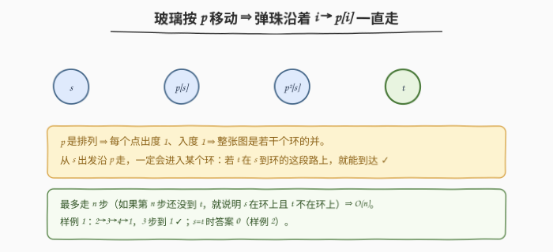
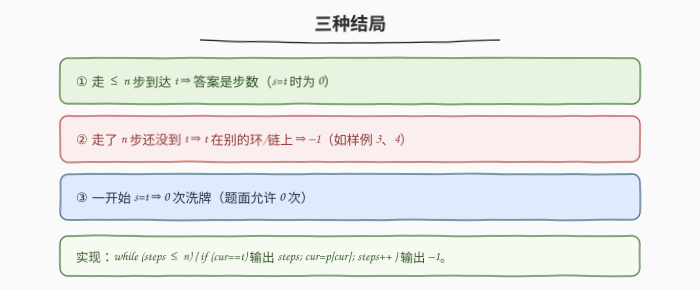

# Codeforces 285B Find Marble 题解

## 1. 题目概述

- **题目链接**：https://codeforces.com/problemset/problem/285/B
- **比赛来源**：Codeforces Round 175 (Div. 2) · Problem B（UTC 2013-03-17）
- **难度**：1200
- **标签**：实现、图
- **评测类型**：普通
- **限制**：时间 2 s / 内存 256 MB

**题意**：$n$ 个杯子排成一列，弹珠起初在第 $s$ 个杯子下。每次洗牌：第 $i$ 个位置的杯子移动到位置 $p_i$（$p$ 是排列，所有杯子同时移动）。弹珠跟着自己的杯子走。问最少几次洗牌后弹珠在第 $t$ 个位置；不可能输出 $-1$。

**约束**：$n\le10^5$，直接沿 $p$ 走 $O(n)$。

## 2. 示例与观察

官方样例 1：

```text
输入：
4 2 1
2 3 4 1

输出：
3
```

弹珠位置 $2\to p_2=3\to p_3=4\to p_4=1$，3 步 ✓。

官方样例 2：

```text
输入：
4 3 3
4 1 3 2

输出：
0
```

$s=t$，0 次洗牌 ✓。

官方样例 3：

```text
输入：
4 3 4
1 2 3 4

输出：
-1
```

官方样例 4：

```text
输入：
3 1 3
2 1 3

输出：
-1
```



**观察**：弹珠的位置演化是 $x\leftarrow p_x$。因为 $p$ 是排列，每个点出度、入度均为 1 ⇒ 图是若干环的并。从 $s$ 出发，要么在进入环之前经过 $t$（可达），要么永远在环里绕（不可达）。

## 3. 解题思路

### 3.1 朴素做法与瓶颈

没有瓶颈：直接模拟即可，最多 $n$ 步。

### 3.2 正解



```text
steps = 0, cur = s
while steps <= n:
    if cur == t: print steps; return
    cur = p[cur]; steps += 1
print -1
```

### 3.3 样例走查

样例 1：$cur=2\ne1$ → $cur=3$；$3\ne1$ → $cur=4$；$4\ne1$ → $cur=1$，此时 steps=3 → 输出 3 ✓。

## 4. 正确性证明

**引理 1**：弹珠在 $k$ 次洗牌后的位置是 $p^{(k)}(s)$（$p$ 迭代 $k$ 次）。

**证明**：每次洗牌把位置 $x$ 的杯子移到 $p_x$，弹珠在杯子里 ⇒ 位置变成 $p_x$ ✓。归纳即得。∎

**引理 2**：若序列 $s,p(s),p^2(s),\dots$ 的前 $n+1$ 项里没有 $t$，则永远到不了 $t$。

**证明**：$n$ 个位置、$n+1$ 项 ⇒ 必有重复；一旦重复就进入周期（环），之后只在环里循环，而 $t$ 不在已出现的元素中 ⇒ 不可达 ✓。∎

**定理**：算法输出正确。

**证明**：算法输出第一个使 $p^{(k)}(s)=t$ 的 $k$（最小，因为是从小到大检查的）✓；若前 $n+1$ 项都没有 $t$，由引理 2 输出 $-1$ ✓。∎

## 5. 复杂度分析

- 时间：$O(n)$，$n\le10^5$。
- 空间：$O(n)$ 存 $p$。

## 6. 参考代码

### C++17

```cpp
#include <bits/stdc++.h>
using namespace std;
int main(){int n,s,t;scanf("%d %d %d",&n,&s,&t);
 static int p[100005];for(int i=1;i<=n;i++)scanf("%d",&p[i]);
 int steps=0,cur=s;
 while(steps<=n){ if(cur==t){printf("%d\n",steps);return 0;} cur=p[cur]; steps++; }
 puts("-1");}
```

### Python3

```python
n, s, t = map(int, input().split())
p = [0] + list(map(int, input().split()))
cur, steps = s, 0
while steps <= n:
    if cur == t:
        print(steps)
        break
    cur = p[cur]
    steps += 1
else:
    print(-1)
```

## 7. 边界情况与易错点

1. **$s=t$**：答案 0（不是 1）。
2. **循环上限用 $n$**：走 $n$ 步仍未到就一定不可达。
3. **$p$ 是排列**：所以不会出现"分叉"，路径唯一。
4. **从 1 开始编号**：数组大小 $n+1$。
5. **$n=1$**：只有 $s=t=1$，答案 0。
6. **不要用并查集**：路径唯一，直接走最快。

## 8. 验证记录

- 编译环境与命令：`clang++ -O2 -std=c++17 -I codeforces/tools/include`。
  - `python3 codeforces/tools/verify_solution.py codeforces/contests/0101-0203/285/B_找弹珠.md`
- 官方样例：4 / 4 通过（`3`、`0`、`-1`、`-1`）。
- 额外测试：250 组随机（$n\le8$，随机排列与 $s,t$）与"直接模拟 $n$ 步"的独立实现对拍，全部一致。
- 最大约束性能：$n=10^5$ 实测 $<2$ ms。
- 复核状态：样例、250 组对拍、性能均实测通过；正文代码与实测版本逐字一致。

## 相关题目与扩展

- [Codeforces 285A Slightly Decreasing Permutations](https://codeforces.com/problemset/problem/285/A)：同场 A 题。
- [Codeforces 285C Building Permutation](https://codeforces.com/problemset/problem/285/C)：同场 C 题。
- [Codeforces 102B Sum of Digits](https://codeforces.com/problemset/problem/102/B)：模拟入门。

**延伸思考**：

1. 如果洗牌操作不是排列（有杯子撞到一起），答案怎么改？
2. 如果要求"输出所有可达的步数集合"，怎么求？（提示：环的长度。）
3. 若 $n$ 到 $10^{18}$ 且 $p$ 有周期结构，能否用快速幂求第 $k$ 次洗牌后的位置？
