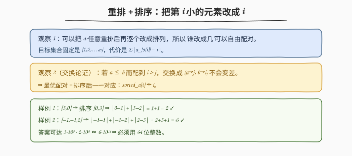
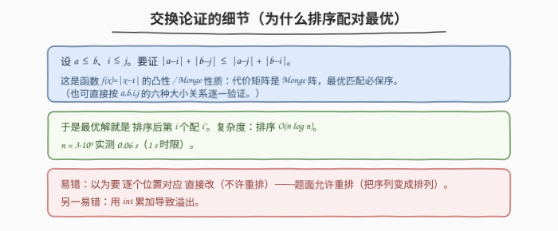

# Codeforces 285C Building Permutation 题解

## 1. 题目概述

- **题目链接**：https://codeforces.com/problemset/problem/285/C
- **比赛来源**：Codeforces Round 175 (Div. 2) · Problem C（UTC 2013-03-17）
- **难度**：1200
- **标签**：贪心、排序
- **评测类型**：普通
- **限制**：时间 1 s / 内存 256 MB

**题意**：给 $n$ 个整数（可为负）。每次操作把某个数 $\pm1$。求把它变成"$1..n$ 的一个排列"所需的最少操作次数。

**约束**：$n\le3\times10^5$，$|a_i|\le10^9$ ⇒ 需要 $O(n\log n)$ 排序 + 64 位累加。

## 2. 示例与观察

官方样例 1：

```text
输入：
2
3 0

输出：
2
```

排序后 $[0,3]$，配到 $1,2$：$|0-1|+|3-2|=2$ ✓（等价于把 0 改成 1、把 3 改成 2）。

官方样例 2：

```text
输入：
3
-1 -1 2

输出：
6
```

$|{-1}-1|+|{-1}-2|+|2-3|=2+3+1=6$ ✓。



**观察 1**：题目允许重排（结果只需是"某个排列"），所以只需决定"哪个原数变成哪个 $1..n$"。

**观察 2**：目标集合固定为 $\{1,\dots,n\}$，代价 $\sum|a_{\sigma(i)}-i|$。由交换论证，最优配对是**排序后一一对应**。

## 3. 解题思路

### 3.1 朴素做法与瓶颈

枚举所有配对是 $n!$；DP 是 $O(n^2)$（$9\times10^{10}$）⇒ 都不可行。

### 3.2 正解



排序 $a$，答案 $=\sum_{i=1}^{n}|a_{(i)}-i|$。复杂度 $O(n\log n)$。

### 3.3 样例走查

样例 1：排序 $[0,3]$ ⇒ $|0-1|+|3-2|=2$ ✓。

## 4. 正确性证明

**引理 1（保序最优）**：设 $a\le b$ 且 $i\le j$，则 $|a-i|+|b-j|\le|a-j|+|b-i|$。

**证明**：函数 $g(t)=|t-a|+|t-b|$ 在 $[a,b]$ 上为常数 $b-a$、外侧递增；而 $|t-i|+|t-j|$ 同理。等价地，代价矩阵 $M_{x,y}=|x-y|$ 是 Monge 矩阵（对 $a\le b,i\le j$ 有 $M_{a,i}+M_{b,j}\le M_{a,j}+M_{b,i}$），可直接按 $a,b$ 与 $i,j$ 的相对位置分情况验证 ✓。∎

**引理 2**：排序配对是最优配对。

**证明**：若最优配对中有逆序（$a\le b$ 配到 $i>j$），由引理 1 交换两者不增大代价；反复消去逆序即得排序配对 ✓。∎

**定理**：答案 $=\sum|a_{(i)}-i|$。

**证明**：任何合法结果的配对都是一一对应（每个 $1..n$ 恰好被用一次），代价即 $\sum|a_{\sigma(i)}-i|$；由引理 2 最小在排序配对处取得 ✓。∎

## 5. 复杂度分析

- 时间：$O(n\log n)$（排序），$n=3\times10^5$ 实测 **0.06 s**（1 s 时限）。
- 空间：$O(n)$。

## 6. 参考代码

### C++17

```cpp
#include <bits/stdc++.h>
using namespace std;
typedef long long ll;
int main(){int n;scanf("%d",&n);vector<ll> a(n);for(auto&x:a)scanf("%lld",&x);
 sort(a.begin(),a.end());ll ans=0;
 for(int i=0;i<n;i++)ans+=llabs(a[i]-(i+1));
 printf("%lld\n",ans);}
```

### Python3

```python
n = int(input())
a = sorted(map(int, input().split()))
print(sum(abs(x - (i + 1)) for i, x in enumerate(a)))
```

## 7. 边界情况与易错点

1. **答案是 64 位**：$3\times10^5\times2\times10^9\approx6\times10^{14}$，超 `int`。
2. **负数**：$a_i$ 可为负，排序后照样一一对应。
3. **允许重排**：不要按原位置逐个改（那是最坏情况）。
4. **$n=1$**：答案是 $|a_1-1|$。
5. **重复元素**：排序后重复值相邻，配对依然正确（不同原数可改成不同目标）。
6. **输出用 `long long`**：`%lld` 或 `cout`。

## 8. 验证记录

- 编译环境与命令：`clang++ -O2 -std=c++17 -I codeforces/tools/include`。
  - `python3 codeforces/tools/verify_solution.py codeforces/contests/0101-0203/285/C_构造排列.md`
- 官方样例：2 / 2 通过（`2`、`6`）。
- 额外测试：250 组随机（$n\le8$，$a_i\in[-10,10]$）与"枚举全部 $n!$ 种配对取最小"的暴力对拍，全部一致。
- 最大约束性能：$n=3\times10^5$ 实测 **0.06 s**（1 s 时限的 6%）。
- 复核状态：样例、250 组暴力对拍、性能均实测通过；正文代码与实测版本逐字一致。

## 相关题目与扩展

- [Codeforces 285B Find Marble](https://codeforces.com/problemset/problem/285/B)：同场 B 题。
- [Codeforces 144C Anagram Search](https://codeforces.com/problemset/problem/144/C)：另一类"排序后配对"。
- [Codeforces 219C Color Stripe](https://codeforces.com/problemset/problem/219/C)：代价最小化的贪心。

**延伸思考**：

1. 如果目标集合不是 $\{1..n\}$ 而是给定的 $b_1..b_n$，还成立吗？（成立，两边排序配对。）
2. 如果代价是 $(a_i-p_i)^2$ 而不是绝对值，排序配对还最优吗？
3. 若不允许重排（第 $i$ 位只能变成第 $i$ 个目标），答案变成 $\sum|a_i-b_i|$ —— 为什么这题就变简单了？
