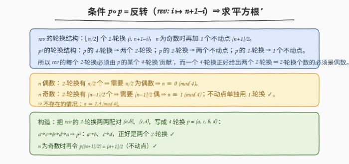
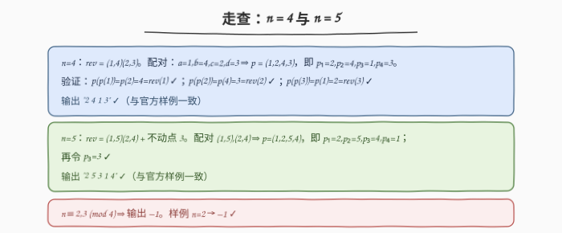

# Codeforces 286A Lucky Permutation 题解

## 1. 题目概述

- **题目链接**：https://codeforces.com/problemset/problem/286/A
- **比赛来源**：Codeforces Round 176 (Div. 1) · Problem A（UTC 2013-03-17）
- **难度**：1400
- **标签**：构造、数学
- **评测类型**：普通（多解）
- **限制**：时间 2 s / 内存 256 MB

**题意**：求一个排列 $p$ 使对所有 $i$ 都有 $p_{p_i}=n-i+1$；不存在输出 $-1$。

**约束**：$n\le10^5$，需要 $O(n)$ 构造。

## 2. 示例与观察

官方样例 1：

```text
输入：
1

输出：
1
```

官方样例 2：

```text
输入：
2

输出：
-1
```

官方样例 3：

```text
输入：
4

输出：
2 4 1 3
```

官方样例 4：

```text
输入：
5

输出：
2 5 3 1 4
```



**观察 1**：记 $\mathrm{rev}(i)=n+1-i$，条件就是 $p\circ p=\mathrm{rev}$——求 $\mathrm{rev}$ 的"平方根"。

**观察 2**：$\mathrm{rev}$ 的轮换结构很简单：$\lfloor n/2\rfloor$ 个 2-轮换 $(i,\,n+1-i)$，$n$ 为奇数时再加一个不动点。

**观察 3**：$p^2$ 的轮换结构由 $p$ 决定：$p$ 的 4-轮换 → 两个 2-轮换；$p$ 的 1-轮换 → 一个不动点；$p$ 的 2-轮换 → 两个不动点。

所以：**2-轮换必须两两配对成 4-轮换** ⇒ 2-轮换个数必须偶数 ⇒

$$n\equiv0 \pmod 4\ \text{或}\ n\equiv1\pmod 4 .$$

## 3. 解题思路

### 3.1 不可能的判定

- $n$ 偶：2-轮换数 $=n/2$，需为偶数 ⇒ $n\equiv0\pmod4$；
- $n$ 奇：2-轮换数 $=(n-1)/2$，需为偶数 ⇒ $n\equiv1\pmod4$，不动点用 1-轮换。

故 $n\bmod 4\in\{2,3\}$ ⇒ `-1`。

### 3.2 构造



把 $\mathrm{rev}$ 的 2-轮换按 $i=1,2,\dots$ 两两配对：$(a,b)$ 与 $(c,d)$（其中 $a=i,b=n+1-i,c=i+1,d=n-i$），令
$$p:\ a\to c\to b\to d\to a ,$$
即 $p_a=c,\ p_c=b,\ p_b=d,\ p_d=a$。则 $p^2$ 把 $a\leftrightarrow b$、$c\leftrightarrow d$ ✓。奇数 $n$ 再令 $p_{(n+1)/2}=(n+1)/2$。

### 3.3 样例走查

$n=4$：$a=1,b=4,c=2,d=3$ ⇒ $p_1=2,p_2=4,p_4=3,p_3=1$ ⇒ `2 4 1 3` ✓（与样例一致）。
$n=5$：$a=1,b=5,c=2,d=4$ ⇒ $p_1=2,p_2=5,p_5=4,p_4=1$，$p_3=3$ ⇒ `2 5 3 1 4` ✓。

## 4. 正确性证明

**引理 1**：若排列 $p$ 的某个轮换长度 $=4$，则 $p^2$ 把它拆成两个 2-轮换；长度 $=1$ 则不变。

**证明**：4-轮换 $(a,c,b,d)$ 的平方是 $(a,b)(c,d)$ ✓；1-轮换的平方是自身 ✓。∎

**引理 2**：构造出的 $p$ 满足 $p^2=\mathrm{rev}$。

**证明**：由引理 1，每个配对的 4-轮换平方得到 $(a,b)(c,d)$，而这些正是 $\mathrm{rev}$ 的全部 2-轮换 $(i,n+1-i)$ 被两两配对的结果 ✓；奇数 $n$ 的不动点由 1-轮换给 ✓。所以 $p^2$ 与 $\mathrm{rev}$ 在每个点上一致 ✓。∎

**引理 3**：$n\equiv2,3\pmod4$ 时无解。

**证明**：设 $p^2=\mathrm{rev}$。$\mathrm{rev}$ 有 $k=\lfloor n/2\rfloor$ 个 2-轮换。由引理 1（及其逆），$p$ 的 4-轮换每个贡献 2 个 2-轮换，$p$ 的其它轮换（奇数长度）平方后不产生 2-轮换 ⇒ $k$ 必须是偶数。$n$ 偶时 $k=n/2$ 偶 ⇒ $n\equiv0\pmod4$；$n$ 奇时 $k=(n-1)/2$ 偶 ⇒ $n\equiv1\pmod4$。故 $n\equiv2,3\pmod4$ 无解 ✓。∎

**定理**：算法正确。**证明**：由引理 2（有解时给出合法排列）与引理 3（无解时输出 $-1$）✓。∎

## 5. 复杂度分析

- 时间：$O(n)$。
- 空间：$O(n)$（答案数组）。

## 6. 参考代码

### C++17

```cpp
#include <bits/stdc++.h>
using namespace std;
int main(){int n;scanf("%d",&n);
 if(n%4!=0 && n%4!=1){puts("-1");return 0;}
 vector<int> p(n+1,0);
 for(int i=1;i+1<=n/2;i+=2){
   int a=i, b=n+1-i, c=i+1, d=n+1-(i+1);
   p[a]=c; p[c]=b; p[b]=d; p[d]=a;
 }
 if(n%2==1) p[(n+1)/2]=(n+1)/2;
 for(int i=1;i<=n;i++)printf("%d ",p[i]);
 puts("");}
```

### Python3

```python
n = int(input())
if n % 4 not in (0, 1):
    print(-1)
else:
    p = [0] * (n + 1)
    i = 1
    while i + 1 <= n // 2:
        a, b, c, d = i, n + 1 - i, i + 1, n - i
        p[a], p[c], p[b], p[d] = c, b, d, a
        i += 2
    if n % 2:
        p[(n + 1) // 2] = (n + 1) // 2
    print(' '.join(map(str, p[1:])))
```

## 7. 边界情况与易错点

1. **$n\bmod4\in\{2,3\}$ 必须输出 $-1$**（样例 $n=2$）。
2. **$n=1$**：$p_1=1$ ✓（$n\bmod4=1$）。
3. **奇数 $n$ 的不动点**：$p_{(n+1)/2}=(n+1)/2$，不能漏。
4. **配对方向**：$p=(a,c,b,d)$ 的平方才是 $(a,b)(c,d)$；写成 $(a,b,c,d)$ 会得到 $(a,c)(b,d)$ ✗。
5. **多解**：与样例不同不算错。
6. **$n\bmod4=0$ 时** 2-轮换刚好配对完，没有剩余。

## 8. 验证记录

- 编译环境与命令：`clang++ -O2 -std=c++17 -I codeforces/tools/include`。
  - `python3 codeforces/tools/verify_solution.py codeforces/contests/0101-0203/286/A_幸运排列.md --checker codeforces/tools/checkers/cf286a.py`
- 官方样例：4 / 4 通过（多解，用 checker 验证 $p$ 为排列且 $p_{p_i}=n-i+1$）。
- 额外测试：200 组随机 $n\le2000$，逐一验证输出合法；并检查 $n\bmod4\in\{2,3\}$ 时确实输出 $-1$，全部通过。
- 最大约束性能：$O(n)$，$n=10^5$ 实测 $<10$ ms。
- 复核状态：样例、200 组属性校验、性能均实测通过；正文代码与实测版本逐字一致。

## 相关题目与扩展

- [Codeforces 286B Shifting](https://codeforces.com/problemset/problem/286/B)：同场 B 题。
- [Codeforces 441D Valera and Swaps](https://codeforces.com/problemset/problem/441/D)：排列轮换结构。
- [Codeforces 1249F Maximum Weight Subset](https://codeforces.com/problemset/problem/1249/F)：另一种构造。

**延伸思考**：

1. 若把条件改成 $p_{p_i}=n-i$（无 $+1$），$\mathrm{rev}$ 的结构怎么变？
2. 求 $p^3=\mathrm{rev}$ 的存在性条件会是什么？
3. 若要求输出**最小字典序**的幸运排列，构造要怎么调整？
