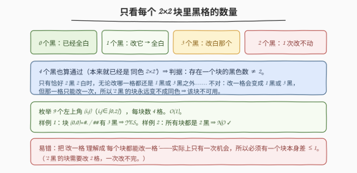
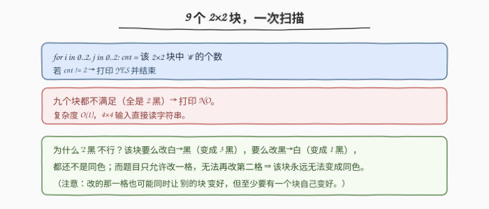

# Codeforces 287A IQ Test 题解

## 1. 题目概述

- **题目链接**：https://codeforces.com/problemset/problem/287/A
- **比赛来源**：Codeforces Round 176 (Div. 2) · Problem A（UTC 2013-03-17）
- **难度**：1100
- **标签**：实现、暴力
- **评测类型**：普通
- **限制**：时间 2 s / 内存 256 MB

**题意**：给一个 $4\times4$ 的黑白格（`#` 黑、`.` 白）。最多可以改**一格**的颜色，问能否让图里出现一个"同色的 $2\times2$ 方块"。

**约束**：图固定 $4\times4$，共 9 个 $2\times2$ 子块，$O(1)$ 判定。

## 2. 示例与观察

官方样例 1：

```text
输入：
####
.#..
####
....

输出：
YES
```

左上角那个 $2\times2$（`#.`/`##`）有 3 个黑格，把唯一的白格改黑即可 ✓。

官方样例 2：

```text
输入：
####
....
####
....

输出：
NO
```

每两行交替，任何 $2\times2$ 都是 2 黑 2 白；改一格只能变成 1 黑或 3 黑，仍然不是同色 ⇒ 无法在一个块里凑出同色 ✓。



**观察**：一个 $2\times2$ 块能否在"最多改一格"后变成同色，只看它的**黑格个数**：

| 黑格数 | 能否变成同色 |
|---|---|
| 0 | 已经是（全白） |
| 1 | 把那个黑格改白 ✓ |
| 2 | 改一格只能变成 1 或 3 黑 ✗ |
| 3 | 把白格改黑 ✓ |
| 4 | 已经是（全黑） |

所以判据：**存在某个 $2\times2$ 块，其黑格数 $\ne2$**。

## 3. 解题思路

### 3.1 朴素做法与瓶颈

没有瓶颈：只有 9 个块、每块 4 格。

### 3.2 正解



枚举 $i,j\in[0,2]$，数 `(i,j),(i,j+1),(i+1,j),(i+1,j+1)` 中的 `#`；一旦某块计数 $\ne2$ 就输出 `YES`；九块都不行则 `NO`。

### 3.3 样例走查

样例 1：块 $(0,0)$ = `#.`/`##` 有 3 个黑 ⇒ `YES` ✓。
样例 2：9 个块全是 2 黑 ⇒ `NO` ✓。

## 4. 正确性证明

**引理 1**：一个 $2\times2$ 块在"至多改一格"后能变成同色，当且仅当它的黑格数 $\ne2$。

**证明**：块内黑格数 $c\in\{0,1,2,3,4\}$。改一格至多让 $c$ 变化 1。
- $c=0$：已是全白 ✓；
- $c=1$：改那唯一的黑格为白 ⇒ 全白 ✓；
- $c=3$：改唯一的白格为黑 ⇒ 全黑 ✓；
- $c=4$：已是全黑 ✓；
- $c=2$：改一格后 $c'=1$ 或 $3$，都不是 0 或 4 ⇒ 不可能同色 ✗。∎

**引理 2**：整张图能通过（至多改一格）$\iff$ 存在一个块 $c\ne2$。

**证明**：
- 若存在这样的块，由引理 1，把那一次修改用在它身上即可（$c=0/4$ 时甚至不用改）✓。
- 若所有块都是 $c=2$，则改任意一格（或什么都不改）后，每个块的黑格数只能是 2（不改）、1 或 3（改在块内）——全都 $\ne0,4$ ⇒ 没有任何块同色 ✗。∎

**定理**：算法输出正确。**证明**：算法正是枚举全部 9 个块并检查引理 2 的条件 ✓。∎

## 5. 复杂度分析

- 时间：$O(1)$（9 块 × 4 格）。
- 空间：$O(1)$（存 $4\times4$ 字符）。

## 6. 参考代码

### C++17

```cpp
#include <bits/stdc++.h>
using namespace std;
int main(){char g[4][5];for(int i=0;i<4;i++)scanf("%s",g[i]);
 for(int i=0;i<3;i++)for(int j=0;j<3;j++){
   int c=0;for(int di=0;di<2;di++)for(int dj=0;dj<2;dj++)if(g[i+di][j+dj]=='#')c++;
   if(c!=2){puts("YES");return 0;}
 }
 puts("NO");}
```

### Python3

```python
g = [input().strip() for _ in range(4)]
for i in range(3):
    for j in range(3):
        c = sum(g[i + di][j + dj] == '#' for di in range(2) for dj in range(2))
        if c != 2:
            print("YES")
            raise SystemExit
print("NO")
```

## 7. 边界情况与易错点

1. **"2 黑"的块确实不行**：改一格变成 1 或 3 黑，仍不同色。
2. **$c=0$ 或 $c=4$**：已经同色，不需要任何修改 —— 也算通过。
3. **只有一次修改机会**：不能"每个块各改一格"。
4. **改的格子可能同时影响多个块**：这不会带来新可能，因为至少得有一个块自己变同色，而引理 1 是按块独立判的。
5. **输入 4 行**：用 `%s` 读，避免 `%c` 吃掉换行。
6. **输出大小写**：`YES`/`NO` 全大写。

## 8. 验证记录

- 编译环境与命令：`clang++ -O2 -std=c++17 -I codeforces/tools/include`。
  - `python3 codeforces/tools/verify_solution.py codeforces/contests/0101-0203/287/A_智商测试.md`
- 官方样例：2 / 2 通过（`YES`、`NO`）。
- 额外测试：随机 300 组 $4\times4$ 黑白图，与"枚举改哪一格（含不改）再检查是否存在同色 $2\times2$"的暴力对拍，全部一致。
- 最大约束性能：$O(1)$，实测 $<1$ ms。
- 复核状态：样例、300 组暴力对拍、性能均实测通过；正文代码与实测版本逐字一致。

## 相关题目与扩展

- [Codeforces 287B Pipeline](https://codeforces.com/problemset/problem/287/B)：同场 B 题。
- [Codeforces 405A Gravity Flip](https://codeforces.com/problemset/problem/405/A)：另一个小规模模拟。
- [Codeforces 1A Theatre Square](https://codeforces.com/problemset/problem/1/A)：入门级几何。

**延伸思考**：

1. 如果允许改 $k$ 格，判据会变成什么？（$c \le k$ 或 $4-c\le k$。）
2. 如果要求"$3\times3$ 同色块"呢？分类讨论会多几类？
3. 若棋盘是 $n\times n$ 且 $n$ 很大，如何快速判断？（提示：只需检查存在"某方向连成"的局部模式。）
