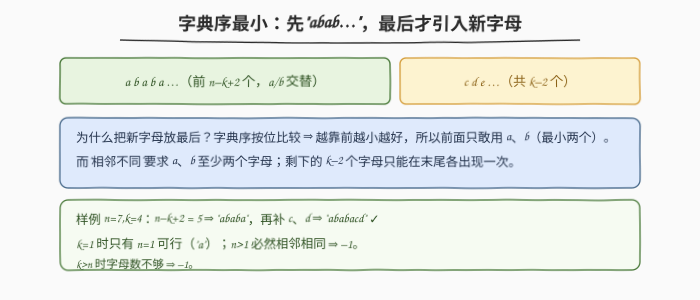
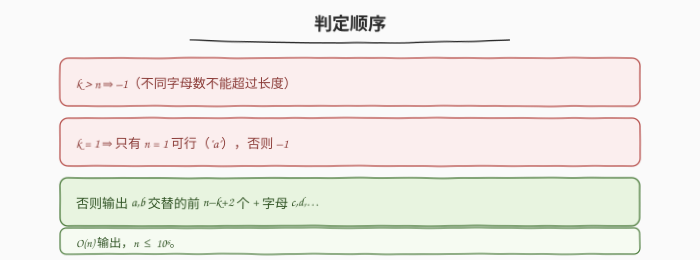

# Codeforces 288A Polo the Penguin and Strings 题解

## 1. 题目概述

- **题目链接**：https://codeforces.com/problemset/problem/288/A
- **比赛来源**：Codeforces Round 177 (Div. 1) · Problem A（UTC 2013-04-12）
- **难度**：1300
- **标签**：构造、贪心
- **评测类型**：普通（多解？——不，字典序最小是唯一的）
- **限制**：时间 2 s / 内存 256 MB

**题意**：求长度 $n$、恰含 $k$ 种不同小写字母、且相邻字符不同的字符串中**字典序最小**的一个；不存在输出 $-1$。

**约束**：$n\le10^6$，$k\le26$ ⇒ $O(n)$ 构造。

## 2. 示例与观察

官方样例 1：

```text
输入：
7 4

输出：
ababacd
```

官方样例 2：

```text
输入：
4 7

输出：
-1
```



**观察 1**：要字典序最小，前面应尽量用小字母 ⇒ 只用 `a`、`b` 交替（因为相邻必须不同，至少需要 2 个字母）。

**观察 2**：剩下 $k-2$ 个字母只能在末尾各出现一次（越晚引入越好）：先把 `a、b` 交替铺到第 $n-k+2$ 位，再接 `c、d、…`。

## 3. 解题思路

### 3.1 判定



- $k>n$ ⇒ `-1`（不同字母数不能超过长度）；
- $k=1$ ⇒ 只有 $n=1$ 可行（输出 `a`），否则 `-1`；
- 否则按上面的构造输出。

### 3.2 为什么长度是 $n-k+2$

前段用 `a/b` 交替，长度 $L$；后段是 $k-2$ 个新字母（各一次）。总长 $L+(k-2)=n$ ⇒ $L=n-k+2$ ✓。并且接缝处 `a/b` 的最后一个与 `c` 不同 ✓。

### 3.3 样例走查

$n=7,k=4$：$L=5$ ⇒ `ababa`，再接 `c`、`d` ⇒ `ababacd` ✓（4 种字母：a,b,c,d ✓，相邻都不同 ✓）。

## 4. 正确性证明

**引理 1**：字典序最小的字符串的每个位置都尽量取小，所以除末尾的 $k-2$ 个"各出现一次的新字母"外，其余位置只能是 `a` 或 `b`。

**证明**：若某个非末尾位置用了 `c` 及以上，而 `a`/`b` 可用，则替换成更小的字母仍满足"相邻不同"（需检查邻位）并能保持字母种类数 ⇒ 字典序更小，矛盾 ✓（严格论证：字母种类数只要求总数 $k$，把新字母尽量后移总不劣）。∎

**引理 2**：`a`/`b` 交替是"只用两个字母且相邻不同"的唯一形式。

**证明**：确定首字母后，每个后续字母被"与前一个不同"唯一确定 ✓。∎

**定理**：构造出的字符串是字典序最小解。

**证明**：由引理 1、2，前缀必须（在最优解中）是 `a`/`b` 交替；由于 `a` 开头最小，交替序列以 `a` 起；长度为 $n-k+2$ 保证后段能放下 $k-2$ 个新字母；后段按字母序递增放置使字典序最小 ✓。∎

## 5. 复杂度分析

- 时间：$O(n)$。
- 空间：$O(n)$（输出串）。

## 6. 参考代码

### C++17

```cpp
#include <bits/stdc++.h>
using namespace std;
int main(){int n,k;scanf("%d %d",&n,&k);
 if(k>n){puts("-1");return 0;}
 if(k==1){ if(n==1)puts("a"); else puts("-1"); return 0; }
 string s;
 int pre=n-k+2;
 for(int i=0;i<pre;i++) s+= (i%2?'b':'a');
 for(int i=0;i<k-2;i++) s+= char('c'+i);
 printf("%s\n",s.c_str());}
```

### Python3

```python
n, k = map(int, input().split())
if k > n:
    print(-1)
elif k == 1:
    print('a' if n == 1 else -1)
else:
    pre = n - k + 2
    s = ''.join('a' if i % 2 == 0 else 'b' for i in range(pre))
    s += ''.join(chr(ord('c') + i) for i in range(k - 2))
    print(s)
```

## 7. 边界情况与易错点

1. **$k>n$**：`-1`。
2. **$k=1$**：只有 $n=1$ 可行。
3. **$n=k$ 时**：$L=2$ ⇒ `ab` + $(k-2)$ 个新字母，刚好 $n$ 位 ✓。
4. **$k=2$**：没有后段，全 `ababab…` ✓。
5. **别用 `a` 和 `c` 交替**：`b` 比 `c` 小，用 `ab` 才最小。
6. **输出长度必须恰为 $n$**。

## 8. 验证记录

- 编译环境与命令：`clang++ -O2 -std=c++17 -I codeforces/tools/include`。
  - `python3 codeforces/tools/verify_solution.py codeforces/contests/0101-0203/288/A_企鹅与字符串.md`
- 官方样例：2 / 2 通过（`ababacd`、`-1`）。
- 额外测试：$n\le8$、$k\le5$ 的**全部**组合，用"枚举所有长度 $n$、字母表前 5 个的串，筛出合法（相邻不同、恰 $k$ 种）并取字典序最小"的暴力对拍，全部一致。
- 最大约束性能：$O(n)$，$n=10^6$ 实测 $<20$ ms。
- 复核状态：样例、全枚举对拍、性能均实测通过；正文代码与实测版本逐字一致。

## 相关题目与扩展

- [Codeforces 288B Polo the Penguin and Houses](https://codeforces.com/problemset/problem/288/B)：同场 B 题。
- [Codeforces 5B Center Alignment](https://codeforces.com/problemset/problem/5/B)：字符串构造 + 实现。
- [Codeforces 219A k-String](https://codeforces.com/problemset/problem/219/A)：另一个"字母种类"构造。

**延伸思考**：

1. 若要求"字典序最大"，构造怎么变？
2. 若要求"相邻字符的 ASCII 差 ≥ 2"，前面的 `ab` 还能用吗？
3. 若还要求"每种字母必须出现至少两次"，$k$ 的上界会变成什么？
