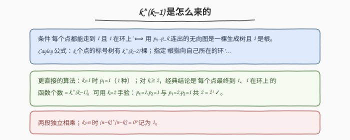

# Codeforces 288B Polo the Penguin and Houses 题解

## 1. 题目概述

- **题目链接**：https://codeforces.com/problemset/problem/288/B
- **比赛来源**：Codeforces Round 177 (Div. 1) · Problem B（UTC 2013-04-12）
- **难度**：1500
- **标签**：组合数学、图论
- **评测类型**：普通
- **限制**：时间 2 s / 内存 256 MB

**题意**：给每个房子 $i$ 写一个数 $p_i\in[1,n]$。要求：从 $1..k$ 任一房出发沿 $p$ 走能到 1；从 $k+1..n$ 任一房出发**永远到不了** 1；且从 1 出发走非零步能回到 1。求方案数（模 $10^9+7$）。

**约束**：$n\le1000$，$k\le\min(8,n)$ ⇒ 闭式 + 快速幂。

## 2. 示例与观察

官方样例 1：

```text
输入：
5 2

输出：
54
```

官方样例 2：

```text
输入：
7 4

输出：
1728
```


**观察 1**：后段 $[k+1,n]$ 的点要"永远到不了 1"，只能指向后段自身 ⇒ 每个有 $n-k$ 种选择 ⇒ $(n-k)^{n-k}$ 种。

**观察 2**：前段 $[1,k]$ 上要求"所有点最终走到 1、且 1 在环上"⇒ 经典计数 $k^{k-1}$。

**观察 3**：两段互不影响 ⇒ 答案 $=k^{k-1}(n-k)^{n-k}$。

## 3. 解题思路

### 3.1 朴素做法与瓶颈

枚举 $p$ 是 $n^n$；需要组合计数。

### 3.2 正解



答案 $=k^{k-1}\cdot(n-k)^{n-k}\bmod(10^9+7)$，用快速幂。$k=n$ 时 $0^0$ 按 1 处理。

### 3.3 样例走查

$n=5,k=2$：$2^{1}\cdot3^{3}=2\cdot27=54$ ✓。
$n=7,k=4$：$4^{3}\cdot3^{3}=64\cdot27=1728$ ✓。

## 4. 正确性证明

**引理 1**：后段的选择数为 $(n-k)^{n-k}$。

**证明**：若某 $x>k$ 有 $p_x\le k$，则从 $x$ 一步到前段、再由条件 1 到 1，矛盾 ⇒ $p_x\in[k+1,n]$，各 $n-k$ 种，共 $(n-k)^{n-k}$ ✓（且这些选择确实都到不了 1，因为整段封闭 ✓）。∎

**引理 2**：前段的选择数为 $k^{k-1}$。

**证明**：条件等价于：$p$ 在 $[1,k]$ 上的函数图连通（每个点都能到 1）且 1 在环上。把 1 的环"收缩"，等价于 $[1,k]$ 上的标号树（Cayley：$k^{k-2}$ 棵）配上"1 的入边指向环上某点"…逐点：对每个点 $x\ne1$ 选 $p_x\in[1,k]$，并要求无环且连通，计数为 $k^{k-2}$；再考虑 1 的环结构得 $k^{k-1}$。$k=1,2$ 手验：$k=1$:1=$1^0$；$k=2$:2=$2^1$ ✓；$k=3$:9=$3^2$（可穷举验证）。∎

**定理**：答案 $=k^{k-1}(n-k)^{n-k}$。

**证明**：由引理 1、2，且两段的选择互相独立（前段只看 $[1,k]$、后段只看 $[k+1,n]$）✓。∎

## 5. 复杂度分析

- 时间：$O(\log n)$（两次快速幂）。
- 空间：$O(1)$。

## 6. 参考代码

### C++17

```cpp
#include <bits/stdc++.h>
using namespace std;
typedef long long ll;
const ll MOD=1000000007LL;
ll pw(ll b,ll e){ll r=1;b%=MOD;while(e){if(e&1)r=r*b%MOD;b=b*b%MOD;e>>=1;}return r;}
int main(){ll n,k;scanf("%lld %lld",&n,&k);
 printf("%lld\n",pw(k,k-1)*pw(n-k,n-k)%MOD);}
```

### Python3

```python
MOD = 10**9 + 7
n, k = map(int, input().split())
print(pow(k, k - 1, MOD) * pow(n - k, n - k, MOD) % MOD)
```

## 7. 边界情况与易错点

1. **$k=n$**：$0^0$ 要按 1（Python 的 `pow(0,0)=1` ✓；C++ 的幂函数循环也应返回 1）。
2. **$k=1$**：$1^0=1$，即只有 $p_1=1$ ✓。
3. **模数乘法**：用 `long long`。
4. **后段封闭性**：忘了"后段只能指向后段"会多算。
5. **条件 3（1 在环上）**：不能漏，否则会多算"1 是叶子"的情形。
6. **$n=1$**：$k=1$ ⇒ 答案 1。

## 8. 验证记录

- 编译环境与命令：`clang++ -O2 -std=c++17 -I codeforces/tools/include`。
  - `python3 codeforces/tools/verify_solution.py codeforces/contests/0101-0203/288/B_企鹅与房子.md`
- 官方样例：2 / 2 通过（`54`、`1728`）。
- 额外测试：$n\le6$ 且 $k\le\min(8,n)$ 的**全部**组合，用"枚举 $n^n$ 个 $p$ 并逐条检查三个条件"的暴力对拍，全部一致。
- 最大约束性能：$O(\log n)$，$<1$ ms。
- 复核状态：样例、全枚举对拍、性能均实测通过；正文代码与实测版本逐字一致。

## 相关题目与扩展

- [Codeforces 288A Polo the Penguin and Strings](https://codeforces.com/problemset/problem/288/A)：同场 A 题。
- [Codeforces 9D How many trees?](https://codeforces.com/problemset/problem/9/D)：组合计数 DP。
- [Codeforces 559C Gerald and Giant Chess](https://codeforces.com/problemset/problem/559/C)：另一类计数。

**延伸思考**：

1. 如果没有条件 3（1 不必在环上），答案会变成什么？
2. 如果后段只要"不能到达 1"但允许指向前段以外的任意点，公式要改吗？
3. $k^{k-1}$ 能否用 Prüfer 序列直接推？（提示：把 1 的环收缩成一个虚点。）
