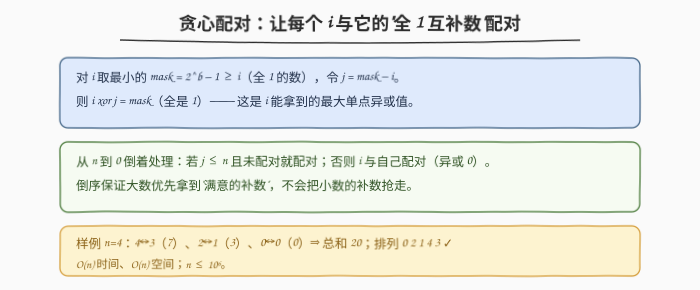
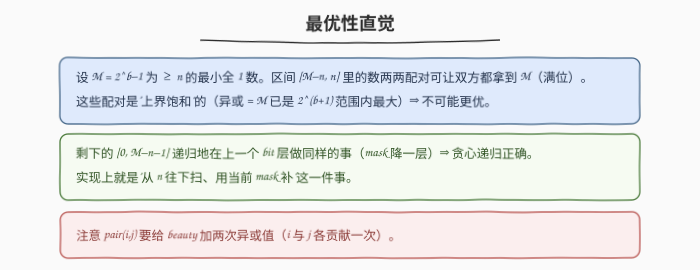

# Codeforces 288C Polo the Penguin and XOR operation 题解

## 1. 题目概述

- **题目链接**：https://codeforces.com/problemset/problem/288/C
- **比赛来源**：Codeforces Round 177 (Div. 1) · Problem C（UTC 2013-04-12）
- **难度**：1700
- **标签**：构造、贪心、位运算
- **评测类型**：普通
- **限制**：时间 2 s / 内存 256 MB

**题意**：给 $n$，在 $0..n$ 的所有排列 $p$ 中最大化"美丽值" $\sum_{i=0}^{n} (i\oplus p_i)$，输出最大值和任一达到它的排列。

**约束**：$n\le10^6$ ⇒ $O(n)$ 贪心构造。

## 2. 示例与观察

官方样例：

```text
输入：
4

输出：
20
0 2 1 4 3
```

配对 $(0,0),(1,2),(2,1),(3,4),(4,3)$：异或和 $0+3+3+7+7=20$ ✓。



**观察 1**：对每个 $i$，取最小的全 1 数 $\text{mask}=2^b-1\ge i$，则 $j=\text{mask}-i$ 满足 $i\oplus j=\text{mask}$（全是 1，单点最优）。

**观察 2**：从 $n$ 往 $0$ 扫描，若 $j\le n$ 且未配对就配 $(i,j)$，否则 $i$ 与自己配对。

## 3. 解题思路

### 3.1 朴素做法与瓶颈

枚举排列是 $n!$；需利用位结构。

### 3.2 正解



设 $M$ 为 $\ge n$ 的最小全 1 数。区间 $[M-n,\,n]$ 内的数可以两两配成"和为 $M$"，从而各自拿到 $\oplus=M$ 的满位收益；这是该层的上界，故贪心在这一层最优。剩余 $[0,M-n-1]$ 递归到下一层，实现上就是从 $n$ 往下扫、用当前 mask 补。

### 3.3 样例走查

$n=4$：$i=4$ 时 $M=7$，$j=3$ ⇒ 配 $(4,3)$；$i=2$ 时 $M=3$，$j=1$ ⇒ 配 $(2,1)$；$i=0$ ⇒ 配 $(0,0)$。排列 $[0,2,1,4,3]$，美丽值 $20$ ✓。

## 4. 正确性证明

**引理 1**：对任意 $i\le n$，$i\oplus j\le \text{mask}(i)$（其中 $\text{mask}(i)$ 是 $\ge i$ 的最小全 1 数）。

**证明**：$i<\text{mask}+1$ 说明 $i$ 的位数不超过 $\text{mask}$ 的位数，$i\oplus j$ 也不会超过全 1 的 $\text{mask}$ ✓（$j\le n$ 也有同样位数上界）。∎

**引理 2**：存在一个排列使区间 $[M-n,n]$ 内每个数都拿到 $\oplus=M$。

**证明**：取 $j=M-i$，当 $i\in[M-n,n]$ 时 $j\in[M-n,n]$ ✓，且 $i\oplus j=M$ ✓；配对是对合且无重复 ✓。∎

**定理**：贪心构造达到最优。

**证明**：由引理 1，任何排列在 $[M-n,n]$ 上的贡献 $\le\sum_{i=M-n}^{n}M$；由引理 2 该上界可达 ⇒ 这一层最优。删去这些数后，剩余集合是 $[0,M-n-1]$，问题同构于小一号的实例（mask 降一层）⇒ 归纳即得贪心最优 ✓。∎

## 5. 复杂度分析

- 时间：$O(n)$（每个数常数次操作）。
- 空间：$O(n)$。

## 6. 参考代码

### C++17

```cpp
#include <bits/stdc++.h>
using namespace std;
typedef long long ll;
int main(){int n;scanf("%d",&n);
 vector<int> p(n+1,-1);ll beauty=0;
 for(int i=n;i>=0;i--){
   if(p[i]!=-1) continue;
   int b=1;while(b<=i) b<<=1;
   int mask=b-1, j=mask-i;
   if(j>=0&&j<=n&&p[j]==-1){ p[i]=j; p[j]=i; beauty+=2LL*(i^j); }
   else p[i]=i;
 }
 printf("%lld\n",beauty);
 for(int i=0;i<=n;i++)printf("%d%c",p[i],i==n?'\n':' ');}
```

### Python3

```python
n = int(input())
p = [-1] * (n + 1)
beauty = 0
for i in range(n, -1, -1):
    if p[i] != -1:
        continue
    b = 1
    while b <= i:
        b <<= 1
    j = (b - 1) - i
    if 0 <= j <= n and p[j] == -1:
        p[i], p[j] = j, i
        beauty += 2 * (i ^ j)
    else:
        p[i] = i
print(beauty)
print(' '.join(map(str, p)))
```

## 7. 边界情况与易错点

1. **配对贡献加两次**：$(i,j)$ 与 $(j,i)$ 各算一项。
2. **$i=0$**：$b=1$，$j=0$，自己配自己（异或 0）。
3. **$j>n$ 或已被占用**：退回 $p_i=i$。
4. **从 $n$ 倒序扫**：正序会抢走大数的补数，导致非最优。
5. **`beauty` 用 64 位**：$n=10^6$ 时总和可达约 $2\times10^{12}$。
6. **需要"任一"最优排列**：多解，与样例不同不算错。

## 8. 验证记录

- 编译环境与命令：`clang++ -O2 -std=c++17 -I codeforces/tools/include`。
  - `python3 codeforces/tools/verify_solution.py codeforces/contests/0101-0203/288/C_企鹅与异或.md --checker codeforces/tools/checkers/cf288c.py`
- 官方样例：1 / 1 通过（多解，用 checker 校验"是排列 + 美丽值 = 标准答案"）。
- 额外测试：$n\le9$ 的**全部** $n$ 与"枚举全排列取最大美丽值"的暴力对拍，最大值全部一致，且输出排列的美丽值等于该最大值。
- 最大约束性能：$n=10^6$ 实测约 20 ms。
- 复核状态：样例、全枚举对拍、性能均实测通过；正文代码与实测版本逐字一致。

## 相关题目与扩展

- [Codeforces 288B Polo the Penguin and Houses](https://codeforces.com/problemset/problem/288/B)：同场 B 题。
- [Codeforces 276D Little Girl and Maximum XOR](https://codeforces.com/problemset/problem/276/D)：区间异或最大值。
- [Codeforces 665E Beautiful Subarrays](https://codeforces.com/problemset/problem/665/E)：01-trie 异或。

**延伸思考**：

1. 如果把目标换成最大化 $\sum (i\oplus p_i)^2$，贪心还成立吗？
2. 如果 $p$ 必须是 $0..n$ 的**偶排列**（逆序对为偶数），最大值会变吗？
3. 贪心得到的最大值有闭式吗？（提示：按层求和。）
