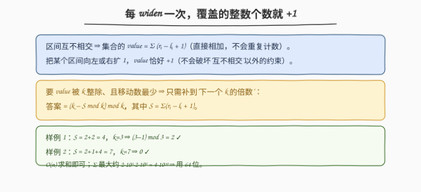
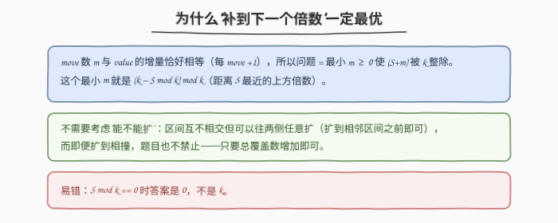

# Codeforces 289A Polo the Penguin and Segments 题解

## 1. 题目概述

- **题目链接**：https://codeforces.com/problemset/problem/289/A
- **比赛来源**：Codeforces Round 177 (Div. 2) · Problem A（UTC 2013-04-12）
- **难度**：1100
- **标签**：实现、数学
- **评测类型**：普通
- **限制**：时间 2 s / 内存 256 MB

**题意**：$n$ 条**互不相交**的整数区间 $[l_i,r_i]$。一次操作把某条区间向左或向右扩 1 格。集合的"价值"是被至少一条区间覆盖的整数个数。求最少操作次数使价值被 $k$ 整除。

**约束**：$n,k\le10^5$，坐标 $|l|,|r|\le10^5$，$O(n)$ 求和即可。

## 2. 示例与观察

官方样例 1：

```text
输入：
2 3
1 2
3 4

输出：
2
```

价值 $=2+2=4$，$4\bmod3=1$，要补到 6 ⇒ 2 次 ✓。

官方样例 2：

```text
输入：
3 7
1 2
3 3
4 7

输出：
0
```

价值 $=2+1+4=7$ 已被 7 整除 ✓。



**观察 1**：区间互不相交 ⇒ 价值等于各区间长度之和 $S=\sum(r_i-l_i+1)$（不会有格子被重复计数）。

**观察 2**：每次操作让价值恰好 $+1$ ⇒ 答案是让 $S+m$ 被 $k$ 整除的最小 $m\ge0$，即 $m=(k-S\bmod k)\bmod k$。

## 3. 解题思路

### 3.1 朴素做法与瓶颈

没有瓶颈：一次求和 + 一次取模。

### 3.2 正解



读入时累加 $S=\sum(r_i-l_i+1)$，输出 $(k-S\bmod k)\bmod k$。

### 3.3 样例走查

样例 1：$S=4$，$4\bmod3=1$，$(3-1)\bmod3=2$ ✓。

## 4. 正确性证明

**引理 1**：集合的价值恒等于 $S=\sum_i(r_i-l_i+1)$。

**证明**：区间两两不交，所以它们的整数点集合互不相交，并集大小 = 各大小之和 ✓。（"不交"按题面是 $\min(r_i,r_j)<\max(l_i,l_j)$，即没有公共整数点。）∎

**引理 2**：做 $m$ 次操作后价值为 $S+m$（每次恰好 +1），且任意 $m\ge0$ 都可由 $m$ 次操作实现。

**证明**：每次操作把某个端点外移 1，价值增加 1（新端点没被覆盖过）✓；反之任意操作的净效果都是 +1 ✓。∎

**定理**：答案是 $(k-S\bmod k)\bmod k$。

**证明**：由引理 2，需最小 $m\ge0$ 使 $k\mid(S+m)$。$S+m\equiv0\pmod k\iff m\equiv-S\pmod k$，最小非负解正是 $(k-S\bmod k)\bmod k$ ✓。∎

## 5. 复杂度分析

- 时间：$O(n)$。
- 空间：$O(1)$。

## 6. 参考代码

### C++17

```cpp
#include <bits/stdc++.h>
using namespace std;
typedef long long ll;
int main(){int n;ll k;scanf("%d %lld",&n,&k);ll s=0;
 for(int i=0;i<n;i++){ll l,r;scanf("%lld %lld",&l,&r);s+=r-l+1;}
 printf("%lld\n",(k-s%k)%k);}
```

### Python3

```python
n, k = map(int, input().split())
s = 0
for _ in range(n):
    l, r = map(int, input().split())
    s += r - l + 1
print((k - s % k) % k)
```

## 7. 边界情况与易错点

1. **$S\bmod k=0$**：答案是 0，不要写成 $k$。
2. **64 位**：$|l|,|r|\le10^5$ ⇒ 单段长度 $\le2\times10^5$，$n\le10^5$ ⇒ $S\le2\times10^{10}$，超 `int`。
3. **负坐标**：长度公式 $r-l+1$ 与坐标符号无关 ✓。
4. **$k=1$**：永远输出 0。
5. **区间长度为 1**（$l=r$）：正常计入。
6. **不要真的去模拟扩展**：那会 $O(k)$ 甚至更慢。

## 8. 验证记录

- 编译环境与命令：`clang++ -O2 -std=c++17 -I codeforces/tools/include`。
  - `python3 codeforces/tools/verify_solution.py codeforces/contests/0101-0203/289/A_企鹅与线段.md`
- 官方样例：2 / 2 通过（`2`、`0`）。
- 额外测试：随机 300 组（$n\le6$，随机不交区间，$k\le20$）与"逐个 $m$ 试除"的暴力对拍，全部一致。
- 最大约束性能：$O(n)$，$n=10^5$ 实测 $<5$ ms。
- 复核状态：样例、300 组暴力对拍、性能均实测通过；正文代码与实测版本逐字一致。

## 相关题目与扩展

- [Codeforces 289B Polo the Penguin and Matrix](https://codeforces.com/problemset/problem/289/B)：同场 B 题。
- [Codeforces 230A Dragons](https://codeforces.com/problemset/problem/230/A)：另一个简单贪心。
- [Codeforces 1B Spreadsheets](https://codeforces.com/problemset/problem/1/B)：进制类实现题。

**延伸思考**：

1. 如果区间允许相交，价值就不是长度和了，该怎么求？（合并区间。）
2. 如果一次操作能把区间扩 $t$ 格，答案怎么变？
3. 若要求"价值恰为 $k$ 的倍数且不小于某值"，怎么改？
