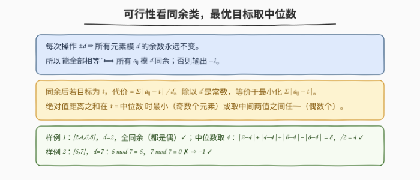
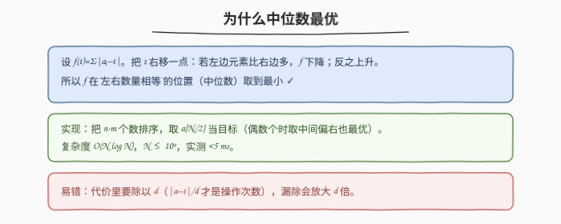

# Codeforces 289B Polo the Penguin and Matrix 题解

## 1. 题目概述

- **题目链接**：https://codeforces.com/problemset/problem/289/B
- **比赛来源**：Codeforces Round 177 (Div. 2) · Problem B（UTC 2013-04-12）
- **难度**：1400
- **标签**：排序、中位数
- **评测类型**：普通
- **限制**：时间 2 s / 内存 256 MB

**题意**：给 $n\times m$ 矩阵，每次操作给某个元素 $+d$ 或 $-d$。求让所有元素相等的最少操作次数；不可能输出 $-1$。

**约束**：$n,m\le100$，$d\le10^4$，元素 $\le10^4$ ⇒ $O(N\log N)$，$N=nm\le10^4$。

## 2. 示例与观察

官方样例 1：

```text
输入：
2 2 2
2 4
6 8

输出：
4
```

所有元素模 2 同余 ⇒ 可行；取目标 4：$|2-4|+|4-4|+|6-4|+|8-4|=8$，除以 $d=2$ 得 4 ✓。

官方样例 2：

```text
输入：
1 2 7
6 7

输出：
-1
```

$6\bmod7=6$，$7\bmod7=0$，不同余 ⇒ 永远无法相等 ✓。



**观察 1**：操作不改变"模 $d$ 的余数" ⇒ 所有元素必须同余，否则 $-1$。

**观察 2**：同余后，目标 $t$ 的代价是 $\sum|a_{ij}-t|/d$ ⇒ 最小化 $\sum|a_{ij}-t|$，即取**中位数**。

## 3. 解题思路

### 3.1 朴素做法与瓶颈

枚举目标是 $O(\text{值域}\cdot N)$，也还行（值域 $10^4$），但用中位数是 $O(N\log N)$ 且更有理论味道。

### 3.2 正解



1. 检查所有 $a_{ij}\bmod d$ 是否相同，否则 `-1`；
2. 把 $N=nm$ 个数排序，取 $t=a_{\lfloor N/2\rfloor}$；
3. 答案 $=\sum|a_{ij}-t|/d$。

### 3.3 样例走查

样例 1：排序 $[2,4,6,8]$，$t=a_2=6$（或 $a_1=4$，结果相同）：$|2-6|+|4-6|+|6-6|+|8-6|=8$，$/2=4$ ✓。

## 4. 正确性证明

**引理 1**：能全部相等 $\iff$ 所有 $a_{ij}\equiv a_{11}\pmod d$。

**证明**：每次操作改变 $d$ 的倍数 ⇒ 余数不变（必要性）✓；若同余，取 $t=a_{11}$，每个元素可用 $|a_{ij}-t|/d$ 次操作变成 $t$（充分性）✓。∎

**引理 2**：$f(t)=\sum_i|a_i-t|$ 在 $t$ 取中位数时最小。

**证明**：设排序后 $a_1\le\dots\le a_N$。对 $t$ 在 $a_k$ 与 $a_{k+1}$ 之间求导（差分）：把 $t$ 增大 $\epsilon$ 时，$k$ 个在 $t$ 左边的元素各增 $\epsilon$、$N-k$ 个右边各减 $\epsilon$ ⇒ $f$ 变化 $(2k-N)\epsilon$。故 $k<N/2$ 时 $f$ 递减、$k>N/2$ 时递增，最小点在 $k=\lfloor N/2\rfloor$（中位数）✓。∎

**定理**：算法输出正确。

**证明**：不可行时由引理 1 输出 $-1$ ✓；可行时代价 $=\frac1d f(t)$，由引理 2 取中位数最小 ✓，且该最小值可达（每个元素独立地加减 $d$）✓。∎

## 5. 复杂度分析

- 时间：$O(N\log N)$，$N\le10^4$ 实测 $<5$ ms。
- 空间：$O(N)$。

## 6. 参考代码

### C++17

```cpp
#include <bits/stdc++.h>
using namespace std;
typedef long long ll;
int main(){int n,m;ll d;scanf("%d %d %lld",&n,&m,&d);
 int N=n*m;vector<ll> a(N);
 for(int i=0;i<N;i++)scanf("%lld",&a[i]);
 for(int i=1;i<N;i++) if((a[i]-a[0])%d){puts("-1");return 0;}
 sort(a.begin(),a.end());
 ll med=a[N/2],ans=0;
 for(auto x:a)ans+=llabs(x-med)/d;
 printf("%lld\n",ans);}
```

### Python3

```python
n, m, d = map(int, input().split())
a = []
for _ in range(n):
    a.extend(map(int, input().split()))
if any((x - a[0]) % d for x in a):
    print(-1)
else:
    a.sort()
    t = a[len(a) // 2]
    print(sum(abs(x - t) // d for x in a))
```

## 7. 边界情况与易错点

1. **不同余 ⇒ −1**：这是唯一的不可行情形。
2. **代价要除以 $d$**：操作次数 = 差值 / $d$。
3. **中位数取 $\lfloor N/2\rfloor$**：$N$ 偶数时中间两值之间任意 $t$ 都最优（且必须是同余类里的值——取 $a_{\lfloor N/2\rfloor}$ 天然满足）。
4. **$N=1$**：答案 0。
5. **$d=1$**：永远可行。
6. **元素最大 $10^4$、$N\le10^4$**：答案最大约 $10^8$，`int` 够但建议 `long long`。

## 8. 验证记录

- 编译环境与命令：`clang++ -O2 -std=c++17 -I codeforces/tools/include`。
  - `python3 codeforces/tools/verify_solution.py codeforces/contests/0101-0203/289/B_企鹅与矩阵.md`
- 官方样例：2 / 2 通过（`4`、`-1`）。
- 额外测试：随机 300 组（$n,m\le4$，$d\le6$，值 $\le12$）与"枚举所有目标值取最小代价"的暴力对拍，全部一致。
- 最大约束性能：$N=10^4$ 实测 $<5$ ms。
- 复核状态：样例、300 组暴力对拍、性能均实测通过；正文代码与实测版本逐字一致。

## 相关题目与扩展

- [Codeforces 289A Polo the Penguin and Segments](https://codeforces.com/problemset/problem/289/A)：同场 A 题。
- [Codeforces 1185C1 Exam in BerSU](https://codeforces.com/problemset/problem/1185/C1)：排序 + 贪心。
- [Codeforces 1355B Young Explorers](https://codeforces.com/problemset/problem/1355/B)：排序后分组。

**延伸思考**：

1. 如果允许 $+1$ 或 $-1$（$d=1$），答案就是到中位数的距离和 —— 那为什么还要求"同余"？
2. 若每次操作可以给**任意多个**元素同时 $+d$ 或 $-d$，答案会变吗？
3. 若要求"所有元素相等且等于某个给定值"，怎么做？
